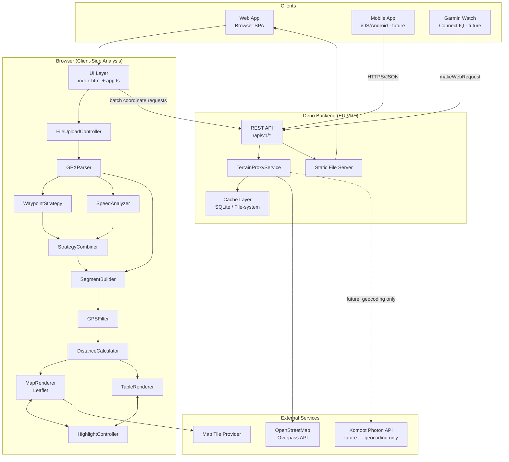
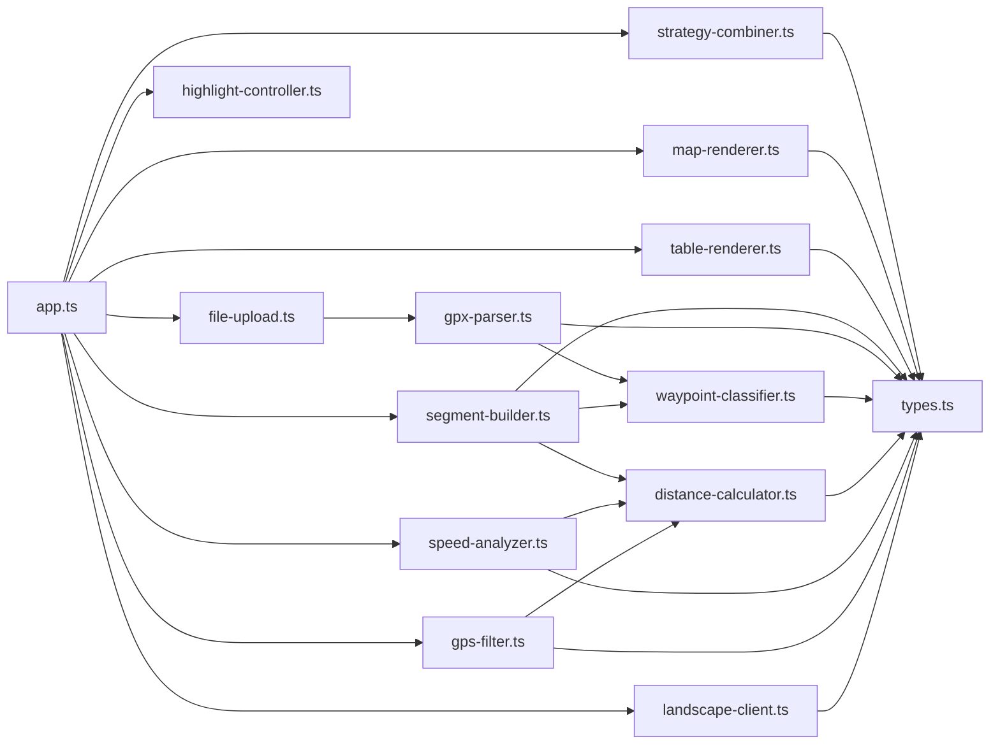
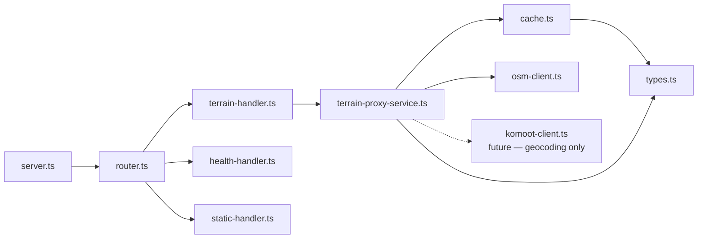
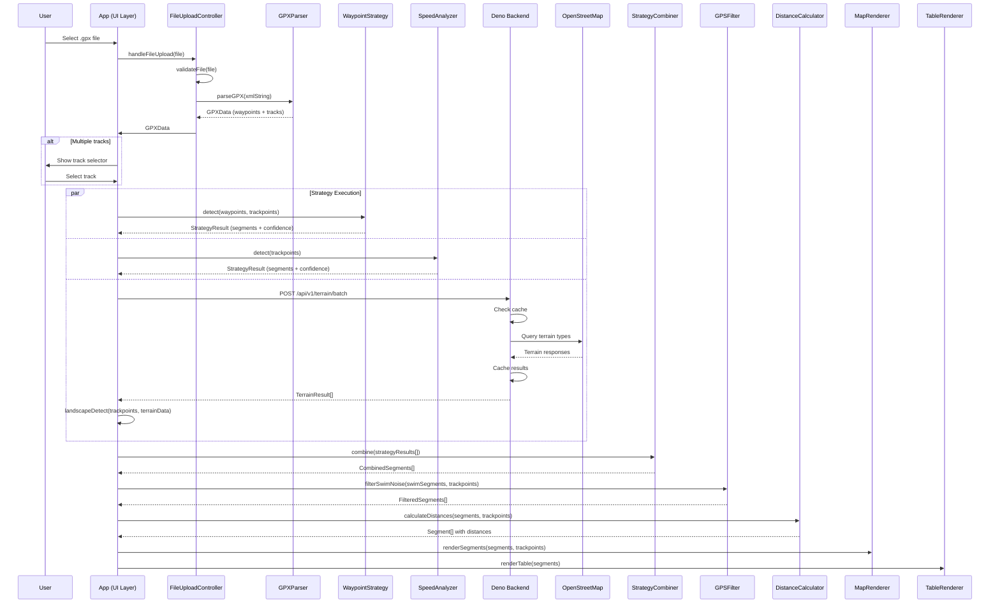
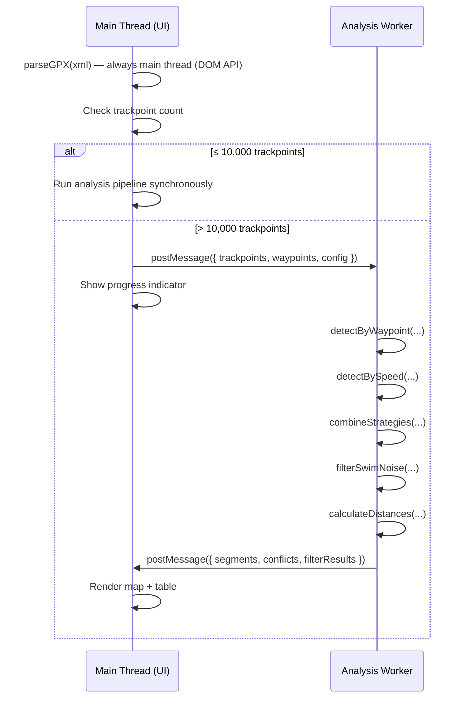
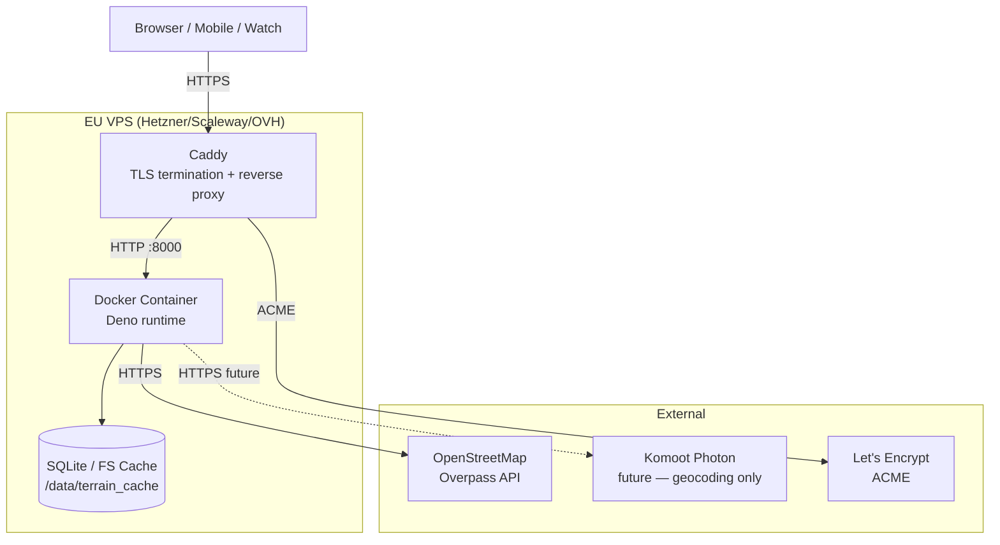
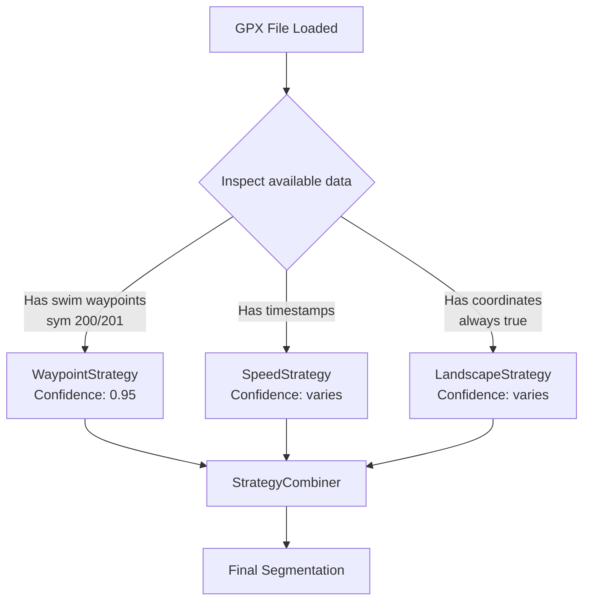
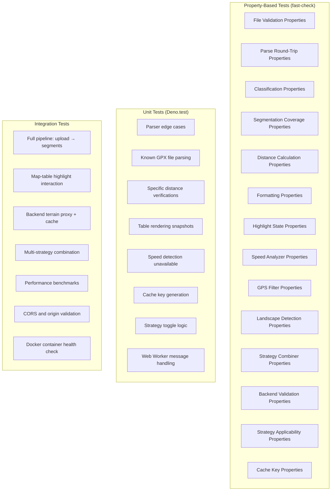

# Design Document: GPX Swimrun Analyzer

## Overview

The GPX Swimrun Analyzer is a client-server application that parses GPX files from swimrun race courses and presents an interactive map alongside a segment distance table. The system splits responsibilities between a browser-based frontend (GPX analysis pipeline) and a Deno backend (terrain API proxy, caching, API key management).

GPX parsing, speed analysis, segmentation, GPS noise filtering, and distance calculation all run client-side in the browser (ADR-0003). The Deno backend is a thin REST/JSON API (ADR-0005) hosted on an EU VPS (ADR-0004) that proxies landscape/terrain lookups to OpenStreetMap Overpass API, manages API keys securely, and caches results. Komoot Photon may be added later for place-name labeling only (ADR-0006).

The system uses a multi-strategy detection approach: waypoint-based (organized race files), speed-based (GPS watch recordings with timestamps), and landscape-based (terrain API via backend, always applicable). Strategies are combined with confidence scoring to produce the best segmentation for any GPX file source.

### Key Design Decisions

1. **Client-side analysis, server-side proxy** — All GPX parsing and segment detection logic runs in the browser. The backend never receives GPX file content; it only answers terrain coordinate queries (ADR-0003).
2. **REST/JSON multi-client API** — The backend exposes endpoints under `/api/v1/` returning JSON, designed to serve the web app, future mobile native apps, and Garmin Connect IQ watch apps via `makeWebRequest()` (ADR-0005).
3. **EU VPS with Docker** — Backend containerized from the start for future K8s/FaaS scaling. Hosted on EU-headquartered provider (Hetzner, Scaleway, or OVHcloud) for GDPR compliance (ADR-0004).
4. **Pure core, imperative shell** — All analysis logic lives in pure functions testable with `deno test`. DOM manipulation, Leaflet rendering, and HTTP handlers are thin wrappers.
5. **No framework** — Vanilla TypeScript with direct DOM APIs for the frontend. Deno standard library and Oak/Hono for the backend HTTP server.
6. **Module-per-concern** — Each logical component is a separate TypeScript module with explicit exports. Shared modules (types, distance calculator) are imported by both frontend and backend tests.
7. **File-system or SQLite caching** — No Deno Deploy-specific APIs (KV, BroadcastChannel). Cache runs on local filesystem or SQLite for portability across VPS, K8s, and FaaS.
8. **Web Workers for large files** — Files with >10,000 trackpoints are processed in a Web Worker to prevent UI blocking. The analysis modules are designed as pure functions with no DOM dependencies, making them directly importable into a Worker context.
9. **Strategy auto-detection** — The system automatically determines which detection strategies are applicable based on available data in the GPX file (waypoints with swim markers → WaypointStrategy; timestamps → SpeedStrategy; coordinates → LandscapeStrategy always applicable).

## Architecture



### Module Dependency Graph



### Backend Module Structure



### Data Flow Sequence



### Web Workers Strategy

For GPX files with >10,000 trackpoints, the analysis pipeline runs in a dedicated Web Worker to prevent UI blocking:



Key constraints:
- GPX parsing (XML → DOM) runs on the main thread because `DOMParser` is unavailable in Workers. The parsed `Trackpoint[]` and `Waypoint[]` arrays are transferred to the Worker.
- All analysis modules (speed-analyzer, gps-filter, distance-calculator, strategy-combiner) are pure functions with no DOM dependencies — they work identically in both main thread and Worker.
- Landscape strategy terrain queries are initiated from the Worker via `fetch()` (available in Workers).
- The Worker returns structured `Segment[]` data back to the main thread for rendering.

### Deployment Architecture



Environment variables on the VPS:

- `ALLOWED_ORIGINS` — comma-separated list of allowed CORS origins
- `OVERPASS_API_URL` — Overpass API endpoint (default: `https://overpass-api.de/api/interpreter`; no API key needed for public instance)
- `CACHE_TYPE` — `"filesystem"` or `"sqlite"`
- `CACHE_PATH` — path to cache directory or SQLite database file
- `PORT` — server listen port (default: 8000)

## Components and Interfaces

### 1. Types Module (`src/shared/types.ts`)

Shared type definitions used across frontend and backend modules.

```typescript
/** Geographic coordinate with latitude and longitude */
export interface Coordinate {
  lat: number;  // -90 to 90
  lon: number;  // -180 to 180
}

/** Parsed GPX waypoint */
export interface Waypoint {
  coordinate: Coordinate;
  elevation: number;
  name: string;
  symbol: string;
  description: string;
}

/** Parsed GPX trackpoint */
export interface Trackpoint {
  coordinate: Coordinate;
  elevation: number;
  timestamp: string | null; // ISO 8601 or null if missing
  index: number;            // position in original track
}

/** Parsed GPX track */
export interface Track {
  name: string;
  trackpoints: Trackpoint[];
}

/** Full parsed GPX data */
export interface GPXData {
  waypoints: Waypoint[];
  tracks: Track[];
}

/** Waypoint classification types */
export type WaypointType = "swim-start" | "swim-end" | "aid-station" | "other";

/** A waypoint with its classification */
export interface ClassifiedWaypoint {
  waypoint: Waypoint;
  type: WaypointType;
}

/** Segment type */
export type SegmentType = "swim" | "run" | "unclassified";

/** Detection strategy identifier */
export type StrategyName = "waypoint" | "speed" | "landscape";

/** A race segment with calculated distance */
export interface Segment {
  number: number;
  type: SegmentType;
  startTrackpointIndex: number;
  endTrackpointIndex: number;
  distanceKm: number;
  detectedBy: StrategyName[];
  confidenceScore: number;  // 0.0 to 1.0
  gpsFiltered: boolean;
}

/** Strategy detection result for a track region */
export interface StrategyResult {
  strategy: StrategyName;
  segments: StrategySegment[];
}

/** A segment as detected by a single strategy */
export interface StrategySegment {
  type: SegmentType;
  startTrackpointIndex: number;
  endTrackpointIndex: number;
  confidenceScore: number;
}

/** Terrain type at a coordinate */
export type TerrainType = "water" | "land" | "unknown";

/** Terrain lookup result for a single coordinate */
export interface TerrainResult {
  coordinate: Coordinate;
  terrainType: TerrainType;
  hasRoadData: boolean;
}

/** GPS filter classification */
export interface FilterResult {
  scatterRatio: number;
  hasSignificantNoise: boolean;
  filterMethod: "none" | "straight-line" | "smoothed";
  filteredDistance: number;
  originalDistance: number;
}

/** Formatted segment pair for display (ADR-0007: paired-row, no empty cells) */
export interface DisplaySegmentPair {
  number: number;
  swimDistanceM: string;       // rounded to nearest 50m, or "—" if absent
  runDistanceKm: string;       // rounded to nearest 0.1 km, or "—" if absent
  cumulativeKm: string | null; // optional cumulative column
  detectedBy: string;
  confidenceScore: number;
}

/** Segment totals */
export interface SegmentTotals {
  totalRunKm: string;
  totalSwimM: string;
}

/** Aid station with position metadata */
export interface AidStation {
  waypoint: Waypoint;
  positionNumber: number;
  totalAidStations: number;
}

/** Validation result */
export interface ValidationResult {
  valid: boolean;
  error?: string;
}

/** Result type for operations that can fail */
export type Result<T> =
  | { ok: true; value: T }
  | { ok: false; error: string };
```

### 2. GPX Parser (`src/client/gpx-parser.ts`)

Responsible for parsing raw XML into structured `GPXData`.

```typescript
export function parseGPX(xmlString: string): Result<GPXData>;
export function parseWaypoints(doc: Document): Waypoint[];
export function parseTracks(doc: Document): Track[];
export function parseCoordinate(element: Element): Coordinate;
```

### 3. Waypoint Classifier (`src/client/waypoint-classifier.ts`)

Pure function that classifies waypoints by type and detects segments.

```typescript
export function classifyWaypoint(waypoint: Waypoint): WaypointType;
export function classifyWaypoints(waypoints: Waypoint[]): ClassifiedWaypoint[];
export function validateSwimPairing(classified: ClassifiedWaypoint[]): ValidationResult;

/**
 * Detect segments using waypoint-based strategy.
 * Produces a StrategyResult with confidence 1.0 (waypoints are authoritative).
 */
export function detectByWaypoint(
  waypoints: Waypoint[],
  trackpoints: Trackpoint[]
): StrategyResult;
```

### 4. Distance Calculator (`src/shared/distance-calculator.ts`)

Pure functions for geographic distance calculations. Shared between frontend and backend.

```typescript
export function haversineDistance(a: Coordinate, b: Coordinate): number;
export function calculateTrackDistance(trackpoints: Trackpoint[]): number;
export function findNearestTrackpoint(
  coordinate: Coordinate,
  trackpoints: Trackpoint[],
  maxRadiusKm?: number
): number | null;
export function straightLineDistance(start: Coordinate, end: Coordinate): number;
export const EARTH_RADIUS_KM = 6371;
```

### 5. Speed Analyzer (`src/client/speed-analyzer.ts`)

Detects swim/run transitions from trackpoint speed data.

```typescript
export interface SpeedAnalyzerConfig {
  windowSize: number;         // sliding window size (default: 10, min: 3, max: 50)
  swimThresholdKph: number;   // speed below which = swim (default: 5)
  minConsecutive: number;     // minimum readings for transition (default: 5)
  stationaryThresholdKph: number; // below this = pause (default: 0.5)
}

/**
 * Calculate instantaneous speed between consecutive trackpoints.
 * Returns null for trackpoints without timestamps or zero elapsed time.
 */
export function calculateInstantaneousSpeed(
  a: Trackpoint,
  b: Trackpoint
): number | null;

/**
 * Apply sliding window average to a speed array.
 * Skips null (stationary/missing) entries.
 */
export function applySlidingWindow(
  speeds: (number | null)[],
  windowSize: number
): (number | null)[];

/**
 * Detect segments from windowed speed data.
 * Returns strategy result with confidence scores.
 */
export function detectBySpeed(
  trackpoints: Trackpoint[],
  config?: Partial<SpeedAnalyzerConfig>
): StrategyResult;

/**
 * Calculate confidence score for a speed transition.
 * Ratio of |meanBefore - meanAfter| / 10, capped at 1.0.
 */
export function calculateSpeedConfidence(
  meanBefore: number,
  meanAfter: number
): number;

/**
 * Check if speed-based detection is available (timestamps present).
 */
export function isSpeedDetectionAvailable(trackpoints: Trackpoint[]): boolean;
```

### 6. GPS Filter (`src/client/gps-filter.ts`)

Filters GPS noise from swim segments where signal is degraded.

```typescript
export interface GPSFilterConfig {
  scatterThreshold: number;        // ratio above which = noisy (default: 1.5)
  deviationThreshold: number;      // metres, lateral deviation (default: 20)
  consecutiveDeviations: number;   // count for curve detection (default: 4)
  smoothingWindow: number;         // moving average window (default: 5)
  maxSmoothedRatio: number;        // max smoothed/straight ratio (default: 1.2)
  minStraightLineDistance: number; // metres, below which skip filtering (default: 5)
}

/**
 * Compute scatter ratio for a swim segment.
 * cumulative distance / straight-line distance.
 */
export function computeScatterRatio(
  trackpoints: Trackpoint[],
  startIndex: number,
  endIndex: number
): number;

/**
 * Determine if consecutive trackpoints deviate laterally from the
 * straight line connecting start to end.
 */
export function detectLateralDeviation(
  trackpoints: Trackpoint[],
  startIndex: number,
  endIndex: number,
  thresholdMetres: number
): { hasConsecutiveDeviation: boolean; maxConsecutive: number };

/**
 * Apply GPS noise filtering to a swim segment.
 * Returns filtered trackpoints and distance.
 */
export function filterSwimSegment(
  trackpoints: Trackpoint[],
  startIndex: number,
  endIndex: number,
  config?: Partial<GPSFilterConfig>
): FilterResult;

/**
 * Apply moving-average smoothing to a trackpoint path.
 */
export function smoothPath(
  trackpoints: Trackpoint[],
  windowSize: number
): Coordinate[];
```

### 7. Landscape Client (`src/client/landscape-client.ts`)

Client-side module that queries the backend terrain API and produces strategy results.

```typescript
export interface LandscapeClientConfig {
  apiBaseUrl: string;       // backend URL
  sampleIntervalMetres: number;  // max 50m between samples
  batchSize: number;        // max 100 per request
  timeoutMs: number;        // 10000ms default
}

/**
 * Sample coordinates along a track at specified intervals.
 */
export function sampleCoordinates(
  trackpoints: Trackpoint[],
  intervalMetres: number
): Coordinate[];

/**
 * Query terrain types from backend in batches.
 */
export function queryTerrain(
  coordinates: Coordinate[],
  config: LandscapeClientConfig
): Promise<Result<TerrainResult[]>>;

/**
 * Detect segments from terrain data.
 */
export function detectByLandscape(
  trackpoints: Trackpoint[],
  terrainResults: TerrainResult[]
): StrategyResult;

/**
 * Calculate landscape confidence based on point agreement ratio.
 */
export function calculateLandscapeConfidence(
  points: TerrainResult[],
  segmentType: SegmentType
): number;
```

### 8. Strategy Combiner (`src/client/strategy-combiner.ts`)

Combines results from multiple detection strategies using confidence scoring.

```typescript
/**
 * Determine which detection strategies are applicable for the given GPX data.
 * - WaypointStrategy: requires ≥1 waypoint with sym 200/201 or name "Début SWIM"/"Fin SWIM"
 * - SpeedStrategy: requires ≥2 consecutive trackpoints with valid timestamps
 * - LandscapeStrategy: requires trackpoints with coordinates (always applicable)
 */
export function detectApplicableStrategies(
  gpxData: GPXData
): StrategyName[];

/**
 * Combine multiple strategy results into a final segmentation.
 * For each track region, the segment type from the highest-confidence
 * strategy is used.
 */
export function combineStrategies(
  results: StrategyResult[],
  trackpointCount: number
): Segment[];

/**
 * Detect boundary conflicts between strategies.
 * Two boundaries within 100m of each other for the same transition = conflict.
 */
export function detectConflicts(
  results: StrategyResult[],
  trackpoints: Trackpoint[]
): ConflictInfo[];

export interface ConflictInfo {
  trackpointIndex: number;
  strategies: StrategyName[];
  resolvedBy: StrategyName;
}
```

### 9. Segment Builder (`src/client/segment-builder.ts`)

Orchestrates segment creation from combined strategy output.

```typescript
export function buildSegments(
  trackpoints: Trackpoint[],
  classifiedWaypoints: ClassifiedWaypoint[]
): Result<Segment[]>;

/**
 * Pair consecutive segments into display rows (ADR-0007).
 * Each pair contains a swim and its subsequent run (or vice versa).
 */
export function pairSegmentsForDisplay(
  segments: Segment[],
  swimFirst: boolean
): DisplaySegmentPair[];

export function formatSegmentDistance(segment: Segment): DisplaySegmentPair;
export function calculateTotals(segments: Segment[]): SegmentTotals;

/**
 * Round swim distance to nearest 50 metres (ADR-0007).
 */
export function roundSwimDistance(metres: number): number;

/**
 * Round run distance to nearest 0.1 km (ADR-0007).
 */
export function roundRunDistance(km: number): number;
```

### 10. File Upload Controller (`src/client/file-upload.ts`)

```typescript
export function validateFile(file: File): ValidationResult;
export function readFileAsText(file: File): Promise<string>;
export const MAX_FILE_SIZE_BYTES = 10 * 1024 * 1024;
```

### 11. Map Renderer (`src/client/map-renderer.ts`)

```typescript
export function initMap(containerId: string): L.Map;
export function renderSegments(map: L.Map, segments: Segment[], trackpoints: Trackpoint[]): L.LayerGroup;
export function renderSwimMarkers(map: L.Map, swimWaypoints: ClassifiedWaypoint[]): L.LayerGroup;
export function renderAidStations(map: L.Map, aidStations: AidStation[]): L.LayerGroup;
export function renderFilteredOverlay(map: L.Map, original: Trackpoint[], filtered: Coordinate[]): L.LayerGroup;
export function fitBounds(map: L.Map, trackpoints: Trackpoint[]): void;
```

### 12. Table Renderer (`src/client/table-renderer.ts`)

```typescript
export interface TableConfig {
  swimFirst: boolean;           // column order toggle (ADR-0007)
  showCumulative: boolean;      // optional cumulative distance column
}

export function renderTable(
  container: HTMLElement,
  pairs: DisplaySegmentPair[],
  totals: SegmentTotals,
  config: TableConfig
): void;
export function renderEmptyState(container: HTMLElement): void;
```

### 13. Highlight Controller (`src/client/highlight-controller.ts`)

```typescript
export function createHighlightController(
  map: L.Map,
  segmentLayers: L.LayerGroup,
  tableContainer: HTMLElement
): HighlightController;

export interface HighlightController {
  selectSegment(segmentNumber: number): void;
  clearSelection(): void;
  getSelected(): number | null;
  destroy(): void;
}
```

### 14. Backend: Server Entry Point (`src/server/server.ts`)

```typescript
/**
 * Start the Deno HTTP server.
 * Serves REST API endpoints and static files.
 */
export function startServer(config: ServerConfig): void;

export interface ServerConfig {
  port: number;
  allowedOrigins: string[];
  staticDir: string;
  cacheDir: string;
}
```

### 15. Backend: Terrain Proxy Service (`src/server/terrain-proxy-service.ts`)

```typescript
/**
 * Look up terrain types for a batch of coordinates.
 * Checks cache first, queries external service for misses.
 */
export function lookupTerrain(
  coordinates: Coordinate[],
  cache: CacheStore
): Promise<TerrainResult[]>;

/**
 * Query OpenStreetMap Overpass API for water features at coordinates.
 */
export function queryOSM(coordinates: Coordinate[]): Promise<TerrainResult[]>;

/**
 * Fetch all water polygons and road/path features along a track corridor.
 * Uses a single Overpass query with the "around" statement to get all
 * relevant features in one API call.
 */
export function fetchTrackCorridor(
  coordinates: Coordinate[],
  corridorWidthMetres: number  // default: 30
): Promise<CorridorFeatures>;

/**
 * Perform point-in-polygon tests to classify each coordinate
 * as water or land based on the fetched corridor features.
 */
export function classifyCoordinates(
  coordinates: Coordinate[],
  corridor: CorridorFeatures
): TerrainResult[];

export interface CorridorFeatures {
  waterPolygons: GeoPolygon[];   // natural=water, waterway=riverbank, etc.
  roads: GeoLineString[];        // highway=* features with type info
  paths: GeoLineString[];        // highway=path|track|footway
}

export interface GeoPolygon {
  coordinates: Coordinate[];     // ring of coordinates
  tags: Record<string, string>;  // OSM tags (natural, water, name)
}

export interface GeoLineString {
  coordinates: Coordinate[];
  tags: Record<string, string>;  // OSM tags (highway, surface, tracktype)
}
```

#### Terrain Lookup Implementation Strategy

The landscape detection relies on OpenStreetMap data via the Overpass API.
Rather than making one API call per coordinate (which would be hundreds of
calls per track and quickly hit rate limits), we use a **single corridor
query** approach:

##### Step 1: Corridor Query (Backend — via Overpass API)

**What is Overpass?**

Overpass API is a read-only query engine for OpenStreetMap (OSM) data,
developed by Roland Olbricht. It functions as a spatial database accessible
over HTTP: clients send queries in Overpass QL (a domain-specific query
language with C-style syntax) and receive matching geographic features as
JSON or XML. Unlike the main OSM editing API, Overpass is optimised for
data retrieval — it can filter and return arbitrary subsets of the global
OSM dataset by tag, geometry, bounding box, or proximity to a set of
coordinates (Olbricht, 2015).

The public instance at `overpass-api.de` mirrors the full OSM planet file
and updates every minute. Self-hosted instances are explicitly supported
and straightforward to set up (Olbricht, n.d.).

**How we use it:**

The backend receives a batch of coordinates representing the track (sampled
at 50m intervals). It constructs a single Overpass QL query using the
`around` statement to fetch all relevant features within 30m of the track:

```text
[out:json][timeout:30];
(
  way["natural"="water"](around:30, lat1,lon1, lat2,lon2, ...);
  way["waterway"~"riverbank|dock|canal"](around:30, lat1,lon1, lat2,lon2, ...);
  relation["natural"="water"](around:30, lat1,lon1, lat2,lon2, ...);
  way["highway"](around:30, lat1,lon1, lat2,lon2, ...);
);
out geom;
```

This returns all water polygons and road/path linestrings near the track
in **one API call**, regardless of track length.

##### Step 2: Point-in-Polygon Classification (Backend)

For each sampled coordinate, the backend performs a point-in-polygon test
against the returned water polygons:

- If the point is inside a `natural=water` or `waterway=riverbank` polygon
  → classified as "water"
- If the point is within 10m of a `highway=*` feature → classified as
  "land" with road data (`hasRoadData: true`)
- Otherwise → classified as "land" (default; ground truth is land unless
  proven water)

##### Step 3: Caching Strategy (Server-Side Only)

Caching is performed exclusively on the backend for simplicity. No
client-side caching of terrain data is implemented in the initial version.

- **Corridor cache**: The full corridor result (water polygons + roads)
  is cached by a hash of the sorted coordinate set. Subsequent analyses of
  the same or overlapping tracks benefit from cached geometry. TTL: 7 days
  (water polygons rarely change).
- **Point cache**: Individual coordinate classification results are cached
  at 5 decimal places (~1m resolution) in SQLite. TTL: 7 days for water
  features, 72 hours for road/path features (trails change more often).
- **Shared across users**: If multiple athletes analyze the same race
  course (e.g. Swimrunman Laffrey), the water geometry is fetched from
  Overpass once and served from cache for all subsequent requests.
- **No client-side cache**: The browser does not store terrain results
  locally. Each landscape detection request goes to the backend, which
  handles caching. This keeps the client simple and ensures all users
  benefit from the shared cache. Client-side caching (IndexedDB) may be
  added later as an optimisation if needed.

##### OSM Data Coverage and Limitations

| Feature | OSM Tag | Coverage Quality | Notes |
|---------|---------|------------------|-------|
| Lakes | `natural=water` | Excellent in EU | Well-mapped polygons |
| Rivers (wide) | `waterway=riverbank` | Good | Polygons for swimmable rivers |
| Canals | `waterway=canal` | Good in NL, FR | Polygon or way |
| Oceans/seas | `natural=coastline` | N/A | Not relevant for swimrun crossings (too far from shore for track points) |
| Paved roads | `highway=primary/secondary/residential` | Excellent | Surface tag often present |
| Trails/paths | `highway=path/track/footway` | Good | `surface=*` and `tracktype=*` sometimes available |
| Surface type | `surface=asphalt/gravel/ground/grass` | Moderate | Not always tagged |

##### Overpass API Rate Limits and Mitigation

The public Overpass API (overpass-api.de) allows approximately 10,000
requests/day and 1 GB download/day per IP. Mitigations:

1. **One query per track** — The corridor approach means one Overpass call
   per GPX analysis, not hundreds.
2. **Aggressive caching** — Water polygons don't change often; cache for
   24 hours minimum.
3. **Self-hosted Overpass instance** — If traffic grows beyond public API
   limits, we can run our own Overpass instance on the same VPS (or a
   dedicated one). OSM data for Europe is ~90 GB on disk.
4. **Fallback** — If Overpass is unavailable, the Landscape Strategy
   returns an error and the Analyzer falls back to Speed/Waypoint
   strategies.

##### Road Type Classification (Future Enhancement)

When `highway=*` data is available near a coordinate, we can further
classify the run surface:

| `highway` value | `surface` value | Classification |
|-----------------|-----------------|----------------|
| `path`, `track` | `ground`, `grass`, `dirt` | Trail (soft) |
| `path`, `footway` | `gravel`, `fine_gravel` | Gravel path |
| `residential`, `primary` | `asphalt`, `paved` | Road (hard) |
| `track` | — (no surface tag) | Assumed trail |

This is informational for athletes (pacing/shoe choice) but does not
affect swim/run classification.

### 16. Backend: Cache Layer (`src/server/cache.ts`)

```typescript
export interface CacheStore {
  get(key: string): Promise<TerrainResult | null>;
  set(key: string, value: TerrainResult): Promise<void>;
  has(key: string): Promise<boolean>;
}

/**
 * Create coordinate-based cache key with 5 decimal place precision.
 * Approximately 1-metre resolution.
 */
export function coordinateCacheKey(coord: Coordinate): string;

/**
 * Create a file-system or SQLite backed cache store.
 */
export function createCacheStore(config: CacheConfig): CacheStore;

export interface CacheConfig {
  type: "filesystem" | "sqlite";
  path: string;
}
```

### 17. Backend: API Router (`src/server/router.ts`)

```typescript
/**
 * REST API endpoints (all under /api/v1/ prefix):
 *
 * GET  /api/v1/health
 *   Returns: { status: "ok", version: string, cacheSize: number }
 *
 * GET  /api/v1/terrain/lookup?lat=X&lon=Y
 *   Returns: TerrainResult
 *   Errors: 400 (INVALID_COORDINATES), 503 (UPSTREAM_ERROR)
 *
 * POST /api/v1/terrain/batch
 *   Body: { coordinates: Coordinate[] }  (max 100)
 *   Returns: { results: TerrainResult[], cached: number, fetched: number }
 *   Errors: 400 (INVALID_COORDINATES, BATCH_TOO_LARGE), 429 (RATE_LIMITED), 503 (UPSTREAM_ERROR)
 *
 * All responses include:
 *   - Content-Type: application/json
 *   - CORS headers (Access-Control-Allow-Origin from config)
 *   - X-Request-Id header for tracing
 *
 * All error responses: { error: string, code: string }
 *
 * CORS preflight:
 * OPTIONS /api/v1/*
 *   Returns: 204 with CORS headers
 */
export function createRouter(config: RouterConfig): Router;

export interface RouterConfig {
  allowedOrigins: string[];
  cache: CacheStore;
  maxBatchSize: number;  // default: 100
}
```

## Segment Detection Algorithm

This section describes how swim/run transitions are found, which is the
core analytical challenge of the system.

### Detection Strategy Priority and Applicability



### Strategy 1: Waypoint-Based (highest confidence when available)

This is the simplest and most reliable strategy, but only works with
GPX files from organized races that embed swim markers.

**Algorithm:**
1. Scan waypoints for sym=200 (swim start) and sym=201 (swim end)
2. Pair Nth start with Nth end
3. Map each waypoint to nearest trackpoint (within 50m)
4. Create alternating swim/run segments between mapped points
5. Confidence: 0.95 (high — explicit human-placed markers)

**Limitations:** Only available for ~10% of GPX files (organized races).
Self-recorded files from GPS watches never have these markers.

### Strategy 2: Speed-Based (good for post-hoc analysis)

Works on any GPX file with timestamps (most GPS watch recordings).

**Algorithm:**
1. Calculate instantaneous speed between consecutive trackpoints
2. Apply sliding window average (default: 10 points) to smooth noise
3. Classify windows: <5 kph = swim, ≥5 kph = run
4. Require minimum 5 consecutive readings to confirm a transition
5. Place boundary at midpoint of the transition window
6. Ignore stationary points (<0.5 kph) — these are pauses, not swims

**Confidence calculation:**
`confidence = min(1.0, |meanSpeedBefore - meanSpeedAfter| / 10)`

Example: transition from 8 kph (run) to 2 kph (swim) =
`min(1.0, |8 - 2| / 10) = 0.6`

**Limitations:**
- GPS noise in water inflates swim distances and can create spurious
  speed spikes (watch emerging from water briefly)
- Athletes pausing at transition points (putting on/removing gear)
  creates stationary periods that must be handled
- Slow uphills (4-5 kph) can be confused with fast swimming

### Strategy 3: Landscape-Based (always applicable, but depends on API)

Works on any GPX file with coordinates, even without timestamps.

**Algorithm:**
1. Sample track at 50m intervals
2. Send coordinates to backend → backend queries Overpass API for
   water polygons in a corridor around the track
3. Backend performs point-in-polygon test for each sample
4. Group consecutive water/land points into segments
5. Require minimum 2 consecutive same-type points to form a segment

**Confidence calculation:**
`confidence = agreeing_points / total_points_in_segment`

Boosted to 0.9 minimum when road/path data confirms land classification.
Reduced by 0.1 per ambiguous point.

**Limitations:**
- Depends on backend availability and OSM data quality
- Small ponds or poorly-mapped water bodies may be missed
- Bridge crossings over water → OSM usually has these as `highway=*`
  over `natural=water`, so the highway tag takes precedence (classified
  as "land" despite being above water — correct for swimrun)

### Strategy Combination

When multiple strategies are available, the combiner works region-by-region:

1. Divide the track into regions where any strategy indicates a transition
2. For each region, take the classification from the strategy with the
   highest confidence score
3. If strategies agree → confidence is boosted (averaged)
4. If strategies conflict → use highest-confidence, mark as conflicted
5. If all strategies have confidence < 0.3 → mark as "unclassified"

**Typical scenarios:**

| GPX Source | Available Strategies | Expected Outcome |
|------------|---------------------|------------------|
| Organized race (Swimrunman) | Waypoint + Speed + Landscape | Waypoint dominates (0.95), others confirm |
| Self-recorded (Garmin/Coros) | Speed + Landscape | Speed primary (~0.6-0.8), landscape confirms |
| Route drawn (afstandmeten.nl) | Landscape only | Landscape alone (~0.7-0.9) |
| Simple route (no water features in OSM) | Landscape (low confidence) | May produce "unclassified" regions |

## Data Models

### Internal Representation

All distances are stored internally in kilometres (`distanceKm` on `Segment`). Display formatting is applied only at the rendering boundary:

- **Run segments**: `distanceKm` → formatted as `"X.Y"` km (1 decimal)
- **Swim segments**: `distanceKm * 1000` → rounded to nearest 100 → formatted as `"N"` metres

### GPX XML → Domain Model Mapping

| GPX XML Element | Domain Type | Key Attributes |
|-----------------|-------------|----------------|
| `<wpt lat="..." lon="...">` | `Waypoint` | lat, lon, name, sym, ele |
| `<trkpt lat="..." lon="...">` | `Trackpoint` | lat, lon, ele, time |
| `<trk>` | `Track` | name, trackpoints[] |
| `<sym>200</sym>` | swim-start classification | — |
| `<sym>201</sym>` | swim-end classification | — |
| `<sym>3</sym>` | aid-station classification | — |

### Backend Cache Schema

Cache keys are coordinate strings at 5 decimal places (e.g. `"45.12345,5.67890"`). Values are serialized `TerrainResult` objects. Storage options:

- **File-system**: one JSON file per coordinate hash (fast lookups, no external dependencies)
- **SQLite**: single `terrain_cache.db` with table `(key TEXT PRIMARY KEY, value TEXT, created_at INTEGER)`

### API Request/Response Models

```typescript
// POST /api/v1/terrain/batch
interface BatchTerrainRequest {
  coordinates: Coordinate[];  // max 100
}

interface BatchTerrainResponse {
  results: TerrainResult[];
}

// Error response (all endpoints)
interface ErrorResponse {
  error: string;
  code: "INVALID_COORDINATES" | "BATCH_TOO_LARGE" | "UPSTREAM_ERROR"
      | "RATE_LIMITED" | "TIMEOUT" | "ORIGIN_NOT_ALLOWED";
}
```

### State Management

Application state is a simple object held in the app entry point:

```typescript
interface AppState {
  gpxData: GPXData | null;
  selectedTrackIndex: number;
  segments: Segment[];
  aidStations: AidStation[];
  highlightedSegment: number | null;
  enabledStrategies: Set<StrategyName>;
  strategyResults: Map<StrategyName, StrategyResult>;
  conflicts: ConflictInfo[];
  filterResults: Map<number, FilterResult>; // segment number → filter result
}
```

### File Size and Performance Constraints

| Metric | Threshold | Action |
|--------|-----------|--------|
| File size | > 10 MB | Reject with error |
| Trackpoints | ≤ 10,000 | Process within 5s |
| Trackpoints | 10,001–50,000 | Process within 30s |
| Trackpoints | > 50,000 | Warn user, ask confirmation |
| Waypoints | > 100 | Warn (unusual), continue |
| Batch coordinates | > 100 per request | Reject with 400 |
| Terrain API timeout | > 10s per request | Fail with error to client |

## Correctness Properties

*A property is a characteristic or behavior that should hold true across all valid executions of a system — essentially, a formal statement about what the system should do. Properties serve as the bridge between human-readable specifications and machine-verifiable correctness guarantees.*

### Property 1: File validation accepts only .gpx files within size limit

*For any* file with a name and size, `validateFile` SHALL return `valid: true` if and only if the filename ends with `.gpx` (case-insensitive) AND the file size is ≤ 10,485,760 bytes. For all other files, it SHALL return `valid: false` with an appropriate error message.

**Validates: Requirements 1.1, 1.3, 1.6**

### Property 2: GPX parse round-trip preserves coordinate and temporal data

*For any* valid GPX XML string containing waypoints with latitude/longitude values to 6 decimal places, and trackpoints with latitude/longitude to 6 decimal places, integer elevation, and ISO 8601 timestamps, parsing the string with `parseGPX` SHALL produce waypoints and trackpoints whose coordinate values match the originals to 6 decimal places, whose elevation values match to integer precision, and whose timestamps match to one-second precision. Additionally, parsing the same valid GPX string multiple times SHALL produce identical results.

**Validates: Requirements 1.2, 7.1, 7.2, 7.3**

### Property 3: Invalid XML produces error result

*For any* string that is not well-formed XML, `parseGPX` SHALL return a `Result` with `ok: false` and a non-empty error message. The function SHALL never throw an exception for malformed input.

**Validates: Requirements 1.4**

### Property 4: Waypoint classification correctness

*For any* waypoint, `classifyWaypoint` SHALL return:

- `"swim-start"` if and only if the waypoint's `sym` value equals `"200"` OR its `name` starts with `"Début SWIM"` (case-sensitive)
- `"swim-end"` if and only if the waypoint's `sym` value equals `"201"` OR its `name` starts with `"Fin SWIM"` (case-sensitive)
- `"aid-station"` if and only if the waypoint's `sym` value equals `"3"` OR its `name` contains `"Ravitaillement"` (case-insensitive)
- `"other"` for all remaining waypoints

These categories SHALL be mutually exclusive: no waypoint SHALL match more than one classification.

**Validates: Requirements 2.1, 2.2, 8.1**

### Property 5: Segmentation produces complete, non-overlapping, alternating coverage

*For any* valid track (non-empty trackpoint array) and valid set of paired swim waypoints, `buildSegments` SHALL produce segments where:

1. Every trackpoint index from 0 to N-1 belongs to exactly one segment (complete coverage)
2. Segments are contiguous: each segment's `endTrackpointIndex + 1` equals the next segment's `startTrackpointIndex`
3. Segment types alternate between "swim" and "run" (no two consecutive segments of the same type)
4. The first segment starts at trackpoint index 0 and the last segment ends at the final trackpoint index

**Validates: Requirements 2.3, 2.4, 2.5, 2.6, 2.7, 5.1**

### Property 6: Unpaired swim-start detection

*For any* list of classified waypoints where the count of swim-start waypoints exceeds the count of swim-end waypoints, `validateSwimPairing` SHALL return `valid: false` with an error message indicating an unpaired swim-start was found.

**Validates: Requirements 2.8**

### Property 7: Haversine distance satisfies metric space axioms

*For any* coordinates A, B, and C:

1. `haversineDistance(A, B) >= 0` (non-negativity)
2. `haversineDistance(A, A) == 0` (identity)
3. `haversineDistance(A, B) == haversineDistance(B, A)` (symmetry)
4. `haversineDistance(A, C) <= haversineDistance(A, B) + haversineDistance(B, C)` (triangle inequality)

**Validates: Requirements 3.1**

### Property 8: Distance accumulation is additive over subsequences

*For any* trackpoint sequence `[p0, p1, ..., pN]` and any split index `k` (0 < k < N), `calculateTrackDistance([p0..pN])` SHALL equal `calculateTrackDistance([p0..pk]) + calculateTrackDistance([pk..pN])`.

**Validates: Requirements 3.2**

### Property 9: Nearest trackpoint search returns closest point within radius

*For any* coordinate `C`, trackpoint array `T`, and radius `R`:

- If `findNearestTrackpoint(C, T, R)` returns index `i`, then `haversineDistance(C, T[i])` ≤ R, and no other trackpoint `j` has `haversineDistance(C, T[j]) < haversineDistance(C, T[i])`
- If `findNearestTrackpoint(C, T, R)` returns `null`, then for all trackpoints `t` in `T`, `haversineDistance(C, t) > R`

**Validates: Requirements 3.3, 3.4**

### Property 10: Segment display formatting follows type-specific rules

*For any* segment, `formatSegmentDistance` SHALL produce:

- For `type: "run"`: `runDistanceKm` is a string with exactly one decimal place (e.g. `"5.2"`), and `swimDistanceM` is `null`
- For `type: "swim"`: `swimDistanceM` is a string representing metres rounded to the nearest 100 (divisible by 100), and `runDistanceKm` is `null`

Additionally, *for any* array of segments, `calculateTotals` SHALL produce `totalRunKm` equal to the sum of all run segment distances formatted to one decimal place, and `totalSwimM` equal to the sum of all swim segment distances in metres rounded to the nearest 100.

**Validates: Requirements 3.5, 3.6, 3.7, 5.3, 5.4, 5.5**

### Property 11: Highlight controller maintains single-selection with toggle

*For any* sequence of `selectSegment(n)` calls on a `HighlightController`:

1. After `selectSegment(n)`, `getSelected()` SHALL return `n`
2. After `selectSegment(n)` followed by `selectSegment(n)` (same segment), `getSelected()` SHALL return `null` (toggle deselect)
3. After `selectSegment(n)` followed by `selectSegment(m)` where `m ≠ n`, `getSelected()` SHALL return `m` (only most recent is selected)

**Validates: Requirements 6.5, 6.6**

### Property 12: Speed calculation correctness

*For any* two trackpoints A and B with valid timestamps where elapsed time > 0, `calculateInstantaneousSpeed(A, B)` SHALL equal `haversineDistance(A.coordinate, B.coordinate) / elapsedHours`, where elapsedHours is the time difference in hours. If elapsed time is zero or timestamps are missing, it SHALL return `null`.

**Validates: Requirements 12.1, 12.9**

### Property 13: Sliding window average correctness

*For any* array of speed values and window size W (3 ≤ W ≤ 50), `applySlidingWindow(speeds, W)` SHALL produce an output where each non-null entry at index `i` equals the arithmetic mean of the non-null values in the window `[i - floor(W/2), i + floor(W/2)]` (clamped to array bounds). Null entries (stationary/missing) SHALL be excluded from averaging and remain null in output.

**Validates: Requirements 12.2, 12.7**

### Property 14: Speed-based segment classification follows threshold rules

*For any* trackpoint sequence with timestamps, `detectBySpeed` SHALL classify a contiguous region as "swim" when the sliding window average speed is below 5 kph for at least 5 consecutive windowed readings, and as "run" when at or above 5 kph for at least 5 consecutive readings. The segment boundary SHALL be placed at the midpoint trackpoint of the threshold-crossing sequence.

**Validates: Requirements 12.3, 12.4, 12.8**

### Property 15: Speed transition confidence formula

*For any* two segment mean speeds `meanBefore` and `meanAfter`, the confidence score SHALL equal `min(1.0, |meanBefore - meanAfter| / 10)`. The result SHALL always be in the range [0.0, 1.0].

**Validates: Requirements 12.5**

### Property 16: GPS filter scatter ratio and method selection

*For any* swim segment with start and end trackpoints where straight-line distance ≥ 5 metres:

- `computeScatterRatio` SHALL equal cumulative trackpoint distance / straight-line distance
- If scatter ratio ≤ 1.5: filter method is "none", distance is cumulative trackpoint distance
- If scatter ratio > 1.5 AND fewer than 4 consecutive trackpoints deviate > 20m laterally: filter method is "straight-line", distance is straight-line distance
- If scatter ratio > 1.5 AND 4+ consecutive trackpoints deviate > 20m laterally in the same direction: filter method is "smoothed", and smoothed distance ≤ 1.2 × straight-line distance

The original trackpoint array SHALL NOT be mutated by the filter operation.

**Validates: Requirements 13.1, 13.3, 13.4, 13.5, 13.6, 13.7, 13.8**

### Property 17: Coordinate sampling interval constraint

*For any* trackpoint sequence, `sampleCoordinates(trackpoints, intervalMetres)` SHALL produce samples where the distance between consecutive samples is no greater than the specified interval (default 50 metres). The first and last trackpoints SHALL always be included as samples.

**Validates: Requirements 14.2**

### Property 18: Landscape segment creation from terrain data

*For any* sequence of terrain results, `detectByLandscape` SHALL:

- Create a Swim_Segment when 2+ consecutive coordinates are classified as "water"
- Create a Run_Segment when 2+ consecutive coordinates are classified as "land"
- Calculate confidence as the ratio of agreeing points to total points in each segment
- Set confidence ≥ 0.9 for land segments where `hasRoadData` is true
- For "unknown" terrain, inherit the preceding classification and reduce confidence by 0.1 per unknown point (minimum 0.1)

**Validates: Requirements 14.3, 14.4, 14.5, 14.8, 14.9**

### Property 19: Backend request validation

*For any* incoming request to the terrain API:

- Coordinates with latitude outside [-90, 90] or longitude outside [-180, 180] SHALL be rejected with a 400 status
- Batch requests with more than 100 coordinates SHALL be rejected with a 400 status
- Requests from origins not in the allowed origins list SHALL be rejected with a 403 status
- Cache keys SHALL be computed at 5 decimal places of precision (approximately 1-metre resolution)

**Validates: Requirements 15.3, 15.4, 15.8**

### Property 20: Strategy combination resolves by highest confidence

*For any* set of strategy results covering the same track region:

- The final segment type SHALL be determined by the strategy with the highest confidence score for that region
- When two strategies produce boundaries within 100 metres of each other, the boundary from the higher-confidence strategy SHALL be used
- When all strategies produce confidence below 0.3 for a region, that region SHALL be classified as "unclassified"
- The resulting segmentation SHALL have complete coverage (no gaps) and contiguous segments

**Validates: Requirements 16.2, 16.3, 16.9**

### Property 21: Strategy applicability auto-detection

*For any* GPXData object:

- `detectApplicableStrategies` SHALL include `"waypoint"` if and only if the data contains at least one waypoint with sym value "200" or "201", or name starting with "Début SWIM" or "Fin SWIM"
- `detectApplicableStrategies` SHALL include `"speed"` if and only if the data contains at least two consecutive trackpoints with non-null, distinct timestamps
- `detectApplicableStrategies` SHALL always include `"landscape"` when trackpoints with coordinates exist
- The returned array SHALL never be empty when the GPXData contains at least one trackpoint with coordinates

**Validates: Requirements 16.1, 16.5**

### Property 22: Cache key determinism and precision

*For any* coordinate, `coordinateCacheKey` SHALL produce a string that:

- Represents latitude and longitude truncated to exactly 5 decimal places
- Is deterministic: the same coordinate always produces the same key
- Treats coordinates differing only beyond the 5th decimal place as identical (same cache key)
- Two coordinates differing at or before the 5th decimal place SHALL produce different keys

**Validates: Requirements 15.4**

## Error Handling

### Error Categories and User Feedback

| Error Condition | Source Module | User-Facing Message | Recovery |
|----------------|---------------|---------------------|----------|
| Non-.gpx extension | FileUploadController | "Only .gpx files are accepted. Please select a file with the .gpx extension." | Re-upload |
| File > 10 MB | FileUploadController | "File exceeds the maximum size of 10 MB. Please use a smaller GPX file." | Re-upload |
| Invalid XML | GPXParser | "The file could not be parsed. Please ensure it is a valid GPX file." | Re-upload |
| No trackpoints | GPXParser | "No track data found in this GPX file." | Re-upload |
| Unpaired swim-start | WaypointClassifier | "Unpaired swim-start waypoint found (waypoint: '{name}'). It will be excluded from analysis." | Continue without that waypoint |
| Waypoint unmatched to track | SegmentBuilder | "Waypoint '{name}' could not be matched to any trackpoint within 50 metres." | Continue without that waypoint |
| No timestamps for speed detection | SpeedAnalyzer | "This file has no timestamp data. Speed-based detection is unavailable. Landscape detection will be used instead." | Fall back to landscape strategy |
| Terrain API timeout | LandscapeClient | "Terrain service did not respond within 10 seconds. Please try again or use waypoint/speed detection." | Retry or use other strategies |
| Terrain API error | LandscapeClient | "Terrain lookup failed. Using available detection strategies only." | Continue with other strategies |
| Backend rate-limited | TerrainProxyService | Returns `{ error: "...", code: "RATE_LIMITED" }` with HTTP 429 | Client retries with backoff |
| Invalid coordinates in request | TerrainProxyService | Returns `{ error: "...", code: "INVALID_COORDINATES" }` with HTTP 400 | Client fixes input |
| Batch too large | TerrainProxyService | Returns `{ error: "...", code: "BATCH_TOO_LARGE" }` with HTTP 400 | Client splits batch |
| > 50,000 trackpoints | App | "This file has {N} trackpoints. Processing may take a while. Continue?" | User confirms or cancels |
| > 100 waypoints | App | "This file has an unusually high number of waypoints ({N}). Proceeding with analysis." | Continue (warning only) |
| All strategies below 0.3 confidence | StrategyCombiner | Region shown as "unclassified" with distinct colour | User can adjust strategy settings |

### Error Handling Strategy

1. **Result type pattern** — All fallible operations return `Result<T>` instead of throwing. This makes error paths explicit and testable.
2. **Fail gracefully** — Non-critical errors (unpaired waypoints, unmatched waypoints, terrain API failures) produce warnings but allow analysis to continue with available data.
3. **Strategy fallback** — If one detection strategy fails (e.g. landscape API timeout), remaining strategies still produce results.
4. **Critical errors stop the pipeline** — Invalid file, unparseable XML, or no trackpoints halt processing and show an error message.
5. **No silent failures** — Every error condition produces visible user feedback.
6. **Backend errors are structured** — All API error responses follow `{ error: string, code: string }` format with appropriate HTTP status codes.

### Error Display

Errors are shown in a dedicated message area above the map/table:

- Critical errors: red background, prevents further processing
- Warnings: amber background, processing continues
- Info messages: neutral background, informational only
- Messages auto-clear when a new file is uploaded

## Testing Strategy

### Testing Architecture



### Property-Based Testing

**Library**: [fast-check](https://github.com/dubzzz/fast-check) — the standard PBT library for TypeScript/JavaScript. Available via npm/deno.

**Configuration**:

- Minimum 100 iterations per property test
- Each property test tagged with: `Feature: gpx-swimrun-analyzer, Property {N}: {title}`

**Custom Generators** (to be implemented in `test/generators.ts`):

- `arbitraryCoordinate()` — random lat/lon within valid ranges
- `arbitraryWaypoint()` — random waypoint with various sym/name combinations
- `arbitraryTrackpoint()` — random trackpoint with coordinate, elevation, timestamp
- `arbitraryTrack(minPoints, maxPoints)` — random trackpoint sequence forming a plausible path
- `arbitraryGPXString(config)` — valid GPX XML string with configurable waypoint/trackpoint counts
- `arbitrarySegmentArray()` — random segment arrays for formatting tests
- `arbitrarySpeedSequence(config)` — speed values with configurable swim/run sections
- `arbitraryNoisySwimPath(config)` — trackpoints with configurable scatter and lateral deviation
- `arbitraryTerrainResults(config)` — terrain result sequences with water/land/unknown zones
- `arbitraryStrategyResults(count)` — multiple strategy results with varying boundaries and confidence
- `arbitraryBatchRequest(maxSize)` — batch coordinate requests for backend validation
- `arbitraryGPXData(config)` — GPXData objects with configurable presence of waypoints, timestamps, and coordinates for strategy applicability testing
- `arbitraryCoordinatePair(precision)` — coordinate pairs differing at specific decimal places for cache key tests

### Unit Tests

Unit tests cover specific examples and edge cases not easily captured by properties:

- Parsing the actual test GPX files from `test-data/`
- Known-distance calculations (e.g. equator traversal, pole-to-pole)
- Speed detection unavailable (no timestamps)
- Cache key format verification
- Accessibility attribute verification
- DOM rendering snapshots
- Multi-track file handling

### Integration Tests

- Full pipeline from file upload to rendered output (multiple strategies)
- Bidirectional highlighting with simulated DOM events
- Backend terrain proxy with mocked OSM responses and cache verification
- Multi-strategy combination with real GPX data
- Performance benchmarks against threshold targets
- Docker container health check and startup

### Test File Structure

```text
test/
├── generators.ts                  # fast-check custom generators
├── client/
│   ├── file-validation.test.ts    # Property 1
│   ├── gpx-parser.test.ts         # Properties 2, 3
│   ├── waypoint-classifier.test.ts # Properties 4, 6
│   ├── segment-builder.test.ts    # Property 5
│   ├── formatting.test.ts         # Property 10
│   ├── highlight-controller.test.ts # Property 11
│   ├── speed-analyzer.test.ts     # Properties 12, 13, 14, 15
│   ├── gps-filter.test.ts         # Property 16
│   ├── landscape-client.test.ts   # Properties 17, 18
│   ├── strategy-combiner.test.ts  # Properties 20, 21
│   └── worker.test.ts             # Web Worker message handling
├── shared/
│   └── distance-calculator.test.ts # Properties 7, 8, 9
├── server/
│   ├── request-validation.test.ts # Property 19
│   ├── cache.test.ts              # Property 22 + unit tests
│   ├── terrain-proxy.test.ts      # Integration
│   └── cors.test.ts               # Integration
├── integration/
│   ├── full-pipeline.test.ts
│   ├── multi-strategy.test.ts
│   ├── performance.test.ts
│   └── docker-health.test.ts
└── test-data/                     # symlink or import from project root test-data/
```

### Running Tests

```bash
# All tests
deno test

# Property tests only (by directory)
deno test test/client/ test/shared/ test/server/request-validation.test.ts

# Backend integration tests
deno test test/server/

# Single module
deno test test/client/speed-analyzer.test.ts

# With coverage
deno test --coverage=coverage/
```

## References

- Olbricht, R. M. (2015). Data retrieval for small spatial regions
  in OpenStreetMap. In J. Jokar Arsanjani, A. Zipf, P. Mooney, &
  M. Helbich (Eds.), *OpenStreetMap in GIScience* (pp. 101–122).
  Springer. https://doi.org/10.1007/978-3-319-14280-7_6

- Olbricht, R. M. (n.d.). *Overpass API user's manual*.
  https://dev.overpass-api.de/overpass-doc/en/

- OpenStreetMap Wiki. (n.d.). *Overpass API*.
  https://wiki.openstreetmap.org/wiki/Overpass_API

- OpenStreetMap Wiki. (n.d.). *Map features: Water*.
  https://wiki.openstreetmap.org/wiki/Key:natural#Water_related

- OpenStreetMap Wiki. (n.d.). *Key:highway*.
  https://wiki.openstreetmap.org/wiki/Key:highway
