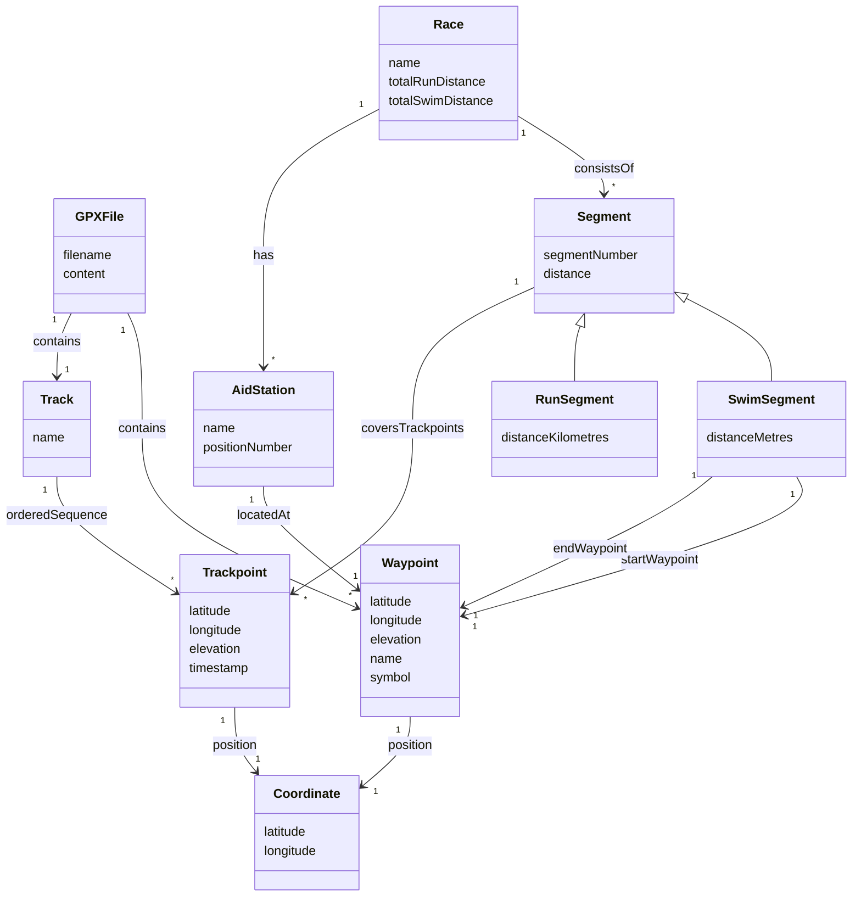

# Requirements Document

## Introduction

The GPX Swimrun Analyzer is a web-based tool that converts GPX
files containing swimrun race courses into structured segment data.
It parses GPX waypoints marking swim start and swim end points,
correlates them with track data, and presents an interactive map
alongside a segment distance table. The tool enables swimrun
athletes and race organizers to visualize and analyze race segments,
with swim distances shown in metres and run distances in kilometres.

## Domain Model

A concept diagram showing the core domain objects and their
relationships (Larman, 2004).

## Glossary

| Concept | Description |
|---------|-------------|
| Analyzer | The web application that processes GPX files and displays segment data |
| GPX_Parser | The component responsible for parsing GPX XML files into structured data |
| Map_View | The Leaflet-based interactive map component displaying the race course |
| Segment_Table | The HTML table component displaying segment distances |
| Segment | A contiguous portion of the race course classified as either a swim or a run |
| Swim_Segment | A segment between a swim-start waypoint (sym 200) and a swim-end waypoint (sym 201) |
| Run_Segment | A segment between a swim-end waypoint and the next swim-start waypoint (or track start/end) |
| Waypoint | A GPX `<wpt>` element with lat, lon, name, and sym attributes marking a point of interest |
| Trackpoint | A GPX `<trkpt>` element with lat, lon, ele, and time attributes forming the route path |
| Distance_Calculator | The component that computes distances along trackpoints using the Haversine formula |
| Highlight_Controller | The component managing bidirectional highlight synchronization between map and table |
| GPXFile | The uploaded `.gpx` file containing waypoints and track data |
| AidStation | A waypoint marked with sym `3` or name "Ravitaillement" indicating a feed zone |
| Coordinate | A latitude/longitude pair representing a geographic position |
| Race | The complete swimrun course with all segments and metadata |

## Requirements

### Requirement 1: GPX File Upload

**User Story:** [US-1] As a swimrun athlete, I want to upload a GPX file
of my planned swimrun race or training, so that I can analyze the
race segments in this route.

#### Acceptance Criteria

1. THE Analyzer SHALL provide a file upload interface accepting
   files with the `.gpx` extension and a maximum file size of 10 MB
2. WHEN a valid GPX file is uploaded, THE GPX_Parser SHALL parse
   the file and extract all waypoints and trackpoints, replacing
   any previously loaded analysis data
3. WHEN a file without the `.gpx` extension is uploaded, THE
   Analyzer SHALL display an error message indicating only GPX
   files are accepted
4. WHEN a file with invalid XML content is uploaded, THE GPX_Parser
   SHALL display an error message indicating the file could not be
   parsed
5. WHEN an uploaded GPX file contains no trackpoints, THE Analyzer
   SHALL display an error message indicating no track data was
   found
6. IF the uploaded file exceeds 10 MB, THEN THE Analyzer SHALL
   display an error message indicating the file exceeds the maximum
   allowed size

### Requirement 2: Waypoint Classification

**US-2:** As a swimrun athlete, I want the tool to
automatically identify swim and run segments from waypoints, so
that I do not have to manually mark each transition.

#### Acceptance Criteria

1. WHEN a GPX file is parsed, THE GPX_Parser SHALL identify
   swim-start waypoints by matching `sym` value `200` or name
   starting with "Début SWIM" (case-sensitive prefix match)
2. WHEN a GPX file is parsed, THE GPX_Parser SHALL identify
   swim-end waypoints by matching `sym` value `201` or name
   starting with "Fin SWIM" (case-sensitive prefix match)
3. WHEN swim-start and swim-end waypoints are identified, THE
   Analyzer SHALL pair them in file-appearance order, where the Nth
   swim-start pairs with the Nth swim-end, and create a
   Swim_Segment entry for each pair
4. WHEN consecutive swim segments are identified, THE Analyzer
   SHALL create Run_Segment entries for trackpoints between each
   swim-end waypoint and the next swim-start waypoint
5. IF the first classified waypoint in the course is a swim-start,
   THEN THE Analyzer SHALL create the first segment as a
   Swim_Segment starting from the track start without a preceding
   Run_Segment
6. IF the first classified waypoint in the course is not a
   swim-start, THEN THE Analyzer SHALL create a Run_Segment from
   the track start to the first swim-start waypoint
7. IF the last classified waypoint is a swim-end, THEN THE Analyzer
   SHALL create a final Run_Segment from that swim-end to the track
   end
8. IF a swim-start waypoint has no subsequent swim-end waypoint in
   the file, THEN THE Analyzer SHALL display an error message
   indicating an unpaired swim-start waypoint was found and exclude
   that waypoint from segmentation

### Requirement 3: Distance Calculation

**US-3:** As a swimrun athlete, I want accurate segment
distances, so that I can plan my race pacing and gear transitions.

#### Acceptance Criteria

1. THE Distance_Calculator SHALL compute distances between
   consecutive trackpoints using the Haversine formula with a mean
   Earth radius of 6,371 kilometres
2. THE Distance_Calculator SHALL accumulate trackpoint-to-trackpoint
   distances to determine total segment distance
3. WHEN a waypoint does not match a trackpoint position within six
   decimal places of latitude and longitude, THE Distance_Calculator
   SHALL use the nearest trackpoint within a 50-metre radius as the
   segment boundary
4. IF no trackpoint exists within a 50-metre radius of a waypoint,
   THEN THE Analyzer SHALL display an error message indicating the
   waypoint could not be matched to the track
5. THE Analyzer SHALL display Run_Segment distances in kilometres
   rounded to one decimal place
6. THE Analyzer SHALL display Swim_Segment distances in metres
   rounded to the nearest 100 metres
7. THE Segment_Table SHALL display a totals row showing cumulative
   run distance in kilometres rounded to one decimal place and
   cumulative swim distance in metres rounded to the nearest
   100 metres

### Requirement 4: Map Visualization

**US-4:** As a swimrun athlete, I want to see the race course
on an interactive map, so that I can understand the terrain and
segment layout.

#### Acceptance Criteria

1. WHEN segments are calculated, THE Map_View SHALL render the full
   track on a Leaflet map with the map bounds fitted to the track
   extent
2. WHEN segments are calculated, THE Map_View SHALL display
   Swim_Segment track portions as polylines in blue colour and
   Run_Segment track portions as polylines in green colour
3. WHEN segments are calculated, THE Map_View SHALL place markers
   at each swim-start and swim-end waypoint position, using a
   visually distinct marker style for swim-start versus swim-end
4. WHEN a user hovers over a segment on the Map_View, THE Map_View
   SHALL display a tooltip showing the segment number, segment type
   (swim or run), and distance formatted consistently with the
   Segment_Table (swim in metres, run in kilometres)
5. IF the uploaded GPX file contains no swim waypoints, THEN THE
   Map_View SHALL render the full track as a single polyline
   without segment colouring or markers

### Requirement 5: Segment Table Display

**US-5:** As a swimrun athlete, I want a clear table of all
segments with distances, so that I can quickly review the race
structure.

#### Acceptance Criteria

1. WHEN segments are calculated, THE Segment_Table SHALL display
   one row per segment in race order, numbered sequentially
   starting at 1
2. THE Segment_Table SHALL display columns for segment number, run
   distance (km), and swim distance (m)
3. WHEN a Swim_Segment row is displayed, THE Segment_Table SHALL
   populate the swim distance column and display a blank cell in
   the run distance column
4. WHEN a Run_Segment row is displayed, THE Segment_Table SHALL
   populate the run distance column and display a blank cell in
   the swim distance column
5. THE Segment_Table SHALL display a final totals row, visually
   distinct from segment rows, with summed run distance in
   kilometres and summed swim distance in metres
6. IF no segments are calculated from the uploaded file, THEN THE
   Segment_Table SHALL display a message indicating no segments
   were found instead of an empty table

### Requirement 6: Bidirectional Map-Table Highlighting

**US-6:** As a swimrun athlete, I want to click a segment on
the map and see it highlighted in the table (and vice versa), so
that I can easily correlate visual and tabular information.

#### Acceptance Criteria

1. WHEN a user clicks a segment on the Map_View, THE
   Highlight_Controller SHALL highlight the corresponding row in
   the Segment_Table and scroll the row into view
2. WHEN a user clicks a row in the Segment_Table, THE
   Highlight_Controller SHALL highlight the corresponding segment
   on the Map_View
3. WHEN a segment is highlighted on the Map_View, THE Map_View
   SHALL visually emphasize the segment by doubling its line weight
   and setting opacity to 1.0
4. WHEN a row is highlighted in the Segment_Table, THE
   Segment_Table SHALL apply a distinct background colour to that
   row
5. WHEN a new segment is selected, THE Highlight_Controller SHALL
   remove the highlight from the previously selected segment in
   both the Map_View and the Segment_Table
6. WHEN a user clicks the already-highlighted segment, THE
   Highlight_Controller SHALL deselect it and restore both the
   Map_View and Segment_Table to their default unhighlighted state

### Requirement 7: GPX Round-Trip Integrity

**US-7:** As a developer, I want to verify that parsing a GPX
file produces consistent data, so that I can trust the segment
analysis output.

#### Acceptance Criteria

1. THE GPX_Parser SHALL produce the same segment list when parsing
   the same valid GPX file multiple times, where "same" means
   identical segment count, segment types in the same order,
   identical segment boundary trackpoint indices, and identical
   computed distances
2. THE GPX_Parser SHALL preserve parsed waypoint latitude and
   longitude values to six decimal places of precision
3. THE GPX_Parser SHALL preserve parsed trackpoint latitude and
   longitude values to six decimal places, elevation values to
   integer metre precision, and timestamp values to one-second
   precision in ISO 8601 format

### Requirement 8: Aid Station Display

**US-8:** As a swimrun athlete, I want to see aid station
locations on the map, so that I can plan my nutrition strategy.

#### Acceptance Criteria

1. WHEN a GPX file is parsed, THE GPX_Parser SHALL identify aid
   station waypoints by matching `sym` value `3` or name containing
   "Ravitaillement" (case-insensitive)
2. WHEN aid stations are identified, THE Map_View SHALL display aid
   station markers using an icon visually distinct from swim-start
   and swim-end markers at each aid station location
3. WHEN a user hovers over an aid station marker, THE Map_View
   SHALL display a tooltip showing the aid station name and its
   sequential position number among all aid stations in the course
   (e.g., "Ravitaillement 2 of 4")
4. IF a parsed GPX file contains no waypoints matching aid station
   criteria, THEN THE Map_View SHALL display the map without aid
   station markers and without an error message

### Requirement 9: Multi-Track File Handling

**US-9:** As a swimrun athlete, I want to be notified when
my GPX file contains multiple tracks, so that I can select the
correct one for analysis.

#### Acceptance Criteria

1. WHEN a GPX file contains more than one `<trk>` element, THE
   Analyzer SHALL display a track selector listing all tracks by
   name (or index if unnamed)
2. WHEN a track selector is displayed, THE Analyzer SHALL not begin
   segment analysis until the user selects a track
3. WHEN a GPX file contains exactly one `<trk>` element, THE
   Analyzer SHALL use that track automatically without displaying
   a selector

### Requirement 10: Accessibility

**QA-1:** As a swimrun athlete who uses assistive technology,
I want the tool to be accessible, so that I can use it regardless
of visual or motor impairments.

#### Acceptance Criteria

1. THE Analyzer SHALL use semantic HTML elements (table, thead,
   tbody, th, button, main, nav) for all interactive components
2. THE Segment_Table SHALL include appropriate ARIA labels and
   scope attributes on table headers so screen readers can
   announce row and column context
3. THE Map_View segment colours SHALL maintain a minimum contrast
   ratio of 3:1 against the map tile background for both swim
   (blue) and run (green) polylines
4. THE Map_View SHALL provide a text-based alternative for segment
   information accessible via keyboard navigation (e.g. a segment
   list that can be tabbed through)
5. ALL interactive elements (upload button, table rows, map
   segments) SHALL be operable via keyboard alone without requiring
   a mouse
6. THE Analyzer SHALL not rely solely on colour to convey segment
   type; each segment SHALL also be identifiable by label text or
   pattern

### Requirement 11: Performance

**QA-2:** As a swimrun athlete, I want the tool to process
my GPX file quickly, so that I do not have to wait long for
results.

#### Acceptance Criteria

1. THE Analyzer SHALL complete parsing, segmentation, and distance
   calculation within 5 seconds for GPX files containing up to
   10,000 trackpoints on a standard desktop browser
2. THE Analyzer SHALL complete parsing, segmentation, and distance
   calculation within 30 seconds for GPX files containing up to
   50,000 trackpoints
3. IF a GPX file contains more than 50,000 trackpoints, THEN THE
   Analyzer SHALL display a warning indicating that processing may
   be slow and ask the user to confirm before proceeding
4. THE Map_View SHALL render all segments and markers within
   2 seconds after distance calculation completes for files with
   up to 10,000 trackpoints
5. IF a GPX file contains more than 100 waypoints, THEN THE
   Analyzer SHALL display a warning indicating an unusually high
   number of waypoints and proceed with analysis
