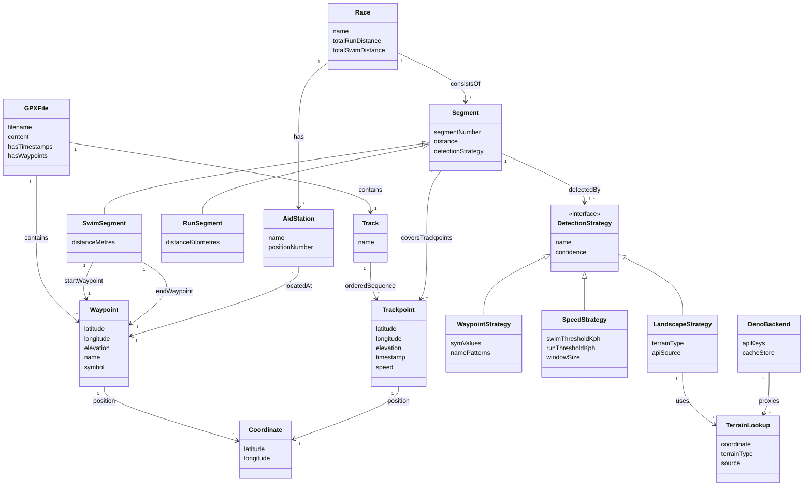

# Requirements Document

## Introduction

The GPX Swimrun Analyzer is a web-based tool that converts GPX
files containing swimrun race courses into structured segment data.
It parses GPX files from multiple sources — organized race exports
with waypoint markers, self-recorded GPS watch files (Garmin, Polar,
Coros), and simple route-drawing tools (afstandmeten.nl, etc.) —
and determines swim/run transitions using one or more detection
strategies: waypoint-based classification, speed/tempo analysis,
and external landscape feature lookup.

The tool presents an interactive map alongside a segment distance
table. It enables swimrun athletes and race organizers to visualize
and analyze race segments, with swim distances shown in metres and
run distances in kilometres.

A Deno backend service proxies external API requests (OpenStreetMap,
Komoot) and securely manages API keys that must not be exposed to
the browser.

## Domain Model

A concept diagram showing the core domain objects and their
relationships (Larman, 2004).

## Glossary

| Concept | Description |
|---------|-------------|
| Analyzer | The web application that processes GPX files and displays segment data |
| GPX_Parser | The component responsible for parsing GPX XML files into structured data |
| Map_View | The Leaflet-based interactive map component displaying the race course |
| Segment_Table | The HTML table component displaying segment distances |
| Segment | A contiguous portion of the race course classified as either a swim or a run |
| Swim_Segment | A segment classified as swimming activity, detected by one or more strategies |
| Run_Segment | A segment classified as running activity, detected by one or more strategies |
| Waypoint | A GPX `<wpt>` element with lat, lon, name, and sym attributes marking a point of interest |
| Trackpoint | A GPX `<trkpt>` element with lat, lon, ele, and time attributes forming the route path |
| Distance_Calculator | The component that computes distances along trackpoints using the Haversine formula |
| Highlight_Controller | The component managing bidirectional highlight synchronization between map and table |
| GPXFile | The uploaded `.gpx` file containing waypoints and/or track data |
| AidStation | A waypoint marked with sym `3` or name "Ravitaillement" indicating a feed zone |
| Coordinate | A latitude/longitude pair representing a geographic position |
| Race | The complete swimrun course with all segments and metadata |
| Detection_Strategy | An algorithm for determining swim/run transitions from GPX data |
| Waypoint_Strategy | Detection using GPX waypoint sym values or name patterns (for organized race files) |
| Speed_Analyzer | The component that determines activity type from trackpoint speed/tempo data |
| Speed_Strategy | Detection using calculated speed between trackpoints to classify activity type |
| Landscape_Strategy | Detection using external terrain data (water vs land) at coordinates |
| Terrain_Lookup | A query to an external service to determine terrain type at a coordinate |
| GPS_Filter | The component that filters GPS noise from swim segments where signal is degraded |
| Deno_Backend | The server-side Deno service that proxies external API calls and manages API keys |
| Sliding_Window | A moving average window applied to speed data to smooth short-term fluctuations |
| Confidence_Score | A numeric indicator (0.0 to 1.0) of how certain a detection strategy is about a segment classification |

## Requirements

### Requirement 1: GPX File Upload

**User Story:** [US-1] As a swimrun athlete, I want to upload a GPX file
of my planned swimrun race or training, so that I can analyze the
race segments in this route.

#### Acceptance Criteria

1. THE Analyzer SHALL provide a file upload interface accepting
   files with the `.gpx` extension and a maximum file size of 10 MB
2. WHEN a valid GPX file is uploaded, THE GPX_Parser SHALL parse
   the file and extract all waypoints and trackpoints, replacing
   any previously loaded analysis data
3. WHEN a file without the `.gpx` extension is uploaded, THE
   Analyzer SHALL display an error message indicating only GPX
   files are accepted
4. WHEN a file with invalid XML content is uploaded, THE GPX_Parser
   SHALL display an error message indicating the file could not be
   parsed
5. WHEN an uploaded GPX file contains no trackpoints, THE Analyzer
   SHALL display an error message indicating no track data was
   found
6. IF the uploaded file exceeds 10 MB, THEN THE Analyzer SHALL
   display an error message indicating the file exceeds the maximum
   allowed size

### Requirement 2: Waypoint-Based Segment Detection (Strategy 1)

**User Story:** US-2 — As a swimrun athlete who has a GPX file from an
organized race with waypoint markers, I want the tool to
automatically identify swim and run segments from waypoints, so
that I do not have to manually mark each transition.

#### Acceptance Criteria

1. WHEN a GPX file is parsed, THE Waypoint_Strategy SHALL identify swim-start waypoints by matching ANY of the following (case-insensitive):
   - `sym` value `200`
   - Name containing "swim start", "swim entry", "water entry", "début swim", "start swim", "zwem start", "begin zwem"
   - Name matching pattern "S\d+" (e.g. "S1", "S2") when paired with a corresponding swim-end
2. WHEN a GPX file is parsed, THE Waypoint_Strategy SHALL identify swim-end waypoints by matching ANY of the following (case-insensitive):
   - `sym` value `201`
   - Name containing "swim end", "swim exit", "water exit", "fin swim", "end swim", "zwem eind", "einde zwem"
   - Name matching pattern "SE\d+" or "S\d+E" (e.g. "SE1", "S1E") when paired with a corresponding swim-start
3. THE Waypoint_Strategy SHALL support user-configurable custom sym values and name patterns via a settings panel, allowing users to add patterns specific to their race organiser's GPX conventions (e.g. racedaymap.com, Openrunner, Garmin Connect)
4. WHEN swim-start and swim-end waypoints are identified, THE Analyzer SHALL pair them in file-appearance order, where the Nth swim-start pairs with the Nth swim-end, and create a Swim_Segment entry for each pair
5. WHEN consecutive swim segments are identified, THE Analyzer SHALL create Run_Segment entries for trackpoints between each swim-end waypoint and the next swim-start waypoint
6. IF the first classified waypoint in the course is a swim-start, THEN THE Analyzer SHALL create the first segment as a Swim_Segment starting from the track start without a preceding Run_Segment
7. IF the first classified waypoint in the course is not a swim-start, THEN THE Analyzer SHALL create a Run_Segment from the track start to the first swim-start waypoint
8. IF the last classified waypoint is a swim-end, THEN THE Analyzer SHALL create a final Run_Segment from that swim-end to the track end
9. IF a swim-start waypoint has no subsequent swim-end waypoint in the file, THEN THE Analyzer SHALL display an error message indicating an unpaired swim-start waypoint was found and exclude that waypoint from segmentation

### Requirement 3: Distance Calculation

**User Story:** US-3 — As a swimrun athlete, I want accurate segment
distances, so that I can plan my race pacing and gear transitions.

#### Acceptance Criteria

1. THE Distance_Calculator SHALL compute distances between
   consecutive trackpoints using the Haversine formula with a mean
   Earth radius of 6,371 kilometres
2. THE Distance_Calculator SHALL accumulate trackpoint-to-trackpoint
   distances to determine total segment distance
3. WHEN a waypoint does not match a trackpoint position within six
   decimal places of latitude and longitude, THE Distance_Calculator
   SHALL use the nearest trackpoint within a 50-metre radius as the
   segment boundary
4. IF no trackpoint exists within a 50-metre radius of a waypoint,
   THEN THE Analyzer SHALL display an error message indicating the
   waypoint could not be matched to the track
5. THE Analyzer SHALL display Run_Segment distances in kilometres
   rounded to the nearest 0.1 km (100 metres)
6. THE Analyzer SHALL display Swim_Segment distances in metres
   rounded to the nearest 50 metres
7. THE Segment_Table SHALL display a totals row showing cumulative
   run distance in kilometres rounded to the nearest 0.1 km and
   cumulative swim distance in metres rounded to the nearest
   50 metres

### Requirement 4: Map Visualization

**User Story:** US-4 — As a swimrun athlete, I want to see the race course on an interactive map, so that I can understand the terrain and segment layout.

#### Acceptance Criteria

1. WHEN segments are calculated, THE Map_View SHALL render the full
   track on a Leaflet map with the map bounds fitted to the track
   extent
2. WHEN segments are calculated, THE Map_View SHALL display
   Swim_Segment track portions as polylines in blue colour and
   Run_Segment track portions as polylines in green colour
3. WHEN segments are calculated, THE Map_View SHALL place markers
   at each swim-start and swim-end waypoint position, using a
   visually distinct marker style for swim-start versus swim-end
4. WHEN a user hovers over a segment on the Map View, THE Map_View
   SHALL display a tooltip showing the segment number, segment type
   (swim or run), and distance formatted consistently with the
   Segment_Table (swim in metres, run in kilometres)
5. IF the uploaded GPX file contains no swim waypoints, THEN THE
   Map_View SHALL render the full track as a single polyline
   without segment colouring or markers

### Requirement 5: Segment Table Display

**User Story:** US-5 — As a swimrun athlete, I want a clear, compact
table of all segments with distances, so that I can quickly review
the race structure and write distances on my swimrun paddles.

#### Acceptance Criteria

1. WHEN segments are calculated, THE Segment_Table SHALL display
   one row per segment pair, where each row contains both the swim
   distance and the run distance for that transition pair, numbered
   sequentially starting at 1 (ADR-0007)
2. THE Segment_Table SHALL display columns for segment number, swim
   distance (m), and run distance (km), with no empty cells in the
   table body
3. WHEN the race starts with a run (default), THE Segment_Table
   SHALL use column order: #, Run (km), Swim (m) — each row shows
   run N followed by swim N
4. WHEN the race starts with a swim, THE Segment_Table SHALL use
   column order: #, Swim (m), Run (km) — each row shows swim N
   followed by run N
5. IF a segment pair is incomplete (first row has no swim because
   race starts with a run, or last row has no run because race ends
   with a swim), THEN THE Segment_Table SHALL display a dash ("—")
   in the empty cell to explicitly indicate absence
6. THE Segment_Table SHALL display a final totals row, visually
   distinct from segment rows, with summed run distance in
   kilometres and summed swim distance in metres
7. THE Segment_Table SHALL provide a toggle to switch column order
   between "swim first" and "run first"
8. THE Segment_Table SHALL optionally display a cumulative distance
   column (swim + run, in km rounded to 0.1 km), toggleable in
   the UI
9. IF no segments are calculated from the uploaded file, THEN THE
   Segment_Table SHALL display a message indicating no segments
   were found instead of an empty table

### Requirement 6: Bidirectional Map-Table Highlighting

**User Story:** US-6 — As a swimrun athlete, I want to click a segment on the map and see it highlighted in the table (and vice versa), so
that I can easily correlate visual and tabular information.

#### Acceptance Criteria

1. WHEN a user clicks a segment on the Map_View, THE
   Highlight_Controller SHALL highlight the corresponding row in
   the Segment_Table and scroll the row into view
2. WHEN a user clicks a row in the Segment_Table, THE
   Highlight_Controller SHALL highlight the corresponding segment
   on the Map_View
3. WHEN a segment is highlighted on the Map_View, THE Map_View
   SHALL visually emphasize the segment by doubling its line weight
   and setting opacity to 1.0
4. WHEN a row is highlighted in the Segment_Table, THE
   Segment_Table SHALL apply a distinct background colour to that
   row
5. WHEN a new segment is selected, THE Highlight_Controller SHALL
   remove the highlight from the previously selected segment in
   both the Map_View and the Segment_Table
6. WHEN a user clicks the already-highlighted segment, THE
   Highlight_Controller SHALL deselect it and restore both the
   Map_View and Segment_Table to their default unhighlighted state

### Requirement 7: GPX Round-Trip Integrity

**User Story:** US-7 — As a developer, I want to verify that parsing a GPX
file produces consistent data, so that I can trust the segment
analysis output.

#### Acceptance Criteria

1. THE GPX_Parser SHALL produce the same segment list when parsing
   the same valid GPX file multiple times, where "same" means
   identical segment count, segment types in the same order,
   identical segment boundary trackpoint indices, and identical
   computed distances
2. THE GPX_Parser SHALL preserve parsed waypoint latitude and
   longitude values to six decimal places of precision
3. THE GPX_Parser SHALL preserve parsed trackpoint latitude and
   longitude values to six decimal places, elevation values to
   integer metre precision, and timestamp values to one-second
   precision in ISO 8601 format

### Requirement 8: Aid Station Display

**User Story:** US-8 — As a swimrun athlete, I want to see aid station
locations on the map, so that I can plan my nutrition strategy.

#### Acceptance Criteria

1. WHEN a GPX file is parsed, THE Waypoint_Strategy SHALL identify aid station waypoints by matching ANY of the following (case-insensitive):
   - `sym` value `3` or `49`
   - Name containing "ravitaillement", "aid station", "feed zone", "energy post", "food", "drink", "verzorging", "voeding", "verpflegung"
2. WHEN aid stations are identified, THE Map_View SHALL display aid
   station markers using an icon visually distinct from swim-start
   and swim-end markers at each aid station location
3. WHEN a user hovers over an aid station marker, THE Map_View
   SHALL display a tooltip showing the aid station name and its
   sequential position number among all aid stations in the course
   (e.g., "Ravitaillement 2 of 4")
4. IF a parsed GPX file contains no waypoints matching aid station
   criteria, THEN THE Map_View SHALL display the map without aid
   station markers and without an error message

### Requirement 9: Multi-Track File Handling

**User Story:** US-9 — As a swimrun athlete, I want to be notified when
my GPX file contains multiple tracks, so that I can select the
correct one for analysis.

#### Acceptance Criteria

1. WHEN a GPX file contains more than one `<trk>` element, THE
   Analyzer SHALL display a track selector listing all tracks by
   name (or index if unnamed)
2. WHEN a track selector is displayed, THE Analyzer SHALL not begin
   segment analysis until the user selects a track
3. WHEN a GPX file contains exactly one `<trk>` element, THE
   Analyzer SHALL use that track automatically without displaying
   a selector

### Requirement 10: Accessibility

**User Story:** QA-1 As a swimrun athlete who uses assistive technology,
I want the tool to be accessible, so that I can use it regardless
of visual or motor impairments.

#### Acceptance Criteria

1. THE Analyzer SHALL use semantic HTML elements (table, thead,
   tbody, th, button, main, nav) for all interactive components
2. THE Segment_Table SHALL include appropriate ARIA labels and
   scope attributes on table headers so screen readers can
   announce row and column context
3. THE Map_View segment colours SHALL maintain a minimum contrast
   ratio of 3:1 against the map tile background for both swim
   (blue) and run (green) polylines
4. THE Map_View SHALL provide a text-based alternative for segment
   information accessible via keyboard navigation (e.g. a segment
   list that can be tabbed through)
5. ALL interactive elements (upload button, table rows, map
   segments) SHALL be operable via keyboard alone without requiring
   a mouse
6. THE Analyzer SHALL not rely solely on colour to convey segment
   type; each segment SHALL also be identifiable by label text or
   pattern

### Requirement 11: Performance

**User Story:** QA-2 — As a swimrun athlete, I want the tool to process
my GPX file quickly, so that I do not have to wait long for
results.

#### Acceptance Criteria

1. THE Analyzer SHALL complete parsing, segmentation, and distance
   calculation within 5 seconds for GPX files containing up to
   10,000 trackpoints on a standard desktop browser
2. THE Analyzer SHALL complete parsing, segmentation, and distance
   calculation within 30 seconds for GPX files containing up to
   50,000 trackpoints
3. IF a GPX file contains more than 50,000 trackpoints, THEN THE
   Analyzer SHALL display a warning indicating that processing may
   be slow and ask the user to confirm before proceeding
4. THE Map_View SHALL render all segments and markers within
   2 seconds after distance calculation completes for files with
   up to 10,000 trackpoints
5. IF a GPX file contains more than 100 waypoints, THEN THE
   Analyzer SHALL display a warning indicating an unusually high
   number of waypoints and proceed with analysis

### Requirement 12: Speed-Based Segment Detection (Strategy 2)

**User Story:** US-10 — As a swimrun athlete who records activities on
a GPS watch (Garmin, Polar, Coros) without swim-specific waypoints,
I want the tool to detect swim and run transitions from my speed
data, so that I can analyze self-recorded training and race files.

#### Acceptance Criteria

1. WHEN a GPX file contains trackpoints with timestamps, THE
   Speed_Analyzer SHALL calculate instantaneous speed between
   consecutive trackpoints as distance divided by elapsed time,
   using the Haversine formula for distance
2. THE Speed_Analyzer SHALL apply a sliding window average over a configurable number of consecutive trackpoints (default: 10, minimum: 3, maximum: 50) to smooth short-term speed fluctuations
3. THE Speed_Analyzer SHALL classify a trackpoint sequence as Swim_Segment when the sliding window average speed is below 5 kph for a minimum of 5 consecutive windowed readings
4. THE Speed_Analyzer SHALL classify a trackpoint sequence as
   Run_Segment when the sliding window average speed is at or
   above 5 kph for a minimum of 5 consecutive windowed readings
5. THE Speed_Analyzer SHALL assign a Confidence_Score between 0.0 and 1.0 to each detected transition, calculated as the ratio of the absolute speed difference between the mean speed of the preceding segment and the mean speed of the following segment, divided by 10 kph, capped at 1.0
6. IF a GPX file contains trackpoints without timestamp data, THEN THE Analyzer SHALL indicate that speed-based detection is unavailable for that file and suggest using landscape-based detection instead
7. THE Speed_Analyzer SHALL ignore stationary trackpoints (speed
   below 0.5 kph) when determining segment transitions, treating
   them as pauses rather than activity changes
8. WHEN a speed transition is detected, THE Speed_Analyzer SHALL
   place the segment boundary at the midpoint trackpoint of the
   consecutive-reading sequence (as defined in criteria 3 and 4)
   during which the sliding window average speed crossed the 5 kph threshold
9. IF two consecutive trackpoints have identical timestamps or an
   elapsed time of zero seconds, THEN THE Speed_Analyzer SHALL
   skip the second trackpoint and exclude it from speed calculation and window averaging
10. IF the beginning or end of a track contains fewer than 5
    consecutive windowed readings meeting the swim or run threshold before the first transition or after the last transition, THEN THE Speed_Analyzer SHALL classify those trackpoints using the type of the nearest adjacent detected segment

### Requirement 13: GPS Noise Filtering for Swim Segments

**User Story:** US-11 — As a swimrun athlete, I want GPS noise from
swim segments to be filtered, so that swim distances are accurate
despite degraded GPS signal in water.

#### Acceptance Criteria

1. WHEN a Swim_Segment is detected, THE GPS_Filter SHALL compute
   the scatter ratio for that segment, defined as the cumulative
   trackpoint-to-trackpoint distance divided by the straight-line
   distance between segment start and end
2. IF the straight-line distance between a Swim_Segment start and
   end is less than 5 metres, THEN THE GPS_Filter SHALL use the
   cumulative trackpoint-to-trackpoint distance as the segment
   distance without applying noise classification or filtering
3. WHEN the scatter ratio exceeds 1.5 for a Swim_Segment, THE
   GPS_Filter SHALL classify the segment as having significant
   GPS noise
4. WHEN a Swim_Segment has a scatter ratio of 1.5 or below, THE
   GPS_Filter SHALL use the unfiltered cumulative
   trackpoint-to-trackpoint distance as the segment distance
5. WHEN a Swim_Segment has significant GPS noise AND fewer than 4
   consecutive trackpoints deviate more than 20 metres from the
   straight line connecting start to end in the same lateral
   direction, THE GPS_Filter SHALL replace the trackpoints with a
   straight line from water entry to water exit for distance
   calculation
6. WHEN a Swim_Segment has significant GPS noise AND 4 or more
   consecutive trackpoints deviate more than 20 metres from the
   straight line connecting start to end in the same lateral
   direction, THE GPS_Filter SHALL apply a moving-average smoothing
   window of 5 trackpoints to the path, such that the smoothed path
   distance is no more than 120% of the straight-line distance
   between segment start and end
7. THE GPS_Filter SHALL use the filtered path for distance
   calculation of noise-classified Swim_Segments
8. THE GPS_Filter SHALL retain the original unfiltered trackpoints
   and make them available for optional overlay display on the
   Map_View
9. WHEN GPS filtering is applied to a segment, THE Map_View SHALL
   display the filtered path as a dashed blue polyline and the
   original unfiltered trackpoints as semi-transparent scatter
   points
10. THE GPS_Filter SHALL use open-source libraries compatible with
    Deno (npm-compatible or native Deno modules) for GPS smoothing
    algorithms

### Requirement 14: Landscape Feature Lookup (Strategy 3)

**User Story:** US-12 — As a swimrun athlete, I want the tool to use
terrain data to identify water crossings, so that I can analyze
GPX files that have no timestamps or waypoints (e.g. routes drawn
in afstandmeten.nl or similar tools).

#### Acceptance Criteria

1. WHEN landscape-based detection is invoked, THE Landscape_Strategy
   SHALL query an external terrain service to determine whether each
   sampled coordinate lies over a body of water or over land
2. THE Landscape_Strategy SHALL sample coordinates at intervals no
   greater than 50 metres along the track to detect water/land
   transitions
3. WHEN a sequence of 2 or more consecutive sampled coordinates is
   classified as over water, THE Landscape_Strategy SHALL create a
   Swim_Segment covering the trackpoints between the first and last
   water-classified sample in that sequence
4. WHEN a sequence of 2 or more consecutive sampled coordinates is
   classified as over land, THE Landscape_Strategy SHALL create a
   Run_Segment covering the trackpoints between the first and last
   land-classified sample in that sequence
5. THE Landscape_Strategy SHALL assign a Confidence_Score between
   0.0 and 1.0 to each detected segment, calculated as the ratio
   of sampled points within the segment that agree with the segment
   classification to the total number of sampled points in that
   segment
6. IF the external terrain service does not respond within
   10 seconds per request or returns an error, THEN THE Analyzer
   SHALL display a message indicating terrain-based detection
   failed and suggest using an alternative detection strategy
7. THE Landscape_Strategy SHALL use OpenStreetMap data or an
   equivalent open and free terrain data service as its primary
   data source
8. WHEN road or path type data (e.g. highway=* or footway tags) is
   available at a coordinate classified as over land, THE
   Landscape_Strategy SHALL set the Confidence_Score for that
   coordinate's Run_Segment to a minimum of 0.9
9. IF a sampled coordinate receives an ambiguous or unknown terrain
   classification from the external service, THEN THE
   Landscape_Strategy SHALL treat that coordinate as matching the
   classification of the preceding coordinate in the sequence and
   reduce the segment Confidence_Score by 0.1 per ambiguous point
   (to a minimum of 0.1)

### Requirement 15: Deno Backend Service

**User Story:** US-13 — As a developer, I want a Deno backend that manages API keys and proxies external requests, so that API credentials are never exposed to the browser client.

#### Acceptance Criteria

1. THE Deno_Backend SHALL provide HTTP endpoints that proxy requests
   to external terrain and map services (OpenStreetMap Overpass API)
2. THE Deno_Backend SHALL store configuration (API URLs, allowed
   origins) in environment variables; the public Overpass API
   requires no API key or authentication
3. THE Deno_Backend SHALL validate incoming requests from the
   frontend client by verifying that the request origin matches
   the configured allowed origins list, and that coordinates are
   within valid ranges (latitude -90 to 90, longitude -180 to 180)
4. THE Deno_Backend SHALL cache terrain lookup results to reduce
   redundant external API calls, using coordinate-based cache keys
   with a precision of 5 decimal places (approximately 1-metre
   resolution)
5. IF an external service returns a rate-limit or error response,
   THEN THE Deno_Backend SHALL return a structured error response
   to the client with an appropriate HTTP status code and a
   human-readable error message
6. THE Deno_Backend SHALL serve the frontend static files in
   development mode and provide a CORS configuration allowing the
   frontend origin to access API proxy endpoints
7. THE Deno_Backend SHALL log all proxied requests with timestamp,
   target service, and response status for debugging purposes,
   without logging request or response payloads that may contain
   sensitive data
8. THE Deno_Backend SHALL accept batch terrain lookup requests of
   up to 100 coordinates per request, reducing HTTP round-trips
   for the Landscape_Strategy
9. THE Deno_Backend SHALL be deployable on a standard Linux VPS
   and SHALL use file-system or SQLite-based caching; it SHALL
   NOT depend on Deno Deploy-specific APIs (KV, BroadcastChannel)

### Requirement 16: Multi-Strategy Detection and Combination

**User Story:** US-14 — As a swimrun athlete, I want the tool to
automatically select and combine the best available detection
strategies for my GPX file, so that I get the most accurate
segment analysis regardless of the file source.

#### Acceptance Criteria

1. WHEN a GPX file is loaded, THE Analyzer SHALL determine which
   detection strategies are applicable based on available data:
   Waypoint_Strategy requires at least one waypoint with sym value
   200 or 201, or name starting with "Début SWIM" or "Fin SWIM";
   Speed_Strategy requires at least two consecutive trackpoints
   with valid timestamps; Landscape_Strategy requires trackpoints
   with coordinates (always applicable)
2. WHEN multiple detection strategies are applicable, THE Analyzer
   SHALL execute all applicable strategies and produce a combined
   segmentation where each track region is assigned the segment
   type (swim or run) determined by the strategy with the highest
   Confidence_Score for that region
3. WHEN two or more detection strategies produce segment boundaries
   that differ by 100 metres or less for the same transition point,
   THE Analyzer SHALL place the boundary at the position determined
   by the strategy with the highest Confidence_Score and display a
   conflict indicator in the Segment_Table row for that segment,
   showing which strategies disagreed
4. THE Analyzer SHALL display which detection strategies contributed
   to each segment as a label in the Segment_Table (e.g. "Detected
   by: speed + landscape")
5. WHEN only one detection strategy is applicable, THE Analyzer
   SHALL use that strategy alone without requiring confirmation
   from the user
6. THE Analyzer SHALL allow the user to disable specific detection
   strategies via a settings panel, where each strategy has an
   individual toggle control
7. WHEN the user disables a detection strategy, THE Analyzer SHALL
   re-run segmentation within 5 seconds using only the remaining
   enabled strategies and update the Map_View and Segment_Table
   accordingly
8. IF the user disables all detection strategies, THEN THE Analyzer
   SHALL display a message indicating that at least one strategy
   must be enabled and SHALL retain the most recent segmentation
   results without clearing them
9. IF all applicable strategies produce a Confidence_Score below
   0.3 for a track region, THEN THE Analyzer SHALL mark that
   region as "unclassified" in the Segment_Table and display it
   on the Map_View with a distinct colour separate from swim and
   run segments
