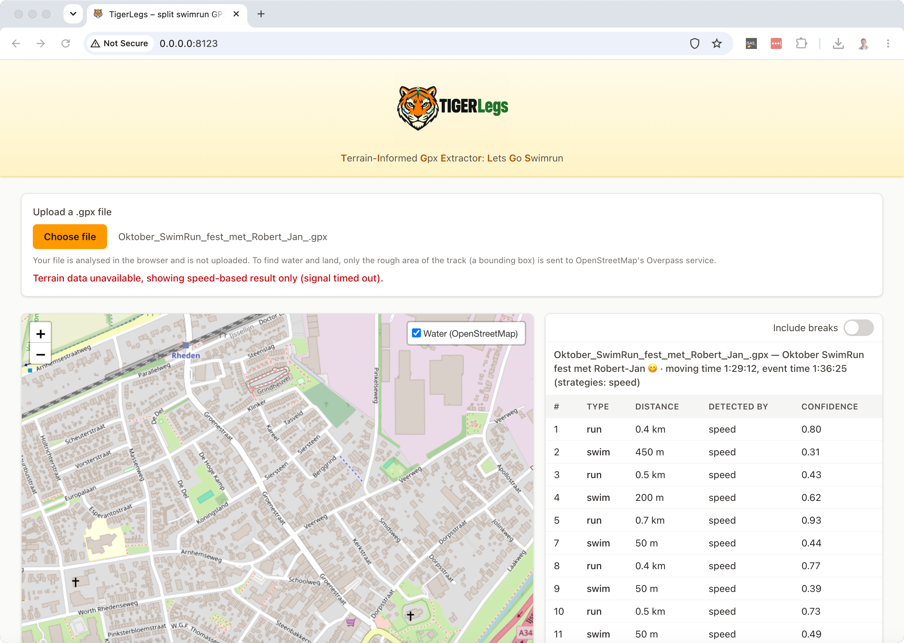

# Contributing to TigerLegs

TigerLegs is currently developed by a small, invited group. The repository is private, so access is by invitation only.

## Want to help?

Message Bart in the SwimRun huiskamer group. Once you are introduced there, you get access to the repository.

## Working agreements

- Read [AGENTS.md](./AGENTS.md) first. It holds the working agreements.
- Run `deno task test` and `deno task build` before you push.
- Write commit messages in the imperative mood ("Add ...", "Fix ...").
- Documentation is in English. Change the README, the [software guidebook](./docs/software-guidebook.md) or an ADR in the same commit as the behaviour it describes.
- Prefer user stories with Given/When/Then acceptance criteria for functional requirements.

## History

Bart started this project on Monday 15 June 2026 — his brother's birthday. After a morning of work, the first commit (*"Initial commit: README, spec, ADRs, and project config"*) landed at 12:09, and the analysis, design and first code followed that same afternoon and evening, done by Kiro, the agentic editor from AWS.

The next day he travelled to Bussum for Sogeti's *"Now What?"* congress and kept building on the train — the commit log shows the GPX parser, waypoint classifier and segment builder arriving between 07:44 and 09:34 that morning. That evening he swam and ran *Het Rondje Eilanden* with a friend: the same course that now lives in the repo as the [rondje-eilanden.gpx](./public/samples/rondje-eilanden.gpx) sample.

The founding sprint ran on for two more days: wave 5 (GPS filter, API router, property tests) landed on 17 June and wave 6 (landscape client, backend validation) on 18 June. Then the project hibernated for four and a half months — not a single commit, issue or file touched.

It woke up on Halloween, Friday 31 October 2026: 28 commits in one day brought the TigerLegs name and branding, the upload page, the software guidebook and this very history section.

*Figure 1*: Screenshot of the first prototype of TigerLegs (which started as a project called `gpx-to-swimrun-segments`), taken on 31 October 2026 when the project was picked up again.
