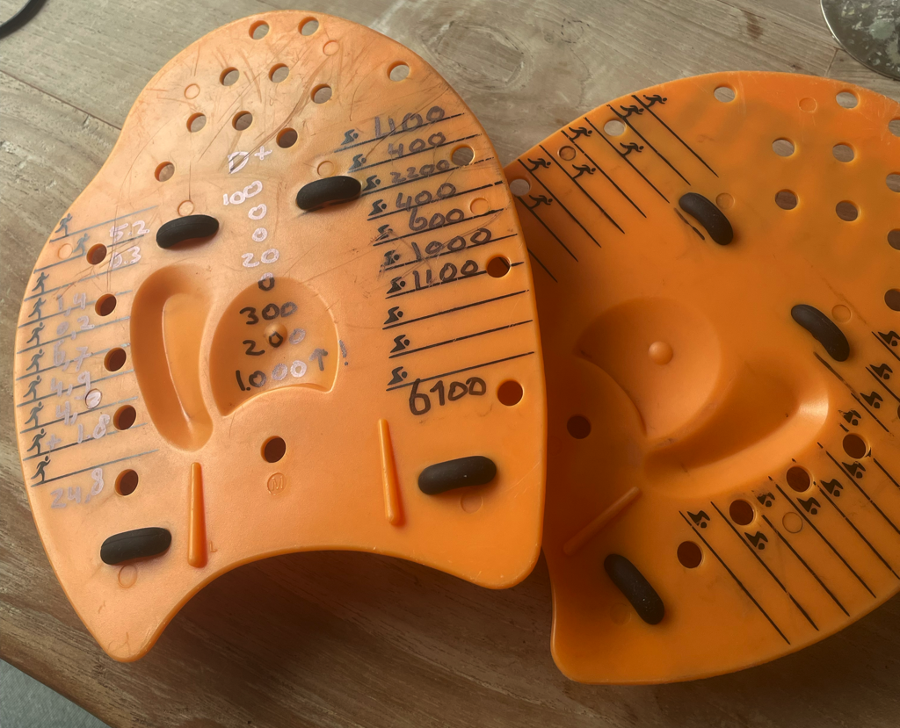
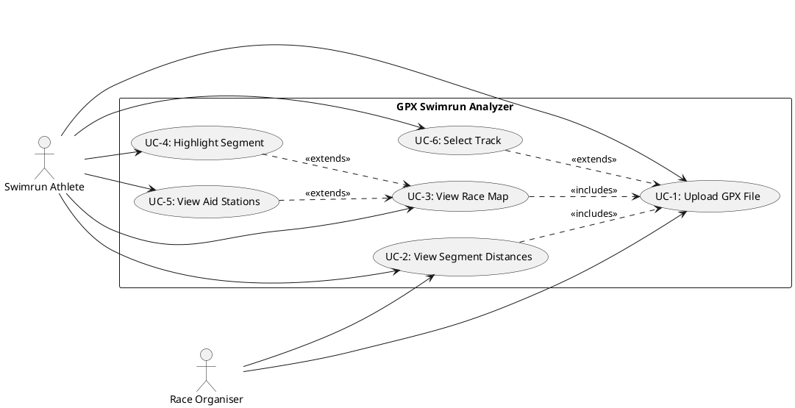

# GPX to Swimrun Segments

A web-based tool that parses GPX files from swimrun race courses and splits them into alternating swim and run segments. It displays an interactive map (Leaflet) alongside a distance table, with bidirectional highlighting between the two.

## What it does

Upload a `.gpx` file exported from a route planner like [Openrunner](https://www.openrunner.com). The tool detects swim/run transitions from GPX waypoints and calculates segment distances along the track.

- Runs are displayed in **kilometres** (km)
- Swims are displayed in **metres** (m)

## Example: Vertical SwimRunMan Laffrey 2026

This race starts with a swim (unusual in swimrun). Segment distances as published by the organisation:

| # | Run🏃‍♂️(km)| Swim🏊‍♀️(m)| Cum. |
|---|----------|----------|------|
| 1 |          | 400      | 0.4  |
| 2 | 5.2      | 400      | 5.6  |
| 3 | 0.3      | 2200     | 6.3  |
| 4 | 1.4      | 400      | 9.9  |
| 5 | 0.2      | 600      | 10.5 |
| 6 | 6.7      | 1000     | 17.8 |
| 7 | 4.9      | 1100     | 23.7 |
| 8 | 6.1      |          | 29.1 |
|**Tot** | 24.8 | 6100    | 30.9 |

Test GPX file: `vertical_swimrunman_2026-22910326-1781510068-71.gpx`

The above shows an atypical example where the event starts with a swim (🏊‍♀️/🏊‍♂️). But normally you start with a run (🏃‍♂️/🏃‍♀️ or 🏃‍♀️‍➡️/🏃‍♂️‍➡️). A 'run' first view could also be selected, for instance using a toggle (swim first (default off, e.g. 'run first')). And the shown cumulative distance after 'current' swim and run could also be shown or hidden (toggle 'show cumulative' in UI).

| # | Swim🏊‍♀️(m)| Run🏃‍♂️(km)|
|---|----------|----------|
| 1 | 400      | 5.2      |
| 2 | 400      | 0.3      |
| 3 | 2200     | 1.4      |
| 4 | 400      | 0.2      |
| 5 | 600      | 6.7      |
| 6 | 1000     | 4.9      |
| 7 | 1100     | 6.1      |
|**Tot** | 6100 | 24.8    |




## How swim/run detection works: the GPX `<sym>` element

The GPX format (GPS Exchange Format) is an open XML schema for exchanging GPS data between applications and devices. According to file-extensions.com (n.d.): "The GPX file format was created by TopoGrafix, a company specializing in mapping software and GPS mapping devices. Since its inception in 2002, the GPX format has become the de facto standard for interchange of GPS data, supported by hundreds of software applications and Web services around the world."

Each waypoint (`<wpt>`) can contain a `<sym>` element that specifies a symbol or icon to display for that point. The GPX 1.1 specification defines `<sym>` as free-form text representing the waypoint symbol name — there is no standardised list of allowed values (TopoGrafix, 2004).

The spec recommends human-readable names like `"City"` or `"Golf Course"`, but since the field is unconstrained, different applications and route creators use their own conventions. In the test GPX file for this project (created by a race organiser via a route planner), these numeric `<sym>` values appear:

| `<sym>` value | Meaning (race organiser convention) |
|---|---|
| `200` | Start of a swim section |
| `201` | End of a swim section |
| `3` | Aid station (ravitaillement) |
| `206` | Start of vertical kilometre (KV) |
| `49` | Hot food aid station |

**These numeric codes are not part of the GPX standard.** They are conventions used by the route planner Openrunner. Other applications (Garmin, Komoot, Strava, racedaymap.com, etc.) may use entirely different symbol schemes. There is no universal registry or standard for `<sym>` values — the GPX spec intentionally leaves this field unconstrained.

We aim to also support GPX files from [racedaymap.com](https://racedaymap.com) (used by ÖTILLÖ and other major swimrun events) once we can examine their waypoint conventions.

This tool detects swim segments using two strategies:

1. **`<sym>` value matching**: `200` = swim start, `201` = swim end
2. **Waypoint name matching** (fallback): names starting with `"Début SWIM"` or `"Fin SWIM"`

This dual approach makes the tool work with GPX files that use either convention. Future support is planned for GPX conventions used by other platforms, including [racedaymap.com](https://racedaymap.com/) (used by ÖTILLÖ for their interactive race maps).

### References

- file-extensions.com. (n.d.). *GPX file format*. Retrieved June 15, 2026, from https://file-extensions.com/docs/gpx
- TopoGrafix. (2004). *GPX 1.1 Schema Documentation*. https://www.topografix.com/GPX/1/1/
- TopoGrafix. (2004). *Developing GPX applications*. https://www.topografix.com/gpx_for_developers.asp
- Wikipedia. (n.d.). GPS Exchange Format. In *Wikipedia*. Retrieved June 15, 2026, from https://en.wikipedia.org/wiki/GPS_Exchange_Format

## System Context (C4 Level 1)

A C4 context diagram (Brown, 2018) showing the system boundary,
users, and external systems.

```plantuml
@startuml C4_Context
!include https://raw.githubusercontent.com/plantuml-stdlib/C4-PlantUML/master/C4_Context.puml

title System Context Diagram - GPX Swimrun Analyzer

Person(athlete, "Swimrun Athlete", "Uploads GPX files and reviews segment distances for race preparation")
Person(organiser, "Race Organiser", "Creates GPX routes with swim/run waypoints to share with participants")

System(analyzer, "GPX Swimrun Analyzer", "Web application that parses GPX files into swim/run segments and displays them on a map with a distance table")

System_Ext(tileProv, "Map Tile Provider", "Serves OpenStreetMap or similar raster tiles for the Leaflet map")
System_Ext(routePlanner, "Route Planner", "External tool (e.g. Openrunner, Komoot, Garmin Connect) used to create/export .gpx files")

Rel(athlete, analyzer, "Uploads .gpx file, views segments")
Rel(organiser, routePlanner, "Creates race route with swim waypoints")
Rel(organiser, analyzer, "Verifies segment distances")
Rel(routePlanner, athlete, "Exports .gpx file")
Rel(analyzer, tileProv, "Fetches map tiles via HTTPS")

@enduml
```

## Use Cases (UC)



The use cases (UC) map to user stories (US) as follows. Quality
attributes (QA) are non-functional cross-cutting concerns.

| UC | US | Requirement | Description |
|----|-----|-------------|-------------|
| UC-1 | US-1 | Req 1 | Upload a GPX file to analyze segments |
| UC-2 | US-3, US-5 | Req 3, 5 | See accurate distances in a table |
| UC-3 | US-4 | Req 4 | See the course on an interactive map |
| UC-4 | US-6 | Req 6 | Click map/table for cross-highlighting |
| UC-5 | US-8 | Req 8 | See aid station locations on the map |
| UC-6 | US-9 | Req 9 | Pick which track to analyse in multi-track files |
| — | US-2 | Req 2 | (internal) Waypoint classification |
| — | US-7 | Req 7 | (internal) GPX round-trip integrity |
| — | QA-1 | Req 10 | Accessibility |
| — | QA-2 | Req 11 | Performance |

US-2 (Waypoint Classification) and US-7 (Round-Trip Integrity)
are internal processing concerns, not user-initiated use cases.
QA-1 and QA-2 are quality attributes that apply across all use
cases.

## Tech stack

- **Frontend**: HTML, CSS, JavaScript (vanilla or lightweight framework)
- **Map**: [Leaflet](https://leafletjs.com/)
- **GPX parsing**: Browser-based XML/DOM parsing
- **Distance calculation**: Haversine formula

## Roadmap

- [x] GPX parsing with swim/run segment detection
- [x] Interactive Leaflet map with colour-coded segments
- [x] Segment distance table with totals
- [ ] Bidirectional map ↔ table highlighting
- [ ] Toggle: "swim first" column order (default off, i.e. run first)
- [ ] Toggle: show cumulative distance column
- [ ] Miles/yards unit conversion toggle
- [ ] Elevation profile per segment
- [ ] Garmin Connect IQ data field (Monkey C) — see below
- [ ] Support for additional GPX conventions beyond Openrunner

## Garmin Connect IQ app (future)

A Garmin watch data field written in Monkey C using the Connect IQ SDK. During a swimrun race it would show:

- Remaining distance in the current segment
- Total distance of the current segment
- Current segment number / total segments (e.g. "3/15")
- Segment type indicator (swim or run)

The web app would export segment data in a format the watch app can import (e.g. a FIT course or a JSON sideload via Garmin Connect).

## Development approach

This project follows **README-driven development** (Preston-Werner, 2010).

### References

- Brown, S. (2018). *The C4 model for visualising software architecture*. https://c4model.com/
- Preston-Werner, T. (2010, August 23). *Readme Driven Development*. https://tom.preston-werner.com/2010/08/23/readme-driven-development.html
- Larman, C. (2004). *Applying UML and Patterns* (3rd ed.). Prentice Hall.

## License

Open source (license TBD).
