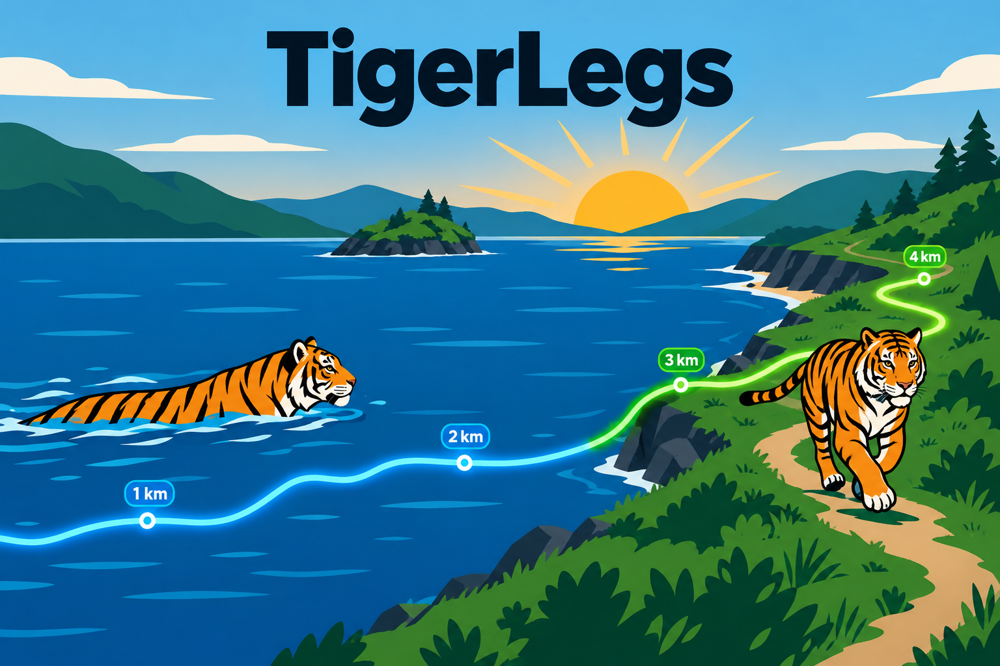
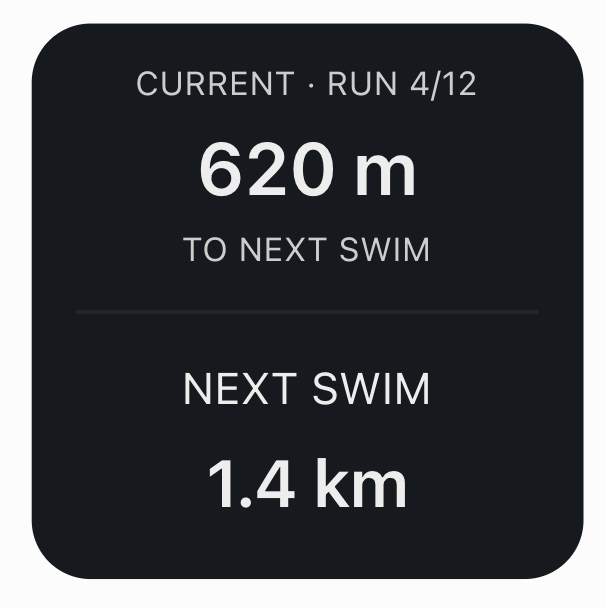

# TigerLegs


<picture>
  <source media="(prefers-color-scheme: dark)" srcset="./public/img/tigerlegs-acronym-anim-dark.svg">
  
</picture>



TigerLegs splits a swimrun course into its swim and run legs. You upload a GPX file, and the tool shows the course on an interactive map next to a table with the distance of every swim (in metres) and run (in kilometres).

TIGERLegs stands for *Terrain-Informed Gpx Extractor: LEts Go Swimrun!* (TIGE-R + LEGS). The tiger is also a nod to Team Groot Rondje Eilanden (TGRE), since a tiger is an amphibious animal and a good swimmer.

**Requirements:** [Deno](https://deno.com/) 2.x and a modern web browser. The maintainers develop on macOS and have not tested other platforms.

## Getting started

1. Install Deno by following the [installation guide](https://docs.deno.com/runtime/getting_started/installation/).
2. Clone the repository and open its folder:

   ```sh
   git clone https://github.com/swimrun/gpx-to-swimrun-segments.git
   cd gpx-to-swimrun-segments
   ```

3. Build the browser code and start the server:

   ```sh
   deno task dev
   ```

4. Open <http://localhost:8123> in your browser.
5. Upload a GPX file, for example one from the `test-data/` folder.

`src/server/config.ts` sets the port.

## Build and test

| Task | Command |
| --- | --- |
| Bundle the browser code into `public/app.js` and `public/about.js` | `deno task build` |
| Run all tests | `deno task test` |
| Lint the code | `deno task lint` |
| Format the code | `deno task fmt` |

## Roadmap

The roadmap shows what is done and what is planned. Checked items are done.
For the longer horizon — terrain milestones, the Garmin Connect IQ data field and Apple Watch/Coros export — see the [milestone roadmap](./docs/ROADMAP.md) and the [product vision](./docs/PRODUCT_VISION.md).



- [x] GPX parsing with swim and run segment detection
- [x] Interactive Leaflet map with colour-coded segments
- [x] Segment distance table with totals
- [ ] Highlighting that links the map and the table
- [ ] Toggle for the swim-first column order (default off, so run first)
- [ ] Toggle for a cumulative distance column
- [ ] Toggle between kilometres and metres, and miles and yards
- [ ] Elevation profile per segment
- [ ] Support for GPX conventions beyond Openrunner
- [ ] Garmin Connect IQ data field (see the [constraints](./docs/software-guidebook.md#4-constraints) in the guidebook)
- [ ] Accounts and login (for example Auth0), and saving analysed routes online. This is the first feature that needs a real backend, and it needs its own privacy review, because stored routes reveal home locations. Until then the app stays static, with no backend.

## Learn more

The [software guidebook](./docs/software-guidebook.md) describes what the system does (including use cases and an example course), how it is built, the domain terms and the GPX conventions it relies on. The [architecture decision records](./docs/adr/) explain why the design looks the way it does.

## Contribute

Read [CONTRIBUTING.md](./CONTRIBUTING.md) to get involved and [AGENT.md](./AGENT.md) for the working agreements. Documentation lives in the repository and changes in the same commit as the behaviour it describes, so update the README, the guidebook or an ADR when your change affects them.


