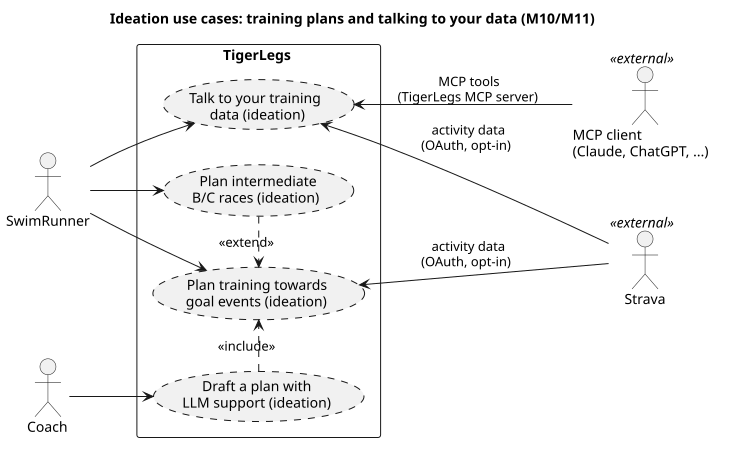

# TigerLegs roadmap

Milestone-level roadmap. The README "Roadmap" section holds the
near-term feature checklist; this document holds the longer horizon and
the open technical questions. New functional requirements are written as
user stories with Given/When/Then acceptance criteria (see
[.github/copilot-instructions.md](../.github/copilot-instructions.md)).

## M0 — Analyze a course in the browser ✅

Speed-based swim/run segmentation, Leaflet map, compact segment table,
sample courses. Done during the June 2026 founding sprint and the
31 October revival.

## M1 — Terrain-informed segmentation (current)

Combine speed evidence with OpenStreetMap water polygons so swims are
found even when pace alone is ambiguous (issue #5: "Swims seem to be
missing").

> As an athlete, given a GPX track crossing a lake at walking pace,
> when I enable "Use terrain data", then the crossing is classified as a
> swim with terrain listed as the detecting strategy.

## M2 — Transition editor

Interactively move, add, merge and delete transitions; corrections
survive re-analysis. Depends on map–table highlighting (README list).

> Given an analysed course with a wrong transition, when I drag the
> transition marker along the track, then the adjacent segment distances
> update and my correction is preserved.

## M3 — Versioned course export format

A compact, versioned format for an analysed course (ordered legs, types,
distances, transition coordinates) that watch platforms can consume —
candidate encodings: FIT course, JSON. Builds on ADR-0005 and ADR-0007.

> Given an analysed course, when I export it, then re-importing it
> reproduces the same legs, and the format carries a schema version.

## M4 — Garmin Connect IQ data field

Monkey C data field showing: current leg number / total (e.g. 3/15),
swim or run, remaining distance of the current leg. Feasibility and
constraints (HTTPS, makeWebRequest, phone proxy) are documented in
[ADR-0005](./adr/0005-rest-json-api-for-multi-client-support.md); the
feature specification lives in
[specs/001-garmin-datafield/spec.md](../specs/001-garmin-datafield/spec.md).

> Given a loaded TigerLegs course, when I pass a transition during an
> activity, then the data field advances to the next leg within one
> GPS fix.

## M5 — Apple Watch and Coros

The M4 next-segment feature (current leg, distance left, what comes
next) is wanted on other watches too. Friends with Apple Watch and
Coros devices are available as testers.

- **Apple Watch** (#54): which watchOS surface can show the next
  segment during an outdoor or swim workout, and how a course gets onto
  the watch. Open: WorkoutKit custom workouts, a watchOS app with its
  own workout session.
- **Coros** (#55): whether anything beyond route or structured-workout
  import exists; route import formats (GPX/FIT) and what survives.
- **Getting data in** (#56): users import a GPX file themselves, which
  suits technical users only. A fellow swimrunner and developer asked
  the key question: *how do you get the data from Garmin?* Compare
  better import help, a phone share target and platform integrations.
- What degrades when there is no custom app: a plain route file and the
  segment table on paper or on the phone.

## M6 — Live navigation

Route progress, distance to the next transition and off-course warning
during a race, reusing the M4 leg model.

## M7 — Automatic locomotion detection

Detect swim/run from live sensor data (speed, stroke/cadence) to confirm
or correct planned transitions. Research: GPS accuracy deteriorates
while swimming.

## M8 — Post-activity analysis

Compare planned with observed transitions, refine the course from the
recorded activity, per-leg pacing.

## M9 — Accounts, sharing, monetization

Saving and sharing analysed routes requires a real backend and a privacy
review first (stored routes reveal home locations) — see the README.
Commercial distribution remains an option, not a commitment.

## M10 — Training plans towards goal events

Build a training plan towards goal events (A races) with intermediate
B/C races, covering the four swimrun capacities: trail running,
open-water swimming, strength, and static and dynamic flexibility.
LLM-assisted drafting keeps the coach in control: drafts need explicit
coach approval. Design issue: #20. These goals are ideation only and are
deliberately kept out of the software guidebook until committed to;
the figure below shows them with their actors.

> **Plan towards goal events.** As a swimrunner, I want to build a
> training plan towards my goal events, so that I can structure my
> fitness build-up and perform at my best.
> Given I have set an A race and its date, when I generate a plan, then
> the plan shows progressive weekly swim, run, strength and flexibility
> sessions from today to race day, with a taper before the race.

> **Plan intermediate races.** As a swimrunner, I want to plan
> intermediate B and C races, so that I can rehearse A-race skills such
> as transitions and my nutrition plan without fully easing off or
> tapering.
> Given a plan towards an A race, when I add a B race six weeks before
> it, then the plan keeps building load through the B race with at most
> a short easing, and marks the B race as a rehearsal for transitions
> and nutrition.

> **Draft a plan with LLM support.** As a swimrun coach, I want to draft
> training plans with LLM support, so that I spend less time while
> keeping enough grip for a programme genuinely tuned to the swimrunner,
> with a sound build-up and no sessions that are too hard or too light.
> Given an athlete profile and goal events, when I ask the assistant for
> a draft plan, then I receive an editable draft that I must explicitly
> approve before the athlete sees it.

## M11 — TigerLegs MCP server and Strava integration

"Talk to your training data" from a swimrun perspective: a TigerLegs
MCP server that any MCP client (Claude, ChatGPT, …) can connect to,
with Strava as an activity data source — the pattern Stryd ships for
running. Depends on M9 (accounts, OAuth token storage, privacy review)
and on Strava's API agreement, which since November 2024 restricts
showing a user's data to anyone but that user and restricts AI-model
training on API data. See the draft
[ADR-0010](./adr/0010-tigerlegs-mcp-server-and-strava-integration.md)
and issue #20.

> **Talk to your training data.** As a swimrunner, I want to make my
> Strava data available for analysis in TigerLegs and query it through a
> custom TigerLegs MCP server from any MCP client, so that I can talk to
> my training plan and propose adjustments to my coach.
> Given I connected Strava and an MCP client to the TigerLegs MCP
> server, when I ask about last week's sessions, then the answer uses
> only my own activities, and a proposed session change goes to my coach
> for approval instead of silently changing the plan.

These goals follow the same evidence rule as segment detection: activity
data is evidence for how training went, and an LLM draft is evidence for
what a plan could be; the athlete and the coach keep the final say.

## M12 — Premium: hosted back end and quality of service

Connecting to the back end is a premium feature; the front end works
fully without it (ADR-0013, #58). For paying users TigerLegs can offer a
quality of service the public services cannot: our own Overpass
instance in the EU behind the back end, with a cache and without rate
limits (#57), next to saved courses, sharing, the MCP server (M11) and
training plans (M10). Depends on M9 (accounts and the privacy review)
and on the back-end technology choice (#13, #6). The local Overpass
setup ([docs/local-overpass.md](./local-overpass.md)) is the starting
point, and the back end runs locally for development and tests.

> Given no back end is reachable, when I use TigerLegs, then every free
> feature works and the premium features say what they need.

## Technical uncertainties

- Quality and coverage of OSM water polygons for race venues.
- Connect IQ constraints: HTTPS only, JSON via makeWebRequest, memory
  limits of data fields on older watches.
- Apple/Coros: no public API may exist for custom leg-by-leg display;
  export may be limited to plain route files.
- Getting activity data from Garmin, Coros and Apple into TigerLegs
  without a manual file export: which programmes exist, what approval
  and terms they carry (#56).
- Back end optional: every back-end feature needs a test with the back
  end absent, slow and failing (#58).
- Own Overpass hosting: regions, refresh frequency, cost against
  pricing, uptime (#57).
- GPS noise during swims: transition detection needs hysteresis.
- Strava API terms: data display limited to the athlete themself and
  restrictions on AI-model training (November 2024 update); how the
  coach-approval flow fits these terms needs legal reading.
- MCP server hosting: OAuth, rate limits and token storage imply a real
  backend in the EU (ADR-0004) and a privacy review before any training
  data is stored.
