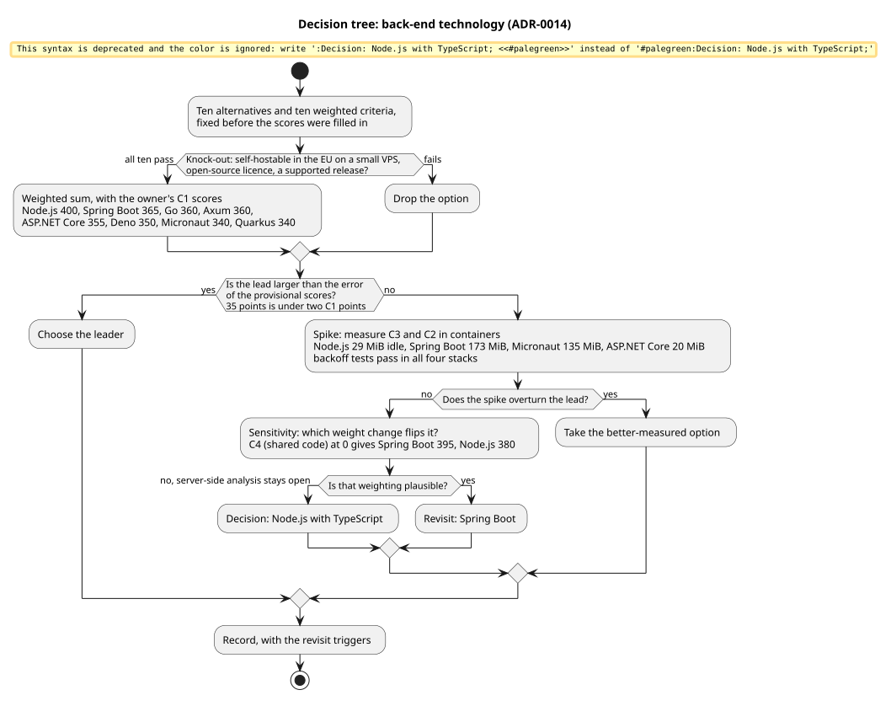

# 14. Back-end technology

Date: 2026-11-10

## Status

Accepted on 11 November 2026: the back end is Node.js with TypeScript (see [Decision](#decision)).
The decision was taken before the persistence part of the spike (C10) was measured, which is the main risk; the [revisit triggers](#consequences-and-revisit-triggers) say what would reopen it.
It builds on [ADR-0002](./0002-use-deno-with-typescript.md), [ADR-0004](./0004-host-deno-backend-on-eu-vps.md), [ADR-0005](./0005-rest-json-api-for-multi-client-support.md) and [ADR-0013](./0013-back-end-is-optional.md); the fate of ADR-0002 and ADR-0004 follows in #61.

## Context

The back end is optional and a premium feature ([ADR-0013](./0013-back-end-is-optional.md)): saved and shared courses, a hosted terrain service on our own Overpass server (#57), the MCP server and Strava integration ([ADR-0010](./0010-tigerlegs-mcp-server-and-strava-integration.md)) and training plans (spec 003).
It runs as a container on a small EU VPS (ADR-0004).
Today it is a small Deno service with a disk cache; ADR-0002 chose Deno and TypeScript for the whole project, when the server needs were minimal.
Issue #13 asks whether that holds once persistence, accounts and external APIs come in.

### Overpass does not decide the language

The Overpass API is plain HTTP: a POST with a query in Overpass QL, answered with JSON (OpenStreetMap Wiki, n.d.-a, n.d.-b).
The example on the wiki uses `fetch` in JavaScript, but any language that can send an HTTP request can do the same; there is no JavaScript-only Overpass API.
The advantage TypeScript has here is different: the browser already contains the working client (`queryOverpass`, with backoff and cache), and a TypeScript back end could reuse it and the water-detection code.
That is a code-sharing argument (C4), not an Overpass argument.

### Deno after October 2026

On 9 October 2026 Cloudflare announced that Deno joins it: Ryan Dahl and Bert Belder lead an effort to merge Deno's `celld` into Cloudflare's `workerd` and to make self-hosting of the Workers programming model a first-class option (Cloudflare, 2026).
For the Deno runtime itself, a Deno team member states in the project's issue tracker (Deno, 2026): the runtime stays MIT licensed and forkable; the Deno Company maintains it until October 2027 with monthly 2.9.x LTS releases (bug and security fixes); no new features are developed, and feature pull requests are closed; the team is trying to place Deno in a foundation but has nothing to report.
Heise reports that Deno Deploy shuts down after six months, that the JSR package registry keeps running on Cloudflare's infrastructure, and that JSR's community governance is now unclear (Roden, 2026).
The Deno team itself confirmed the one-year LTS period in an update on 15 October (Linuxiac, 2026). Reaction in the community is reported as strong, with forks and foundation proposals under discussion; those are early and secondary reports (Hacker News, 2026; Socket, 2026), and no fork is mature.

What this means for us:

- The runtime stays usable and open for at least a year; the risk is the time after that, and it is a risk of *stewardship*, not of licence.
- Our own exposure is moderate: 45 source and test files use `Deno.*` APIs, 38 import `@std/*` from JSR, and `deno test` and `deno task` run the tests and builds, while the site itself is built with Astro and npm. The back end is 6 files.
- Deno KV and Deno Deploy are platform services; we use neither, and we should not start. Persistence for the premium features is PostgreSQL in a container, which works the same on every option below and keeps us free to host in the EU.

### Java and .NET: what the LTS releases offer, and under which licence

- **OpenJDK or Oracle JDK.** The Oracle JDK builds are made from the same OpenJDK source; vendor and licensing write-ups find no meaningful performance difference between them and Temurin, Corretto or Zulu on the same Java version, and the difference left is the licence: OpenJDK is GPLv2 with the Classpath Exception, while Oracle JDK 17, 21 and 25 are free in production under Oracle's No-Fee Terms and Conditions, but only until a year after the next LTS (OpenLogic, n.d.). So the language and runtime features below come with the free OpenJDK distributions too; a Temurin or Corretto build avoids the licence question altogether (Adoptium, n.d.).
- **Startup time.** Project Leyden's ahead-of-time cache is part of OpenJDK itself (from JDK 24, improved in 25) and speeds up the start of a Spring Boot application without a different JDK (InfoQ, 2025; Halbritter, 2026). GraalVM Native Image compiles to a native binary instead, with a very short start and low memory; Spring Boot, Quarkus and Micronaut support it. GraalVM is a separate distribution: Oracle GraalVM is free in production under the GraalVM Free Terms and Conditions, and there is a Community Edition (GraalVM, n.d.). CRaC (a checkpointed process) is a third route, offered by some OpenJDK vendors. Published numbers differ per application and are vendor or blog figures: to be measured in our spike.
- **Project Valhalla.** Value classes (JEP 401), the Java counterpart of structs that flatten data in memory, are integrated as a *preview* feature in JDK 28 (March 2027), disabled by default, and not expected to be final even in JDK 29, the next LTS (InfoQ, 2026). They are not in Java 25 and cannot be relied upon for this decision; like everything in OpenJDK they will come to all builds.
- **.NET 10.** The .NET runtime is licensed under MIT and is a .NET Foundation project (.NET Foundation, n.d.); .NET 10 is LTS until 14 November 2028 (Microsoft, n.d.). That ASP.NET Core was far behind Java servers such as Jetty is an old picture: for years it has been at or near the top of the TechEmpower results. Those results were archived (see below), so no current neutral comparison exists for .NET 10 against Java 25, and we measure ourselves.

### Server-side analysis for weak devices

An option to keep open: let the back end do some of the GPX analysis for devices that are too slow, such as old phones or simple browsers, as a premium or fallback service.
That bends ADR-0003 (analysis in the browser, the GPX file stays on the device): the file would be uploaded, so it must be opt-in, processed in the EU and not stored, and the privacy review of roadmap M9 applies.
First find out whether the need is real: today the analysis of the Rügen recording (19,771 points) runs in about a tenth of a second on a laptop in a Web Worker; measure a low-end phone before building anything.
If the back end does run the analysis, TypeScript decides it: a Node.js (or Deno) back end runs the very code the browser runs, one implementation with one set of tests, while every other language needs a second implementation that must stay equal to the first (the official-split tests of the Cannes and Rondje Eilanden recordings would be the parity check).
Weighing this in C4 is a decision of the owner; the sensitivity below shows what it does to the totals.

### Does Astro put pressure on the choice?

Little. The site is Astro in its default static mode on GitHub Pages: "By default, your entire Astro site will be prerendered, and static HTML pages will be sent to the browser", and an adapter (Node.js, Cloudflare, Netlify, Vercel) is only needed for pages rendered on demand (Astro, n.d.-a). A static site that calls a separate API needs no adapter, and in static mode Astro endpoints only run at build time (Astro, n.d.-b). So the back end is a separate service behind a REST/JSON contract (ADR-0005), and Astro does not care what it is written in.

Two related questions are tracked in #64. Astro itself now belongs to Cloudflare: its company joined Cloudflare on 16 January 2026, and Astro stays MIT-licensed with a public roadmap and open governance (heise online, 2026), the same pattern as Deno. And Next.js, the usual alternative for an app-like front end, is governed by Vercel but can be self-hosted: as a Node server or Docker container with standalone output, as a static export, and since version 16.2 through a stable Adapter API (Next.js, 2026). Cloudflare is an American company: it is headquartered in San Francisco and listed on the New York Stock Exchange (Cloudflare, n.d.).
The reaction of the community to the Astro deal is reported as mixed, between excitement and caution, with the question "will Astro become coupled to a hosting provider?" and the reassurance of the stated commitments: free, open source and MIT licensed, open governance, continued support of the ecosystem fund and of partners such as Netlify, Wix and Sentry, and portability to other runtimes (IT Brief, 2026; The New Stack, 2026; these are news reports, not measurements).
What the commitments are worth is the open question, and the precedent that fits is Gatsby.
Netlify acquired Gatsby in February 2023 and ended Gatsby Cloud, the hosting product, with the free plan discontinued on 29 September 2023; the Gatsby framework itself was kept, but by September 2023 its co-founders indicated that it would be in maintenance mode (Netlify, 2023; the maintenance mode is reported in a community discussion, "Is GatsbyJS Officially Dead?", not in a Netlify statement). A Hacker News commenter who had moved from Gatsby to Astro described "a sense of déjà vu" (nozzlegear, 2026), and another warned that "almost every acquisition begins with saying, 'nothing will change'" (mmooss, 2026); these are opinions, not evidence.
The one piece that sets the Cloudflare deals side by side is an anonymous blog post without cited sources, so treat it as an opinion too: "Astro and VoidZero were promised continuity; Deno Runtime was given a sunset schedule. Open source guarantees access to code, not perpetual staffing" (aiidelist, 2026).
We found no commentary by Roden on the Astro deal; his commentary on Deno does not mention Astro (Roden, 2026).
For this project the exposure is limited, because the site is static HTML on GitHub Pages: if Astro were wound down, the generated pages keep working and the cost would be moving the layouts and React islands to another builder (#64).

Astro needs Node.js: the installation guide asks for Node.js v22.23.4 or higher, with only even-numbered versions supported (Astro, n.d.-c), and rendering pages on demand needs an adapter for a server runtime (Node.js, Cloudflare, Netlify or Vercel). Astro as the back end would therefore be a Node.js back end, running the Node adapter in a container; it would tie the back end to the front-end framework and its release cycle, which cuts against a back end that is optional and separately deployable (ADR-0013), and Astro endpoints cover routes, not accounts, payments, jobs or a data layer. As a thin layer for the front end it is possible, as the whole back end it is not recommended here.
A Next.js front end with server code would pull the back end toward Node.js, which is the one real pressure from a framework on this decision; it does not follow from the current static site.

Where pressure could appear:

- **If Astro were the back end** (on-demand rendering, endpoints or actions with a Node or Cloudflare adapter), a JavaScript runtime and a host for it would follow. That is not planned: the static site stays on GitHub Pages and the back end stays optional (ADR-0013).
- **Types shared with the islands.** A TypeScript back end can share types with the React islands directly. Any other language needs the API described first, for example in OpenAPI (Javalin, Spring Boot, ASP.NET Core and FastAPI can all produce it), and the TypeScript client types generated from that description.
- **Toolchains in the repository.** Astro and Playwright already need Node, and today Deno runs the tests. A Java, Kotlin or .NET back end adds a JDK or SDK and a build tool (Gradle or Maven) to every contributor's machine and to CI; a Node back end adds none. This is part of C4.
- **Origins and cookies.** The site lives at `swimrun.group/tigerlegs`. A back end on a subdomain of the same site (for example `api.swimrun.group`) lets sign-in cookies work without cross-site settings, and CORS is already handled (`ALLOWED_ORIGINS`). This holds for every option.

### If an LLM writes the code anyway

Raw speed does not decide this back end, which will see few requests; the interesting question is what changes when a language model writes most of the code.
It lowers the cost of writing in an unfamiliar language and so favours languages with a strong compiler (Rust, Go, Kotlin, C#, Java): the compiler catches many mistakes a model makes before they run.
It does not lower the cost of *reading*, reviewing, debugging and operating the result, which stays with the owner, and C1 is about exactly that (and the wish to get to know a language better).
Models also write best where the training data is richest, which favours TypeScript, Python, Java with Spring and C#.
Rust frameworks such as Actix and Axum are reported among the fastest in blog comparisons of the last TechEmpower round; that is not verified here and does not matter at our load.
What Rust offers at our scale is a very small image and memory use and a strict compiler; what it costs is a smaller batteries-included ecosystem for accounts and OAuth, a steeper language to review, and a library that is still pre-1.0.

### What the owner has said (11 November 2026)

Interest in Java and in getting to know it better, in Spring Boot or another Java microservice framework (Micronaut, Quarkus, Javalin), in Project Leyden for the start-up time, and in Spring Data JDBC for its support of the aggregate pattern; a long-standing interest in Domain-Driven Design; and a liking for database migrations, as known from EF Core and Flyway.
These are inputs for C1 and for C10, not scores; the C1 scores stay the owner's.

## Method

The comparison follows the [ICT Research Methods multi-criteria decision making method](https://ictresearchmethods.nl/workshop/multi-criteria-decision-making/), as ADR-0009 did: a preparation phase (alternatives, criteria, weights, the stakeholders involved) and an evaluation phase (judge each option per criterion), with time to iterate between judging the options and adjusting the criteria (ICT Research Methods, n.d.).
The page gives no scoring scale or formula, so this record chooses the plain weighted sum: scores run from 1 (poor) to 5 (excellent), weights add up to 100, and the total is the sum of weight times score.
The stakeholder is the project owner (learning goals, own time, self-hosting in Europe); contributors and later coaches and organisers can be added when they exist.

## Alternatives

Only supported releases are considered: Java 25 is an LTS release, available from Temurin from September 2025 until at least September 2031 (Adoptium, n.d.); .NET 10 is an LTS release of November 2025 with support until 14 November 2028 (Microsoft, n.d.).
.NET 11 (STS) was released today and is left out for that reason.

| Option           | Language and runtime          | Reasons to consider                                                                                                                                                                                                                                |
| ---------------- | ----------------------------- | -------------------------------------------------------------------------------------------------------------------------------------------------------------------------------------------------------------------------------------------------- |
| **Deno** (now)   | TypeScript on Deno            | Same language as the front end; already built, tested and containerised; MIT; but see above                                                                                                                                                        |
| **Node.js**      | TypeScript on Node.js         | Same language as the front end; the largest ecosystem; the site build already uses npm; OpenJS Foundation governance                                                                                                                               |
| **FastAPI**      | Python                        | Readable, well known, strong for data work later                                                                                                                                                                                                   |
| **Spring Boot**  | Java 25 LTS                   | Batteries for accounts, persistence and OAuth; the named alternative in #13; several independent OpenJDK vendors; the owner wants to get to know Java and Spring better                                                                            |
| **Micronaut**    | Java 25 LTS                   | A framework aimed at small services: dependency injection at build time, lower memory, native image support; a smaller community than Spring                                                                                                       |
| **Quarkus**      | Java 25 LTS                   | A framework aimed at small services and containers: build-time optimisation, fast start with native image or Leyden (Quarkus, n.d.); a smaller community than Spring                                                                               |
| **Javalin**      | Kotlin or Java on Java 25 LTS | A small framework in the style of Express: few concepts, routes and handlers, on top of Jetty, Apache 2.0, equal support for Kotlin and Java, optional virtual threads and OpenAPI (Javalin, n.d.); you assemble accounts and persistence yourself |
| **ASP.NET Core** | C# on .NET 10 LTS             | Mature web stack, strong tooling, open source; Native AOT for small and fast containers                                                                                                                                                            |
| **Go**           | Go                            | Small static binary, very light on a small VPS                                                                                                                                                                                                     |
| **Axum**         | Rust                          | A Rust web library on hyper and tower, MIT, maintained by the Tokio project; among the fastest web stacks, tiny memory and image; pre-1.0 (0.8 on crates.io) (Tokio, n.d.)                                                                         |

## Criteria and weights (draft)

| #   | Criterion                                                            | Weight | What it asks                                                                                                                                                    |
| --- | -------------------------------------------------------------------- | ------ | --------------------------------------------------------------------------------------------------------------------------------------------------------------- |
| C1  | Accessible language the owner knows or wants to learn or know better | 20     | Familiarity and learning value (the owner's own score)                                                                                                          |
| C2  | Fit with external HTTP APIs such as Overpass                         | 5      | HTTP client, JSON, retry and cache libraries (every option has them, so little separates the options)                                                           |
| C3  | Light on a small VPS                                                 | 15     | Image size, idle memory, start time                                                                                                                             |
| C4  | Shares code with the front end                                       | 10     | Reuse of the TypeScript client, types and analysis code (weight 0 if the back end never analyses GPX)                                                           |
| C5  | Ecosystem for accounts, payments and jobs                            | 5      | Sign-in, OAuth for Strava, payments, e-mail, background jobs, the MCP server (see the list below)                                                               |
| C6  | Tooling and testing                                                  | 5      | Tests, lint, format, container workflow                                                                                                                         |
| C7  | Security and supply chain                                            | 10     | Permissions, and how exposed the ecosystem is to poisoned dependencies                                                                                          |
| C8  | Autonomy                                                             | 15     | Self-hostable in the EU on our own infrastructure; no lock-in to one vendor's platform services; open licence and governance not controlled by a single company |
| C9  | Long-term health                                                     | 5      | Support timeline, who maintains it, size of the community                                                                                                       |
| C10 | Database and geodata                                                 | 10     | PostgreSQL with PostGIS: drivers, migrations, spatial types, and persistence that fits a domain model with aggregates (the owner works in DDD)                  |

C8 is named *autonomy* here. *Sovereignty* is also used for this idea, but the word has other uses; what is meant is the ability to run, move and fix our own service without asking a vendor.

### C4 and C6: a portable core, enforced, and the test runner

A TypeScript back end only shares code with the front end if the shared modules stay free of Deno and of the browser.
That is an architecture rule, so it is enforced by tooling and not by review (`tsconfig.shared.json`, `test/portability.test.ts`, two CI steps):

1. **Compiler rule.** `npm run check:shared` compiles the listed modules with only Node's types (no `Deno` namespace, no DOM) and with `erasableSyntaxOnly`, which rejects what Node's type stripping cannot run: enums, runtime namespaces and parameter properties (Node.js, n.d.).
2. **Load test.** A Deno test starts `node` and imports every listed module, so Node 24 itself proves that it can load them. The module list is the `include` of the tsconfig, a single source.
3. **Both runners.** The spike's tests already run on `node:test`; the repository's tests run on Deno. Running one shared suite under both is the next step and is not done yet (it needs the shared tests to move from `Deno.test` and `@std/assert` to `node:test` and `node:assert`).

Nine modules pass today: `gps-filter`, `speed-analyzer`, `segment-builder`, `segment-cleaner`, `rest-detector`, `strategy-combiner`, `waypoint-classifier`, `training-week` and `overpass`.
The check found two leaks that keep other modules out of the list: `gpx-parser.ts` is typed against the DOM (`Element`, `Document`) although it parses with xmldom, and `water.ts` imports `overpass-cache.ts`, which uses the browser Cache API (so `analyze.ts` follows). Both are small to fix: a cache interface that the back end implements differently, and xmldom's own types for the parser.

**Test runner.** Node's type stripping removes the pressure to adopt one for the back end: `node:test` is built in and needs no dependency (Node.js, n.d.).
Vitest is already in the repository (version 5, for the Storybook tests in a browser), so a second `environment: 'node'` project would cost no new dependency, but it is a different runner from the one the repository's 42 test files use, and a Vitest run would have to be added next to `deno test`.
Whether Vitest accepts TypeScript that Node's stripping rejects (enums), and whether it is faster, are not measured here. The portability rule above matters more than the runner: keep the shared tests on the common denominator (`node:test` and `node:assert`) and both runners can execute them.

**Dependency audit.** `deno audit` reads `deno.lock` (Deno, n.d.), which holds 411 npm packages; `package-lock.json` holds 647. The Storybook chain `@storybook/react-vite` → `glob` → `minimatch`, which `npm audit` reports (4 moderate), is only in the second file, so `deno audit` cannot see it. `npm audit --omit=dev`, now a CI step, reports 0 vulnerabilities for what ships: the findings are in development tooling.

### C5: what the roadmap will ask of the ecosystem

The weight of C5 is low now and will grow with the roadmap (M9 to M12):

- accounts, sign-in and sharing (M9), with the privacy review first;
- OAuth against Strava and token storage (M11, ADR-0010) and an MCP server (M11);
- payments for the premium service (M9, M12): iDEAL, Apple Pay and cards through a payment provider; Mollie, for example, offers iDEAL, Apple Pay and others through one REST API with webhooks for payment status, official client libraries for JavaScript, PHP, .NET, Python and Ruby, and community libraries for Java and Go (Mollie, n.d.); Wero is announced as the successor of iDEAL, and is available in Germany and Belgium through the same API. Garmin Pay is a payment method for paying with a watch in a shop; we found nothing to suggest it is something a web service integrates, and assume it is not relevant;
- e-mail for sign-in and receipts, scheduled and background jobs (refreshing Overpass data, calendar feeds for training plans, M10) and webhooks;
- storage of files and a database (C10).

A payment provider is a REST and webhook integration, so every option can do it; what differs is whether an official client library exists in our language and how much of the work we write ourselves (a small surface: create a payment, receive a webhook, check the status).
Node.js, .NET and Python have official libraries; Java, Go and Rust would use a community library or direct HTTP calls.

### C7: supply chain

Poisoned dependencies are the most active attack on software in 2026, and npm is by far the main target: in the first half of 2026 npm accounted for about four in five of the malicious packages indexed by one security vendor, PyPI for about one in eleven, and Go, Cargo and NuGet for about one in a hundred each, with Maven Central not in the list (Phoenix Security, 2026; a vendor report, so the proportions are indicative).
Worm-like campaigns (Shai-Hulud and its successors) steal maintainers' tokens and republish themselves into the packages those maintainers control; on 4 August 2026 one such attack began in packages such as keyv and flat-cache and spread to hundreds of packages with more than two billion monthly installs (eSecurity Planet, 2026).
So Node.js scores low on C7, and the front end is exposed already: Astro, React and Storybook come from npm.
Mitigations apply to any option and lower the exposure but do not remove it: install from the lock file only (`npm ci`), do not run dependency install scripts, wait a few days before taking new releases, keep few direct dependencies, and pin and verify.
A Java, Go or .NET back end has a smaller attack surface for the server itself because the platform brings more in its standard library and its frameworks pull fewer small packages; the front end stays on npm in every case.

### C10: the database

The back end will store accounts, teams and app groups, courses and their variants, swimrunner profiles and saved recordings (roadmap M9, M10, M12).
PostgreSQL is the working assumption for all of it, and it covers more than tables: JSONB columns for flexible course documents, and the PostGIS extension for geometry (course lines, bounding boxes, the nearest course for a recording).
Files such as GPX recordings go in object or file storage next to it, in the EU.
The choice of database is independent of the language: every option below has a PostgreSQL driver, migrations and a query layer (for example JDBC with Flyway or Liquibase, Hibernate or jOOQ for Java, Npgsql with EF Core and NetTopologySuite for .NET, `pg`, Drizzle or Prisma for Node.js, SQLAlchemy and GeoAlchemy for Python, `pgx` for Go, `sqlx` for Rust), so C10 separates the options only a little: it rewards mature migration and ORM support and ready-made spatial types.
Is the database the bottleneck? Not at our scale: the heavy computation stays in the browser (ADR-0003), the server does mostly small reads and writes, and the usual causes of slow queries (missing indexes, one query per row, no spatial index) are design matters, not language matters. Spatial queries need a GiST index, connections need a pool, and a small VPS must share its memory between the database and the service; we measure with realistic data in the spike instead of guessing. The slower dependency today is the shared public Overpass server, which is why #57 exists.
A persistent-storage decision record (PostgreSQL with PostGIS, files, caches) follows this one (#63).

### Persistence for a domain model with aggregates

The owner works in Domain-Driven Design and values persistence that follows the aggregate pattern: one repository per aggregate root, consistency inside an aggregate, and references between aggregates by id.
The model we expect has aggregates such as a course (with its variants and legs), a team or app group (with its members), a swimrunner profile and a recording, where a recording refers to a course by id instead of containing it.
What each ecosystem offers for that:

- **Java with Spring Data JDBC.** Built on exactly these ideas: "each aggregate has exactly one aggregate root", all entities reachable from the root belong to the aggregate, references across aggregates are not guaranteed to be consistent at all times but eventually, and there is no lazy loading, so an aggregate loads and saves as a whole; the price is that child entities of an aggregate are deleted and recreated when it is saved, so large aggregates are costly to write (Spring, n.d.-a). Spatial types are not mapped out of the box; PostGIS columns need converters or SQL functions, to be tried in the spike. Kotlin's immutable data classes suit value objects. Micronaut Data JDBC is close in mechanics: queries are computed as SQL at build time and "results are mapped straight to your entities, without an ORM, lazy loading or a persistence context", with association mapping and fetching, PostgreSQL and GraalVM native image support; but its guide does not present aggregates as its design, and how it saves child collections (cascading) was not found in the pages we read, so it must be tried (Micronaut, n.d.). Quarkus offers Panache on top of Hibernate ORM, in an active record style (entity classes carry their own queries, which works against persistence ignorance) or a repository style; it is a JPA model with the usual lazy loading, so the aggregate boundaries are ours to keep, in exchange for Hibernate's mature migrations and spatial support (Quarkus, n.d.-b).
- **.NET with Entity Framework Core.** Microsoft's own guidance for DDD uses it: persistence-ignorant POCO entities, private fields and read-only collections that the aggregate root controls, value objects as owned types, one repository per aggregate and the `DbContext` as unit of work, with Dapper for queries in a CQRS split (Microsoft, 2021).
- **Python with SQLAlchemy.** The imperative (classical) mapping lets the ORM depend on the domain model and not the other way round, so "our domain model classes stay blissfully unaware of the database" (Percival & Gregory, n.d.).
- **TypeScript (Node.js or Deno).** The popular tools (Prisma, Drizzle) are schema and query builders and do not model aggregates; MikroORM comes closest: it describes itself as a data mapper that aims at persistence ignorance, with an identity map, a unit of work that tracks changes and writes them in one transaction on `flush`, and repositories as thin layers over the entity manager; its documentation does not present aggregates or DDD, so the boundaries are ours, and PostGIS is not built in but needs custom types (MikroORM, n.d.-a, n.d.-b, n.d.-d). Repositories written by hand are common.
- **Go and Rust.** No aggregate-aware mapper; the usual way is hand-written repositories over `pgx` or `sqlc` and `sqlx`, which is clear but is all code to write and test.

So Java with Spring Data JDBC, .NET with EF Core and Python with SQLAlchemy have the best-documented fit with the aggregate pattern; of the Java frameworks only Spring Data JDBC is built around it, Micronaut Data JDBC comes close in mechanics and Quarkus follows the JPA model, and the scores for C10 reflect that (Spring Boot 5, Micronaut and Quarkus 4).

### Transactions, integrity and growth (Node.js)

The question is whether the TypeScript route gives ACID inside an aggregate and a way to eventual consistency between aggregates when the system grows.
PostgreSQL itself provides the ACID guarantees; what matters is that the mapper uses them well.
MikroORM does: "All the write operations (INSERT/UPDATE/DELETE) are queued until `em.flush()` is invoked which wraps all of these changes in a single transaction", `em.transactional(cb)` gives an explicit transaction, and the isolation level can be set up to `SERIALIZABLE`.
For conflicting updates it offers optimistic locking ("automatic optimistic locking via a version field", with an `OptimisticLockError` when "the entity has been modified by someone else already") and pessimistic locking at the database level, including `SKIP LOCKED` and `NOWAIT` (MikroORM, n.d.-e).
That fits one aggregate, one transaction.
For eventual consistency across aggregates the MikroORM transaction page says nothing about domain events or an outbox, so that part is ours to build: the usual pattern is to write the event to an outbox table in the same transaction as the aggregate change and let a separate process publish it. I have not sourced that pattern here, so it is to be checked before it is relied on.
This matches how Spring Data JDBC treats references between aggregates, as eventually and not always consistent (Spring, n.d.-a), so the model does not need to change when the system grows; the tooling around it is what Node.js has less of than Spring.

**Unit of work is not the aggregate.** They are two patterns that work together. Fowler describes a unit of work as something that "maintains a list of objects affected by a business transaction and coordinates the writing out of changes and the resolution of concurrency problems" (Fowler, n.d.-a); an aggregate is "a cluster of domain objects that can be treated as a single unit", and "transactions should not cross aggregate boundaries" (Fowler, n.d.-b); the term is also used in UML, where it is not the same concept as a DDD aggregate (Fowler, n.d.-b). The unit of work is the mechanism that saves; the aggregate is the rule for what may be saved together.
MikroORM's unit of work (like EF Core's `DbContext`) can track many aggregates and write them all in one transaction, which breaks that rule unless we keep it ourselves: one use case changes one aggregate root, then flushes once.
In MikroORM `em.persist()` only marks a new entity as managed, entities loaded from the database need no `persist` and are written by `em.flush()`, and `await em.persist(user).flush()` chains the two (MikroORM, n.d.-a); `flush` computes the changes and runs them in a transaction, so there is no separate commit step to write. The two calls are the same split as `Add` and `SaveChanges` in EF Core. Spring Data JDBC has no persistence context at all: saving the aggregate root is the whole operation (Spring, n.d.-a).
The MikroORM page on the unit of work says the changes run in a transaction "if supported by given driver". PostgreSQL has its own driver package, `@mikro-orm/postgresql`, and the SQL documentation states that "all changes computed during `em.flush()` are executed inside a database transaction by default"; the only driver limitation it names is Cloudflare D1 (MikroORM, n.d.-f). Because a claim in documentation is not a test, the persistence spike will include a test that a failure between two writes rolls both back (planned, not yet written).

**Flyway in Node.js.** Flyway is a Java tool with a command line and an official container image that supports its Community, Teams and Enterprise editions (Redgate, n.d.), so a Node.js back end uses it the same way as a Java one: a container that applies the SQL migrations before the service starts. Wrappers such as `node-flywaydb` exist but need a JVM on the machine, and Node-native tools (umzug, node-pg-migrate, MikroORM's own migrator) are the alternative if the JVM image is unwelcome; the SQL files stay the same either way.

### Database migrations

The owner likes migrations, as known from EF Core and from Flyway in Java: schema changes that are versioned, reviewable and repeatable. There are two styles, and the tools of the options fall in one or both:

- **Model-first**: the tool compares the model with a snapshot or the database and generates the migration. EF Core keeps a model snapshot, generates migration source files and records applied migrations in a history table; for deployment it points to migration bundles or reviewed SQL scripts rather than the development tools (Microsoft, 2026). Alembic does the same for SQLAlchemy, with autogenerate from the differences and upgrade and downgrade scripts (Bayer, n.d.). MikroORM generates migrations from the schema difference, with `up` and `down`, and can run them at start-up through its Migrator API (MikroORM, n.d.-c). The other TypeScript, Go and Rust tools have their own migration tools; we have not checked them.
- **SQL-first**: versioned SQL files, applied in order and recorded in a history table. Flyway uses files named `V<version>__<name>.sql`, and Liquibase uses change logs; Spring Boot runs either at start-up when it is on the classpath, with Flyway scripts in `db/migration` by default (Spring, n.d.-b). Flyway's Community edition is Apache 2.0, while Liquibase moved to the Functional Source License with version 5.0 in September 2025 (Bytebase, 2026; a vendor blog).

Flyway and Liquibase are separate tools with a command line and a container image, so they work with every option here and can run as an initialisation step in a container before the service starts; they are not tied to a language or an ORM.
PostGIS asks for hand-written SQL in any case (`CREATE EXTENSION postgis`, spatial indexes), so SQL migrations are the common ground and a generator from the ORM is an aid to draft them, not the source of truth.
The working assumption is therefore: SQL migrations with Flyway, whatever the language, and the choice of ORM does not decide this.

## Evaluation (provisional)

Scores 1 to 5. C1 is left to the owner. The C3 score of Deno is measured; the other C3 scores are estimates to be measured in a spike. The rest are judgements from the reasons above and open to challenge; they are mine, not the owner's, and the TypeScript options profit from C4. C8 and C9 for Deno reflect the events of October 2026: the objective reason is not that Cloudflare owns it (the runtime stays MIT and forkable) but that its own maintainers stop developing it after October 2027 unless a foundation or a fork takes over. Until then Deno remains a usable choice with monthly security and bug-fix releases; the owner can weigh C9 lower.

| Option       | C2 (5) | C3 (15) | C4 (10) | C5 (5) | C6 (5) | C7 (10) | C8 (15) | C9 (5) | C10 (10) | Subtotal (80) |
| ------------ | ------ | ------- | ------- | ------ | ------ | ------- | ------- | ------ | -------- | ------------- |
| Deno         | 5      | 4       | 5       | 3      | 4      | 4       | 3       | 1      | 3        | **290**       |
| Node.js      | 5      | 4       | 5       | 5      | 4      | 2       | 5       | 5      | 4        | **340**       |
| FastAPI      | 4      | 3       | 1       | 4      | 4      | 3       | 5       | 5      | 5        | **295**       |
| Spring Boot  | 4      | 2       | 1       | 5      | 4      | 3       | 5       | 5      | 5        | **285**       |
| Micronaut    | 4      | 3       | 1       | 4      | 4      | 3       | 5       | 4      | 4        | **280**       |
| Quarkus      | 4      | 3       | 1       | 4      | 4      | 3       | 5       | 4      | 4        | **280**       |
| Javalin      | 4      | 3       | 1       | 3      | 4      | 4       | 5       | 4      | 3        | **275**       |
| ASP.NET Core | 4      | 3       | 1       | 5      | 4      | 4       | 4       | 5      | 5        | **295**       |
| Go           | 4      | 5       | 1       | 3      | 5      | 4       | 4       | 5      | 3        | **300**       |
| Axum         | 4      | 5       | 1       | 3      | 5      | 3       | 5       | 4      | 3        | **300**       |

Measured for Deno on 2026-11-10: the API image is 117 MB and the idle container uses 21.7 MiB of memory (`docker stats`, no traffic, health endpoint answering).

### Performance of the LTS releases

There is no neutral, current cross-framework benchmark to lean on: the TechEmpower Framework Benchmarks were archived on 24 March 2026, and their last round (23, February 2025) predates both .NET 10 and Java 25 (Kalium, 2026).
Blog posts claim that .NET 10 reaches start times under 100 ms with Native AOT and that Java's Project Leyden AOT cache cuts Spring Boot's start by half or more; those are secondary claims that we have not verified.
For this back end, raw throughput hardly matters: it will see few requests.
What matters is the idle memory, the image size and the start time in a container, and those are measured, not read off a benchmark: the spike below builds the same small service (health endpoint plus one Overpass query with backoff) on each shortlisted option.

### Java with GraalVM Native Image: how much trouble?

The frameworks do most of the work: Quarkus, Micronaut and Spring Boot process the application at build time, so a REST service with PostgreSQL is a supported path in all three, and a community repository of reachability metadata covers the common libraries (Oracle, n.d.).
The cost is in the build, not in running it: a native build takes minutes (eight to ten minutes in a pipeline is a common report) and wants about 8 GB of memory (Tech Holder, 2026; a blog post), more than the 5.8 GiB our Docker Desktop has today.
Reflection-heavy libraries need extra metadata, and Hibernate and Spring's dependency injection are named as the hardest cases; Quarkus and Micronaut, designed for it, have fewer surprises.
The development loop stays on the normal JVM, so only the container build pays.
Project Leyden's AOT cache in OpenJDK is the lighter route: no separate compiler, a training run at build, a faster start, but less memory saving than a native binary.
For a back end that runs all day on a VPS, start time hardly matters and memory does, so the spike measures idle memory of the JVM (with a small heap and a cheap garbage collector), with Leyden, and as a native image, before we decide that native is worth its build cost.
GraalVM does not by itself favour Java over Node.js: it narrows the memory gap at the price of build time and compatibility work.

### C1 and the totals (11 November 2026)

The owner confirmed 3 for Node.js with TypeScript ("fine, known from this project") and that server-side analysis stays an open option for later (C4 weight stays 10).
The owner then gave the other C1 scores (11 November 2026); only Deno, which the owner did not mention, keeps my proposal of 3 ("known from this project").

| Option       | C1  | Reason                               | Subtotal | Total |
| ------------ | --- | ------------------------------------ | -------- | ----- |
| Node.js      | 3   | owner's answer                       | 340      | 400   |
| Spring Boot  | 4   | owner's answer                       | 285      | 365   |
| Go           | 3   | owner's answer                       | 300      | 360   |
| Axum         | 3   | owner's answer                       | 300      | 360   |
| ASP.NET Core | 3   | owner's answer                       | 295      | 355   |
| Deno         | 3   | my proposal, known from this project | 290      | 350   |
| Micronaut    | 3   | owner's answer                       | 280      | 340   |
| Quarkus      | 3   | owner's answer                       | 280      | 340   |
| Javalin      | 2   | owner's answer                       | 275      | 315   |
| FastAPI      | 1   | owner's answer                       | 295      | 315   |

Node.js leads Spring Boot by 35 points, and Spring Boot, Go, Axum, ASP.NET Core and Deno lie within 15 points of each other behind it.
That is inside the margin of my provisional scores, so the spike decides.

### The total

Total = subtotal + 20 × C1. A point of familiarity is worth 20 points, so the owner's scores can add 20 to 100 points to each option.
On the provisional subtotals Node.js leads with 340; Go and Axum follow at 300, then FastAPI and ASP.NET Core at 295, Deno at 290 and the Java frameworks between 275 and 285.
Node.js lost 30 points against the first version (supply chain, C7, and the database mapping, C10) and its lead over the best other option shrank from 60 to 40, but it is still ahead.
The lead is mostly C4 (it shares code with the front end) and C8 and C9 (no vendor control, a healthy foundation).
With the owner's scores the totals are 400 for Node.js and 365 for Spring Boot. The owner's gap in C1 is one point in Spring Boot's favour; at a gap of three points (60 points) Spring Boot would pass Node.js, and a better subtotal after the spike would close the rest.

## Spike phase 1: measured (11 November 2026)

The spike in `spikes/backend/` (#65, PR #70) builds the same service on four stacks: a health endpoint and a water endpoint that queries Overpass with exponential backoff (1, 2, 4 s).
Each container ran with 1 CPU and 1 GB against a stand-in Overpass (`fake-overpass/`) that answers a fixed JSON, so the real Overpass is not loaded and the local one does not disturb the measurement.
Memory is idle after start (20 s), and after 100 water requests with a unique bounding box each.
The raw output is stored in `spikes/backend/results/2026-11-11-measure.txt` and `2026-11-11-tests.txt`, written by `spikes/backend/record.sh` on an Apple silicon Mac with Docker at 12 CPUs and 5.8 GiB; run it again to reproduce.
Deno is the idle baseline only (117 MB, 21.7 MiB, 10 November 2026): no service was built on it in this phase.

| Stack                  | Image  | Ready  | Idle MiB | After load MiB |
| ---------------------- | ------ | ------ | -------- | -------------- |
| Node.js 24             | 159 MB | 0.73 s | 29.2     | 38.1           |
| ASP.NET Core (.NET 10) | 250 MB | 1.19 s | 19.5     | 27.3           |
| Spring Boot (JVM)      | 360 MB | 4.68 s | 173.3    | 184.5          |
| Spring Boot + Leyden   | 410 MB | 4.40 s | 180.4    | 193.7          |
| Micronaut              | 354 MB | 3.24 s | 134.6    | 161.2          |

What this says, and what it does not:

- Idle memory orders the stacks as the evaluation guessed for C3: ASP.NET Core and Node.js use 20 to 30 MiB, the JVM stacks 135 to 180 MiB, about five to nine times more. On a VPS of 1 GB that is a cost, not a blocker.
- Ready times come from one run each, so differences of a few tenths of a second are noise. An earlier run on a busier machine gave 6.17 s for the plain JVM and 7.69 s for Leyden, which looked as if Leyden were slower; starting the containers again showed the application itself starting in 3.8 to 4.8 s (JVM) and 2.0 to 4.0 s (Leyden), and the stored run has them within 0.3 s of each other. The honest reading is that Leyden helps little at this size, not that it hurts.
- Leyden's price is visible and real: the AOT cache is 53 MB (the image grows by 50 MB) and idle memory is about 7 MiB higher.
- The four backoff tests (two retries then success, three failures then an error, a 400 not retried, no wait on a first-try success) pass in all four stacks, run in containers.
  The retry logic is about equally small in each; C2 does not separate them.
- The C1 scores are untouched: this phase says nothing about which language the owner prefers to write.

Not yet measured: the PostgreSQL read with a Flyway migration and a PostGIS column (C10), and the native-image variants (build time and memory, and idle memory of the binary).

## Sensitivity

- If the back end never analyses GPX (C4 weight 0, its 10 points to C1), the TypeScript options lose their edge and the owner's preference decides between Node.js, Go, Axum, ASP.NET Core and the Java frameworks.
- If memory on the VPS must stay very small (C3 weight 25), Go, Axum and Deno gain and the JVM options lose unless the measured numbers say otherwise.
- If server-side analysis for weak devices is planned (C4 weight 25), the TypeScript options (Node.js and Deno) gain strongly, because they run the same analysis code as the browser.
- If payments, e-mail and background jobs matter more (C5 weight 15), Spring Boot, ASP.NET Core, Node.js and FastAPI gain.
- If supply chain weighs as much as autonomy (C7 weight 15), Node.js loses another 10 and the gap to Go and Axum closes.
- If autonomy and governance are weighed even higher (C8 and C9 together 30), Deno falls further.

## Decision tree

The method page lists a technique "like a 'decision tree'" among the ingredients (ICT Research Methods, n.d.). This is the path this decision took, with the numbers found at each node:

No option was knocked out at the first node: all ten can be self-hosted in the EU on a small VPS under an open-source licence.
The lead at the second node (35 points) was inside the error of the provisional scores, so the spike was the tiebreaker, and it confirmed the lead on memory (C3) without a difference on the backoff client (C2).
The last node is the sensitivity check: the choice flips to Spring Boot if shared code with the front end (C4) is not wanted at all.

## Lack of prejudice

The method names "a lack of prejudice" as an ingredient (ICT Research Methods, n.d.). What we did, and what we did not manage:

- **Done.** The criteria and weights were fixed before the scores were filled in; every option was scored on the same criteria, including the ones the owner favours; scores carry a source or are labelled provisional; the owner's familiarity (C1) is a weighted criterion and not a veto, and was scored last, after the other scores were visible; memory and image size were measured and not taken from reputation; the sensitivity section says what would flip the result; sources against our own direction were included (the Gatsby precedent and the Hacker News critics for Astro, the supply-chain reports for npm).
- **Not done, and the reader should know.** The provisional scores were written by an AI assistant, whose training data favours widely discussed stacks (Node.js, Spring Boot, .NET), and the weights are the draft's: the owner scored C1 and corrected none of them. The Node.js spike is a bare `http` server and the others use frameworks, so the memory comparison shows the floor of Node.js, not a like-for-like framework test. Each ready time is one run. C10 (the database and the aggregate pattern), where Node.js scores 4 against 5 for Spring Boot, was not measured. No one outside the project has reviewed the scores; a colleague who did not take part should read this record before the revisit triggers are relied on.

## Decision

The back end is **Node.js (version 24) with TypeScript**, run with Node's own type stripping and type-checked with `tsc`, on PostgreSQL with PostGIS and with SQL migrations applied by Flyway in an initialisation container.
It is a separate service behind the REST/JSON contract of ADR-0005, optional as ADR-0013 says, and the front end stays Astro and React.
The shared analysis modules stay portable between browser, Deno tooling and Node.js, enforced by `tsconfig.shared.json` and `test/portability.test.ts` (see C4 and C6).
Whether the data layer is MikroORM or hand-written repositories is decided in the data-access ADR (ADR-0016, #71), on the transactions, concurrency and aggregate points above; the database itself follows in #63.

## Consequences and revisit triggers

- ADR-0002 (Deno with TypeScript) and ADR-0004 (a Deno back end on an EU VPS) no longer describe the back end; Deno remains the runner of the repository's tests and tasks until #61 decides.
- The shared modules `gpx-parser` and `water` (through `overpass-cache`) still depend on the DOM and the browser Cache API and must be freed before the back end can reuse them.
- Persistence is the first back-end task: a PostgreSQL read with a PostGIS column through the chosen data layer, a Flyway migration, one transaction around an aggregate with a test that a failure between two writes rolls both back, and one outbox write. If this is painful, the decision is reopened in favour of Spring Boot.
- Reopen the decision when: shared code with the front end is no longer wanted (with C4 at weight 0 and C1 at 30, Spring Boot scores 395 against 380 for Node.js, Go and Axum and 375 for ASP.NET Core); the phase-2 persistence work fails as above; a supply-chain incident hits a dependency the back end needs; Node.js or its governing foundation changes course.
- The native-image variants of the JVM stacks were not measured; they matter only if the JVM is reconsidered.

## References

- Adoptium. (n.d.). *Temurin support and roadmap*. Retrieved November 10, 2026, from https://adoptium.net/support/
- aiidelist. (2026, October 10). *Cloudflare acquires Deno: Why the runtime is being sunset, and how Astro, Vite, and AI agents fit the plan* [Blog post, no author named]. https://aiidelist.com/blog/deno-joins-cloudflare-runtime-sunset-astro-vite-developer-reactions.md
- Astro. (n.d.-a). *On-demand rendering*. Retrieved November 10, 2026, from https://docs.astro.build/en/guides/on-demand-rendering/
- Astro. (n.d.-b). *Endpoints*. Retrieved November 10, 2026, from https://docs.astro.build/en/guides/endpoints/
- Astro. (n.d.-c). *Install and set up Astro*. Retrieved November 11, 2026, from https://docs.astro.build/en/install-and-setup/
- Bayer, M. (n.d.). *Alembic* [Documentation]. Retrieved November 11, 2026, from https://alembic.sqlalchemy.org/en/latest/
- Bytebase. (2026). *Database deployment tools for DevOps teams in 2026* [Blog]. https://www.bytebase.com/blog/database-deployment-tools.md
- Cloudflare. (2026, October 9). *Deno joins Cloudflare*. https://blog.cloudflare.com/deno-joins-cloudflare
- Cloudflare. (n.d.). *About Cloudflare*. Retrieved November 11, 2026, from https://www.cloudflare.com/about-overview/
- Deno. (n.d.). *deno audit* [CLI reference]. Retrieved November 11, 2026, from https://docs.deno.com/runtime/reference/cli/audit/
- Deno. (2026). *The state of Deno after the Cloudflare announcement* (Issue 37030) [Issue tracker]. GitHub. Retrieved November 10, 2026, from https://github.com/denoland/deno/issues/37030
- eSecurity Planet. (2026). *GitHub account breach fuels Shai-Hulud npm supply chain attack*. https://esecurityplanet.com/threats/github-account-breach-fuels-shai-hulud-npm-supply-chain-attack/
- Fowler, M. (n.d.-a). *Unit of work* [Patterns of enterprise application architecture]. Retrieved November 11, 2026, from https://martinfowler.com/eaaCatalog/unitOfWork.html
- Fowler, M. (n.d.-b). *DDD aggregate* [Bliki]. Retrieved November 11, 2026, from https://martinfowler.com/bliki/DDD_Aggregate.html
- GraalVM. (n.d.). *Downloads*. Retrieved November 10, 2026, from https://www.graalvm.org/downloads/
- Hacker News. (2026). *Cloudflare acquires Deno* [Discussion]. Retrieved November 10, 2026, from https://news.ycombinator.com/item?id=50019911
- Halbritter, M. (2026, February). *Supercharge your JVM performance with Project Leyden and Spring Boot* [Slides]. https://mhalbritter.github.io/slides/2026-02%20-%20Supercharge%20your%20JVM%20performance%20with%20Project%20Leyden%20and%20Spring%20Boot.pdf
- heise online. (2026, January). *Web development: Cloudflare acquires Astro Technology Company*. https://heise.de/-11145912
- ICT Research Methods. (n.d.). *Multi-criteria decision making*. Retrieved November 10, 2026, from https://ictresearchmethods.nl/workshop/multi-criteria-decision-making/
- InfoQ. (2025, March). *Java 24 ships Project Leyden*. https://www.infoq.com/news/2025/03/java-24-leyden-ships
- InfoQ. (2026, August). *JEP 401 value objects preview*. https://infoq.com/news/2026/08/jep401-value-objects-preview
- IT Brief. (2026, January). *Cloudflare buys Astro framework, pledges open future*. https://itbrief.co.uk/story/cloudflare-buys-astro-framework-pledges-open-future
- Javalin. (n.d.). *Javalin: A simple web framework for Java and Kotlin*. Retrieved November 10, 2026, from https://javalin.io/
- Kalium. (2026). *TechEmpower Framework Benchmarks are now archived: What's next?* DEV Community. Retrieved November 10, 2026, from https://dev.to/kaliumhexacyanoferrat/techempower-framework-benchmarks-are-now-archived-whats-next-3l0a
- Linuxiac. (2026). *Cloudflare acquires Deno JavaScript runtime, core development to end in 2027*. https://linuxiac.com/cloudflare-acquires-deno-javascript-runtime/
- Micronaut. (n.d.). *Micronaut Data* [User guide]. Retrieved November 11, 2026, from https://micronaut-projects.github.io/micronaut-data/latest/guide/
- Microsoft. (2021). *Implementing the infrastructure persistence layer with Entity Framework Core* [.NET microservices architecture]. Retrieved November 11, 2026, from https://learn.microsoft.com/en-us/dotnet/architecture/microservices/microservice-ddd-cqrs-patterns/infrastructure-persistence-layer-implementation-entity-framework-core
- Microsoft. (2026, August 5). *Migrations overview* [EF Core]. Retrieved November 11, 2026, from https://learn.microsoft.com/en-us/ef/core/managing-schemas/migrations/
- Microsoft. (n.d.). *.NET and .NET Core official support policy*. Retrieved November 10, 2026, from https://dotnet.microsoft.com/en-us/platform/support/policy/dotnet-core
- MikroORM. (n.d.-a). *Unit of work and identity map*. Retrieved November 11, 2026, from https://mikro-orm.io/docs/unit-of-work
- MikroORM. (n.d.-b). *Repositories*. Retrieved November 11, 2026, from https://mikro-orm.io/docs/repositories
- MikroORM. (n.d.-c). *Migrations*. Retrieved November 11, 2026, from https://mikro-orm.io/docs/migrations
- MikroORM. (n.d.-d). *Custom types*. Retrieved November 11, 2026, from https://mikro-orm.io/docs/custom-types
- MikroORM. (n.d.-e). *Transactions and concurrency* [Documentation]. Retrieved November 11, 2026, from https://mikro-orm.io/docs/transactions
- MikroORM. (n.d.-f). *Usage with SQL drivers* [Documentation]. Retrieved November 11, 2026, from https://mikro-orm.io/docs/usage-with-sql
- mmooss. (2026). Comment on *Cloudflare acquires Astro* [Discussion]. Hacker News. https://news.ycombinator.com/item?id=46646645
- Mollie. (n.d.). *API client libraries*. Retrieved November 11, 2026, from https://docs.mollie.com/docs/libraries
- .NET Foundation. (n.d.). *dotnet/runtime* [Repository and licence]. GitHub. Retrieved November 10, 2026, from https://github.com/dotnet/runtime
- Netlify. (2023). *Gatsby Cloud evolution* [Blog]. https://www.netlify.com/blog/gatsby-cloud-evolution/
- Next.js. (2026, March 25). *Next.js across platforms* [Adapter API announcement]. https://nextjs.org/nextjs-across-platforms
- Node.js. (n.d.). *Modules: TypeScript*. Retrieved November 11, 2026, from https://nodejs.org/api/typescript.html
- nozzlegear. (2026). Comment on *Cloudflare acquires Astro* [Discussion]. Hacker News. https://news.ycombinator.com/item?id=46646645
- OpenLogic. (n.d.). *Java experts on OpenJDK vs. Oracle JDK*. https://www.openlogic.com/blog/java-experts-openjdk-vs-oracle-jdk
- OpenStreetMap Wiki. (n.d.-a). *Overpass API*. Retrieved November 10, 2026, from https://wiki.openstreetmap.org/wiki/Overpass_API
- OpenStreetMap Wiki. (n.d.-b). *Overpass API/Overpass QL*. Retrieved November 10, 2026, from https://wiki.openstreetmap.org/wiki/Overpass_API/Overpass_QL
- Oracle. (n.d.). *Reachability metadata* [GraalVM for JDK 25 documentation]. Retrieved November 11, 2026, from https://docs.oracle.com/en/graalvm/jdk/25/docs/reference-manual/native-image/metadata/
- Percival, H., & Gregory, B. (n.d.). *Repository pattern* [Chapter 2]. In *Architecture patterns with Python*. Retrieved November 11, 2026, from https://www.cosmicpython.com/book/chapter_02_repository.html
- Phoenix Security. (2026). *The acceleration: How supply chain attacks went industrial across npm, PyPI, VS Code, and AI agent tooling*. https://phoenix.security/accelerating-supply-chain-attacks-npm-pypi-vsx-ai-enabled-2026/
- Quarkus. (n.d.-a). *How we integrated Project Leyden into Quarkus*. Retrieved November 10, 2026, from https://quarkus.io/blog/leyden-2/
- Quarkus. (n.d.-b). *Simplified Hibernate ORM with Panache*. Retrieved November 11, 2026, from https://quarkus.io/guides/hibernate-orm-panache
- Redgate. (n.d.). *Flyway* [Docker image]. Docker Hub. Retrieved November 11, 2026, from https://hub.docker.com/r/redgate/flyway
- Roden, G. (2026). *Commentary: Deno joins Cloudflare — judged by its own promises*. heise online. Retrieved November 10, 2026, from https://www.heise.de/en/blog/Commentary-Deno-joins-Cloudflare-judged-by-its-own-promises-11509407.html
- Socket. (2026). *Deno goes the way of the dinosaur*. Retrieved November 10, 2026, from https://socket.dev/blog/deno-acquisition
- Spring. (n.d.-a). *Domain-driven design and relational databases* [Spring Data JDBC reference]. Retrieved November 11, 2026, from https://docs.spring.io/spring-data/relational/reference/jdbc/domain-driven-design.html
- Spring. (n.d.-b). *Database initialization: Flyway and Liquibase* [Spring Boot how-to]. Retrieved November 11, 2026, from https://docs.spring.io/spring-boot/how-to/data-initialization.html
- Tech Holder. (2026, March). *How to optimize Spring Boot native image build times with GraalVM* [Blog post]. https://tech-holder.blogspot.com/2026/03/how-to-optimize-spring-boot-native.html
- The New Stack. (2026). *Why platform companies keep buying frontend framework teams*. https://thenewstack.io/why-platform-companies-keep-buying-frontend-framework-teams/
- Tokio. (n.d.). *axum* [Repository and README]. GitHub. Retrieved November 10, 2026, from https://github.com/tokio-rs/axum
