# Software guidebook: TigerLegs

TigerLegs splits a swimrun course, given as a GPX file, into swim and run segments ("legs" 😉).
TIGERLegs stands for *Terrain-Informed Gpx Extractor: LEts Go Swimrun!* (TIGE-R + LEGS).
The tiger also refers to Team Groot Rondje Eilanden (TGRE), the team of the maintainers.

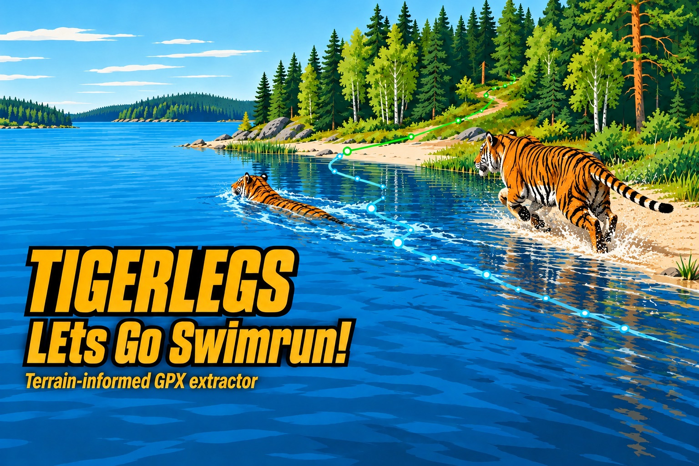

*LEts Go Swimrun! Two partners, one course: running and swimming together.*

This guidebook follows the section structure of Brown's software guidebook (Brown, n.d.-a): lightweight documentation of what you cannot read from the code.
The C4 diagrams (Brown, n.d.-b) form only part of it, namely chapter 6.

## Reading guide

Chapter 1 explains who uses the system and which external systems it relies on; read it first.
Chapter 2 lists what the system does, as user stories, use cases and an example course; read it before you change a feature.
Chapters 3 to 5 describe the quality attributes, constraints and principles that limit your design choices; read them before you make an architecture decision.
Chapter 6 shows the structure of the system, from containers down to the domain model; read it before you add a component.
Chapters 7 to 12 cover code, data, infrastructure, deployment, operation and the development environment; use them as reference.
Chapter 13 links to the architecture decision records (ADRs).
Appendix A defines the domain terms; look there when a term in this guidebook is new to you.
Appendix B maps the domain onto a train journey, to explain the concepts to people outside swimrun.

## 1. Context

This chapter describes why the system exists, who uses it and which external systems it depends on.

A swimrun race alternates between running and swimming.
Organisers publish a GPX file (*GPS Exchange Format*) of the course, but they do not always publish the split into swim and run segments.
Athletes need that split, with distances, to plan their race and to write the numbers on a paddle or wristband.
The system reads a GPX file, detects the segments, computes their distances and shows them on a map and in a table.

The main stakeholders are athletes, race organisers and the maintainers of this project.
Figure 1 shows the system in its environment.

*Figure 1*: System context of TigerLegs.

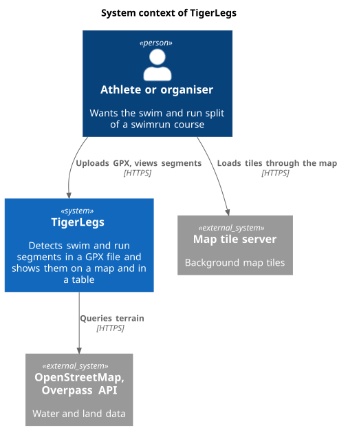

Figure 1 shows that the system has one kind of user and two external data sources.
The athlete never talks to OpenStreetMap directly: the backend queries it and caches the answers.
Live tracking and race results are out of scope.

## 2. Functional overview

This chapter describes what the system does for its users.
The Kiro specs in `.kiro/specs/gpx-swimrun-analyzer/` hold the detailed requirements; this chapter gives the overview.
Section 2.1 maps the user stories to use cases, and section 2.2 shows a real course that the system analyses.
The near-term roadmap is in the README; milestones and the watch-platform strategy are in [ROADMAP.md](./ROADMAP.md) and [PRODUCT_VISION.md](./PRODUCT_VISION.md).

An athlete interacts with the system in four ways.
Each way below is a user story with one acceptance criterion in Given/When/Then form.

1. **Upload a GPX file.** As an athlete, I upload a GPX file so that I see the swim and run segments on a map.
   - Given I opened the page, when I choose a GPX file, then the map shows the track with swim and run segments in different colours.
2. **See distances.** As an athlete, I see the distance per segment and the totals so that I can prepare my race.
   - Given a GPX file with two swims and two runs, when the analysis finishes, then the table shows four distances and a swim and run total.
3. **Link map and table.** As an athlete, I select a map line or a distance in the table so that both views highlight the same segment.
   - Given a segment is shown on the map and in the table, when I click its distance or select its button with Enter or Space, then its map line and table row are highlighted; selecting it again deselects it.
4. **Read a compact table.** As an athlete, I see one row per run and swim pair so that I can write the numbers on a paddle ([ADR-0007](./adr/0007-compact-segment-table-format.md)).
   - Given a course that starts with a run, when the table is shown run-first, then each row shows a run distance and the swim that follows it.

The table defaults to run-first; **Swim first** changes both the pairing and column order.
Each distance is an independently selectable segment, even when two segments share a row.
Map selections scroll the corresponding row into view; Escape clears selection.
Hover still previews a segment when no selection is pinned.
**Cumulative distance** sums the unrounded distances of the displayed segments and shows the result to one decimal place; displayed breaks contribute only when **Include breaks** is enabled.
Incomplete pairs use a dash for the missing distance, and boundary disagreements include a conflict label identifying the resolving strategy.

### Upload and analysis controls

Choose a GPX file or drop exactly one file onto the upload area; both paths use the same validation and analysis pipeline.
For a file with several tracks, the selector lists track names and point counts, and analysis waits for the athlete to choose a non-empty track.
Only that track supplies coordinates, timestamps, distances and the terrain query area.
**Waypoints** and **Speed** are enabled by default; **Use terrain data** remains off until explicitly enabled.
Strategies without usable data are reported in the status area.
Disabling the last local strategy is rejected with a message and retains the results.
Terrain can always be switched off: if it was the only enabled strategy, local speed analysis is re-enabled instead of forcing terrain back on.
Changing the file or track, or disabling terrain, cancels the pending terrain request; late replies cannot overwrite the current selection.

The GPX parser runs in a Web Worker so parsing itself does not block the page.
Analysis also runs in the worker for a selected track with more than 10,000 points.
Files with more than 50,000 points across all tracks require confirmation before analysis; cancelling retains the previous results.
More than 100 waypoints produces a warning but does not block analysis.
The status area reports analysis duration and worker usage, while the large-file notice remains visible during and after processing.
These controls require no backend; GitHub Pages serves the worker bundle alongside the app.
External Overpass response time is separate from local analysis time, and an unavailable service produces a visible error while retaining local results.

Behind these stories, the system detects segments with three strategies, which Table 1 lists.

*Table 1*: Strategies for detecting swim and run segments.

| Strategy | Evidence | Needs |
| --- | --- | --- |
| Waypoint | `<sym>` codes or names on waypoints | Waypoints in the GPX file |
| Speed | Speed drops when swimming | Timestamps on trackpoints |
| Landscape | Water or land at sampled coordinates | The terrain API |

The waypoint strategy is the most precise when the organiser marked the swim starts and ends.
The speed strategy works for any recorded activity, but speed is only indirect evidence.
The landscape strategy needs no extra data in the file, but it depends on OpenStreetMap and on how dense the trackpoints are.
The strategy combiner keeps, per trackpoint, the result with the highest confidence.

The system also shows aid stations, handles files with several tracks and filters GPS noise during swims; the Kiro specs describe these features.

### 2.1 Use cases

The user stories above describe what an athlete wants; the use cases below describe the features the system offers for it.
Table 2 lists the six use cases, who uses them and which user story and Kiro requirement each one implements.

*Table 2*: Use cases and the stories and requirements behind them.

| Use case | Actors | User story | Requirement |
| --- | --- | --- | --- |
| UC-1: Upload a GPX file | Athlete, organiser | US-1 | Req 1 |
| UC-2: View segment distances | Athlete, organiser | US-3, US-5 | Req 3, 5 |
| UC-3: View the course map | Athlete | US-4 | Req 4 |
| UC-4: Highlight a segment | Athlete | US-6 | Req 6 |
| UC-5: View aid stations | Athlete | US-8 | Req 8 |
| UC-6: Select a track | Athlete | US-9 | Req 9 |

Use cases UC-2 and UC-3 include UC-1, because both need an uploaded file.
UC-4, UC-5 and UC-6 extend the use case they build on: highlighting and aid stations extend the map, and track selection extends the upload.

In Cockburn's goal levels these six sit below sea level: uploading a file is a subfunction (fish level), and the others are features inside one larger goal (Cockburn, 2001).
The sea-level goals — one sitting, after which the user goes away satisfied — are: **analyse a swimrun course** (upload, map and distances together), **prepare paddle race notes** ([ADR-0007](./adr/0007-compact-segment-table-format.md)), **verify a designed course** (the organiser's goal) and, planned, **follow the course mid-race** on a watch ([spec 001](../specs/001-garmin-datafield/spec.md)).
Figure 2 shows these sea-level use cases with their actors; Overpass and Garmin Connect appear as supporting actors, which replaces the single "Uses" arrow of the context diagram with one arrow per goal.

*Figure 2*: Sea-level use case diagram.

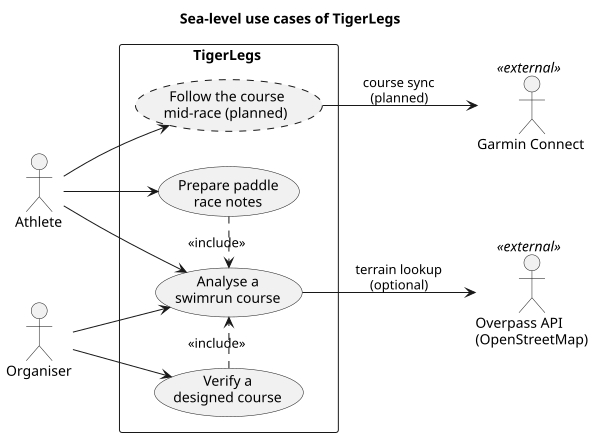

Figures 3 and 4 give a system sequence diagram for the two central goals, following Larman (2005): the system stays a black box and only the system events of the main success scenario appear, so these diagrams belong here with the requirements.
Design-level interaction diagrams, which open the black box, belong in chapter 7 once the components they show exist.

*Figure 3*: System sequence diagram of *Analyse a swimrun course*.

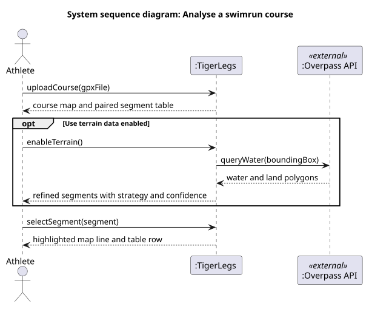

*Figure 4*: System sequence diagram of *Follow the course mid-race* (planned).

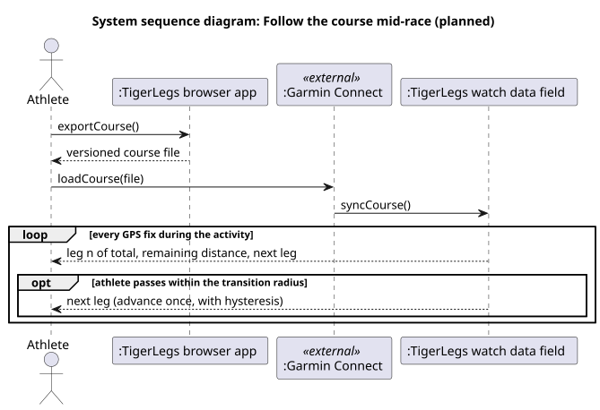
The Kiro specs number these stories and requirements.
Two further stories, US-2 (waypoint classification) and US-7 (GPX round-trip integrity), are internal processing steps that no user starts, so they are not use cases.
Accessibility (Req 10) and performance (Req 11) are quality attributes and apply to all use cases; chapter 3 covers them.

### 2.2 Example course: Vertical SwimRunMan Laffrey 2026

The Vertical SwimRunMan Laffrey 2026 is the main test course.
It starts with a swim, which is unusual: most swimruns start with a run.
Table 3 gives the segment distances as the organisers published them.

*Table 3*: Published segment distances of the Vertical SwimRunMan Laffrey 2026.

| # | Run (km) | Swim (m) | Cumulative (km) |
| --- | --- | --- | --- |
| 1 | | 400 | 0.4 |
| 2 | 5.2 | 400 | 5.6 |
| 3 | 0.3 | 2200 | 6.3 |
| 4 | 1.4 | 400 | 9.9 |
| 5 | 0.2 | 600 | 10.5 |
| 6 | 6.7 | 1000 | 17.8 |
| 7 | 4.9 | 1100 | 23.7 |
| 8 | 6.1 | | 29.1 |
| **Total** | 24.8 | 6100 | 30.9 |

The test file is `test-data/vertical_swimrunman_2026-22910326-1781510068-71.gpx`.
On a comparable Laffrey file the system measured 24.7 km of running and 6250 m of swimming, so its swim total is 150 m longer than the published one.
The cause is not yet known.

Athletes write the numbers on a paddle or wristband, so a table with one row per swim and run pair is easier to copy ([ADR-0007](./adr/0007-compact-segment-table-format.md)).
Table 4 shows the same course in that form, with the swim first.

*Table 4*: The same course as swim and run pairs, swim first.

| # | Swim (m) | Run (km) |
| --- | --- | --- |
| 1 | 400 | 5.2 |
| 2 | 400 | 0.3 |
| 3 | 2200 | 1.4 |
| 4 | 400 | 0.2 |
| 5 | 600 | 6.7 |
| 6 | 1000 | 4.9 |
| 7 | 1100 | 6.1 |
| **Total** | 6100 | 24.8 |

A course that starts with a run would show the run first by default, and a toggle would swap the order.
Figure 5 shows the paddles that the organisers published for this course.

*Figure 5*: Swimrun paddles with the segment distances of the Laffrey course.

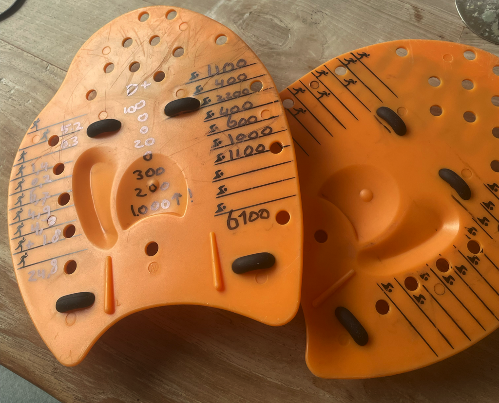

## 3. Quality attributes

This chapter lists the qualities that matter most, so that you can judge a design choice against them.

The system prioritises the following qualities:

- **Privacy.** The browser analyses the GPX file and does not upload it, because location data is personal data ([ADR-0004](./adr/0004-host-deno-backend-on-eu-vps.md)).
- **Responsiveness.** A typical file should be analysed in under five seconds ([ADR-0003](./adr/0003-gpx-analysis-execution-location.md)).
- **Accuracy.** Segment distances should match the published distances.
- **Accessibility.** Requirement 10 in the Kiro specs sets the accessibility requirements.
- **Testability.** Property-based tests cover the analysis and the API validation.

Accuracy deserves a note: on the Vertical SwimRunMan test file the system finds 14 segments, 24.7 km of running and 6250 m of swimming, against 24.8 km and 6100 m published.
The swims come out 50 to 150 m longer than published.
The cause is not yet known; waypoint placement is a hypothesis.

### 3.1 Sampling gap on sparse tracks

The landscape strategy asks the terrain API about a sample of the trackpoints.
`sampleCoordinates` picks existing trackpoints and does not interpolate.
The *gap* between two consecutive samples is therefore at most the sampling interval plus the largest step between two trackpoints.

A *sparse track* has trackpoints that lie far apart, so its gap is large and a short swim can fall between two samples.
The property test "Property 17.3" in `test/client/landscape-client.test.ts` checks this bound.
It first asserted a maximum of twice the interval, which was wrong for sparse tracks, and now asserts the interval plus the largest step.
Interpolating between trackpoints would give a guaranteed maximum gap; the team has not decided on that yet.

The problem resembles the Nyquist–Shannon sampling idea: you can only detect a feature if you sample more densely than the feature is long.
This guidebook gives no exact factor, because it has no verified source for one.

## 4. Constraints

This chapter lists the choices that the team did not make freely.

The following constraints apply:

- The system runs on Deno and TypeScript ([ADR-0002](./adr/0002-use-deno-with-typescript.md)), so browser and server share code.
- The system uses an open-source GIS stack: OpenStreetMap, Leaflet and custom Haversine code ([ADR-0006](./adr/0006-open-source-gis-stack.md)).
- The backend runs on a VPS in the EU, because location data is personal data under GDPR ([ADR-0004](./adr/0004-host-deno-backend-on-eu-vps.md)).
- GPX files can be up to 10 MB with up to 50,000 trackpoints ([ADR-0003](./adr/0003-gpx-analysis-execution-location.md)).
- A planned Garmin Connect IQ data field shapes the data the web app must export. The watch app would be written in Monkey C with the Connect IQ SDK, and during a race it would show the remaining and total distance of the current segment, the segment number out of the total (for example 3/15) and whether it is a swim or a run. The web app must therefore export segments in a format the watch can import, such as a FIT course or a JSON file loaded through Garmin Connect.

## 5. Principles

This chapter lists the rules that guide design choices when no constraint decides.

- **Analyse on the client.** The server proxies terrain data and nothing more.
- **Privacy by design.** Privacy is a design rule, not a setting added later (Cavoukian, 2011). Concretely: (1) the GPX file is analysed in the browser and never uploaded; (2) the default is the most private mode, speed-only analysis with no network call about the track; (3) terrain data is opt-in, behind a toggle that warns the user before anything is sent; (4) what is sent is minimal and coarse, a bounding box snapped outward to a grid of about 5 km (`BBOX_GRID_DEG` in `src/client/water.ts`), never the trackpoints, and the device location is never read; (5) the third party that receives the request (Overpass) also sees the IP address, and the interface says so; (6) no real accounts, cookies or analytics exist, and the only stored values are the language choice in `localStorage` and the flag of the prototype's fake login in `sessionStorage` (see "Fake it till you make it"). Planned privacy-friendly analytics (issue #11) will change this point and must be opt-in or cookieless and documented here first. A bounding box still reveals roughly where the track is, because it comes from the track. A bigger margin would not change that, so the opt-in and the coarse grid carry the protection.
- **One source of truth for configuration.** Ports and origins live in `src/server/config.ts`, so changing a port touches one line.
- **Use the domain language.** Names in code follow the glossary in Appendix A.
- **Navigate with links, not buttons.** Every page shares a header menu with links to *Extractorrr* (with the tiger growl) and *About*, and the current page is marked. Pages have no "back to" buttons. Buttons trigger actions on the current page, links move between pages.
- **Fake it till you make it.** Before building an expensive feature, we may show a believable prototype of it to see whether anyone cares (a fake-door test). Today the chatbot (section 7.2) answers a fixed FAQ, the profile page (section 7.3) has a fake login with one static profile, and the training week (section 7.5) rearranges a hardcoded week without a server. Rules: a fake is labelled as a prototype in the interface, it never collects real personal data, it hides behind a replaceable interface so the real implementation drops in later, and we measure its usage (planned, issue #11) before deciding to build the real thing.
- **Scroll-linked effects never hijack scrolling.** Visual effects may follow the scroll position, but the page always scrolls natively and the effect is decoration only (see section 7.1). Content stays readable without it.
- **Show system status.** Whenever the system is working and the user waits, the interface shows it. This is Nielsen's first usability heuristic, *visibility of system status* (Nielsen, 1994). In the chat it takes the form of a *typing indicator* (section 7.2). The indicator is also announced to screen readers, and it does not animate for people who prefer reduced motion.
- **Document decisions.** Significant choices get an ADR, and the team writes documentation in English.

### 5.1 Documentation approach

This project writes its documentation next to the code and keeps it current as part of the work.
Preston-Werner (2010) advises: "Write your Readme first."
That part is done here: the README describes the tool, so what remains is keeping it true.
We call the practice of maintaining the documents together with the code *continuous documentation*; this is our own term and has no external source.
Documentation is part of the definition of done: a change is finished when the README, guidebook or ADR that it affects is up to date.
The full checklist is in [DEFINITION_OF_DONE.md](./DEFINITION_OF_DONE.md) and is repeated as checkboxes in the GitHub issue and pull request templates.
Task descriptions live in GitHub issues, not in the repository.

Table 5 lists the documents and the question each one answers.

*Table 5*: Documents and the questions they answer.

| Document | Where | What it shows |
| --- | --- | --- |
| README | [README.md](../README.md) | What the tool is and how to run it |
| Software guidebook | this file | Context, structure, domain model and glossary |
| Architecture decision records | [docs/adr/](./adr/) | Why we chose a design, and what we rejected |
| Specifications | [.kiro/specs/](../.kiro/specs/) | Requirements, design and tasks per feature |
| Source code and tests | [src/](../src/), [test/](../test/) | What the system does, in executable form |

The first four documents explain what, how and why, while the code and tests are the only part that is guaranteed to be current.

The source code also explains itself, in the spirit of literate programming.
Knuth (1984) wanted programs written as essays, with prose and code woven into one source.
We keep prose and code in separate files and use names, types and tests to make the code readable, which is closer to self-documenting code than to Knuth's method.

## 6. Software architecture

This chapter shows the structure of the system in three levels: containers (6.1), components (6.2) and the domain model (6.3).

### 6.1 Containers

Figure 6 shows the two containers and how they communicate.

*Figure 6*: C4 container diagram.

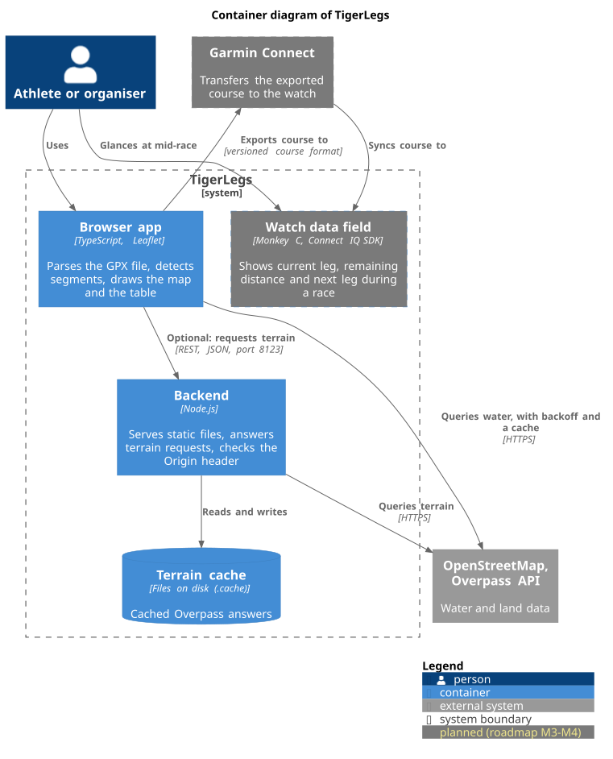

The browser app does the analysis and draws the map. Astro generates static HTML during the build; React owns the interactive extractor. GitHub Pages serves the resulting assets without a runtime application backend. The current Pages app requests terrain directly from Overpass only after opt-in.

The diagram also shows the optional Deno terrain API, not a requirement of the Pages deployment. That API checks the `Origin` header on every API route except the health check and caches terrain answers on disk. The Astro development server uses port 8123; run the optional API separately if testing it, rather than starting both on the same port.

The dashed watch data field is planned, not built ([spec](../specs/001-garmin-datafield/spec.md), roadmap M4).
It would build on the Connect IQ SDK and its Monkey C language; Garmin's developer documentation explains the app types and the simulator (Garmin, n.d.).
It stays a container inside the TigerLegs system rather than a system of its own: in C4 terms a container is a separately deployable unit of one system, and the data field is deployed separately (through the Connect IQ store) but belongs to the same product, team and course model.
Garmin Connect appears as an external system, like Overpass, because it only transports the exported course to the watch.
A separate guidebook or a system landscape diagram becomes worthwhile only if a part grows into its own system with its own team or release cycle, for example the accounts backend of roadmap M9.

### 6.2 Components

Figure 7 shows the components of the browser app and how they depend on each other.
Table 6 lists each component and the file that holds it.

*Figure 7*: C4 component diagram of the browser app.

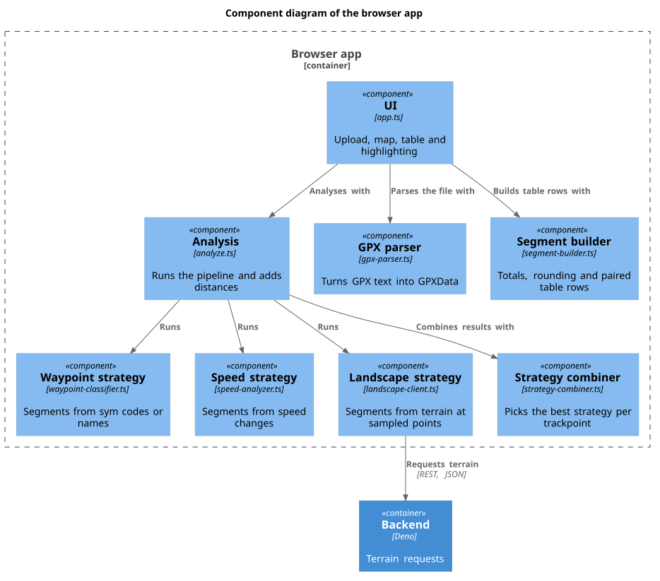

*Table 6*: Components of the browser app.

| Component | File | Responsibility |
| --- | --- | --- |
| GPX parser | `src/client/gpx-parser.ts` | Turns GPX text into `GPXData` |
| Waypoint strategy | `src/client/waypoint-classifier.ts` | Finds segments from `<sym>` codes or names |
| Speed strategy | `src/client/speed-analyzer.ts` | Finds segments from speed changes |
| Landscape strategy | `src/client/landscape-client.ts` | Finds segments from terrain at sampled points |
| Strategy combiner | `src/client/strategy-combiner.ts` | Picks the best strategy per trackpoint |
| Analysis | `src/client/analyze.ts` | Runs the pipeline and adds distances |
| Segment builder | `src/client/segment-builder.ts` | Totals, rounding and paired table rows |
| UI | `src/components/Extractor.tsx`, `CourseMap.tsx`, `SegmentTable.tsx` | React upload, map, table and highlighting |

The analysis component is the entry point for the UI: it runs the strategies that apply, combines them and computes each segment's distance.
The current page skips the landscape strategy, because it needs the backend.
The combiner leaves `distanceKm` at 0; the analysis component fills it in.

### 6.3 Domain model

Figure 8 shows the main domain types, which `src/shared/types.ts` defines.

*Figure 8*: Domain model.

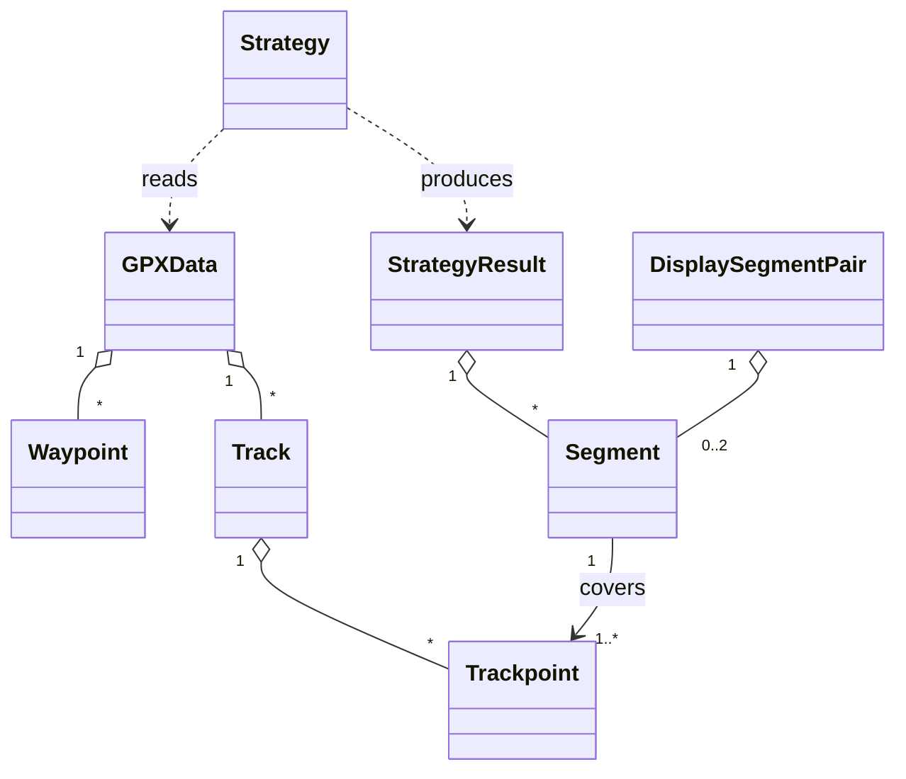

A GPX file holds tracks and waypoints, and a track holds trackpoints.
A strategy reads the file and produces segments, each covering consecutive trackpoints and labelled swim, run or unclassified.
A `DisplaySegmentPair` groups a run and a swim for the compact table.
The planned watch data field adds two runtime types to this model: a `LegProgress` that tracks the current leg and its remaining distance, and a transition detector with hysteresis, so that one noisy GPS fix near a transition cannot advance and regress the leg repeatedly ([spec](../specs/001-garmin-datafield/spec.md), FR-004).
Appendix A defines each term.

### 6.4 Chat domain model

Figure 9 shows the concepts of the prototype chatbot, separate from the course model above.

*Figure 9*: Chat domain model.

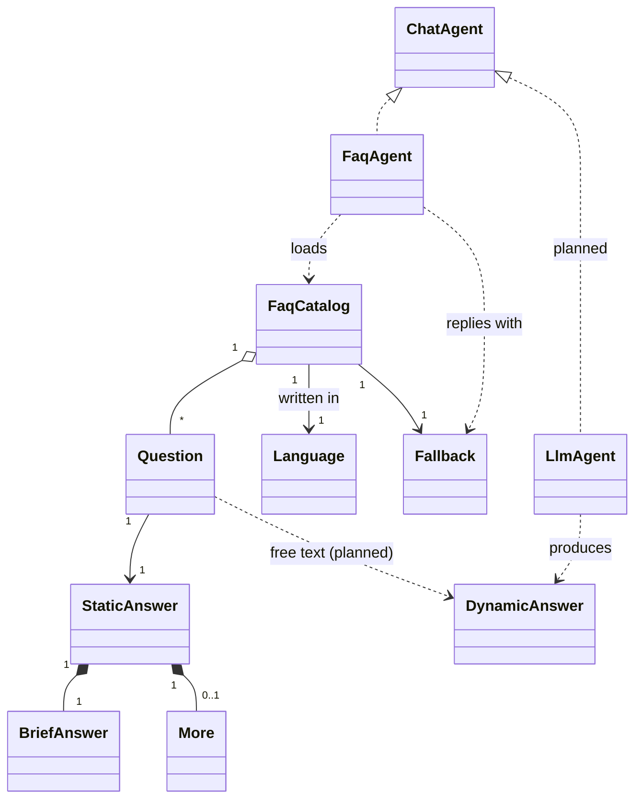

A *question* is a clickable label or free text. The FAQ catalog holds one question per label, each with a static answer: a brief answer, and optionally *more*, which the user asks for with the *Tell me more* follow-up.
There is one catalog per language. Free text gets the fallback today, and a dynamic answer from an LLM agent later. Both agent kinds sit behind the `ChatAgent` interface.

### 6.5 Terrain data paths

Figure 10 shows where the water data comes from and how the optional back end and the planned premium service fit in.

*Figure 10*: Terrain data paths: browser, optional back end and Overpass. The diagram is the PlantUML block below (C4-PlantUML); the Markdown preview, the site and `deno task diagrams` all draw it from that text.

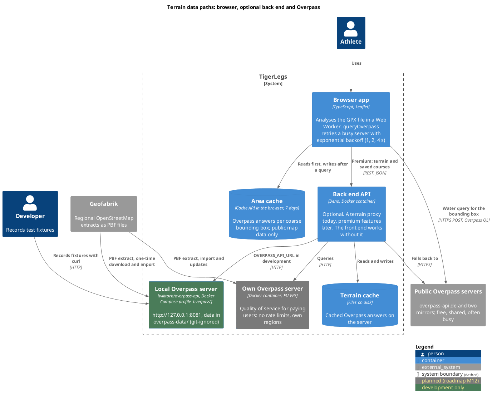

The free path needs no back end: the browser asks a public Overpass server for the water around the track, retries a busy server with exponential backoff, tries the next mirror, and keeps the answer in an area cache for a week.
The query area is a coarse bounding box, so the request reveals the neighbourhood of the track and not the track itself.
The back end is optional ([ADR-0013](./adr/0013-back-end-is-optional.md)); the planned premium service adds our own Overpass server behind it, with a quality of service the public servers cannot give (roadmap M12).
For development a local Overpass container runs from the same `docker-compose.yml` (profile `overpass`), filled once from a Geofabrik extract; see [local-overpass.md](./local-overpass.md).
Overpass speaks plain HTTP with a query in Overpass QL, so the front end and back end can be written in any language; the language choice is the subject of [ADR-0014](./adr/0014-back-end-technology.md).

## 7. Code

This chapter explains how the source code is organised.

The source lives in three folders: `src/client` for the browser, `src/server` for the backend and `src/shared` for types and distance calculation.
Tests sit next to the code (`*.test.ts`) or in `test/`.
Most tests are property-based: they state a rule that must hold for generated inputs, such as the maximum gap between samples.
`deno task build` bundles the browser code into `public/app.js` with `deno bundle`, which is an experimental Deno command.

### 7.1 Front end: the scroll-linked tiger reveal

The About page shows a tiger photo that appears while the reader scrolls down.
This is called a *scroll-linked* (or scroll-driven) animation: an animation whose progress follows the scroll position instead of time.
It is often called *scrolljacking*, but that word strictly speakings means something else: taking over the scroll behaviour of the page, for example by snapping sections or blocking normal scrolling.
We do not do that, because the page scrolls natively and only a visual property changes.

How it works:

- `.tiger-fade` in `src/client/styles.css` is a fixed element at the bottom of the viewport.
Its CSS mask is a `radial-gradient` that is opaque inside a radius and transparent outside it, so the picture seems to grow out of a corner.
- The gradient is centred on the bottom-right corner of the picture, where the tiger swims: `at calc(50% + var(--tiger-w) / 2) 100%`.
The circle uses `farthest-corner`, so it reaches the right side of the picture sooner than the far left side.
- `src/client/about.ts` computes scroll progress (`scrollY` divided by the scrollable height), eases it with `progress ** 2.5` (slow at first, fast near the end, so the picture stays small over the text halfway down) and writes it to the custom property `--reveal` on every scroll event.
The mask radius is a percentage of `--reveal`.
- `::before` is the same photo, stretched and blurred, to fill the sides next to the centred picture so the colours match.
`::after` is the sharp picture; its own horizontal mask fades the left edge over 14% and the right edge over only 6%, so the tiger at the right edge stays visible.

CSS can do the scroll link without JavaScript through `animation-timeline: scroll()`.
We use a small script because browser support for that property is not yet universal.

### 7.2 Front end: the prototype chatbot

The main page has a prototype chatbot, *Ask the tiger*, with clickable FAQ labels (what is swimrun, can tigers swim, segment counts, distances).
It is not an LLM: it answers the fixed questions and replies "There is no actual LLM integration yet" to anything else.

The component `src/components/Chatbot.tsx` depends only on the `ChatAgent` interface in `src/client/chat-agent.ts`.
An agent returns a stream of events (`run-started`, `text`, `run-finished`), a small subset of the AG-UI event types.
`createFaqAgent` is the static implementation. It fetches `public/chat/faq.<lang>.json` (language, *Tell me more* label, fallback text, and the questions and answers) on first use, validates it with `parseFaq`, and pauses before answering so the chat feels like a conversation: the pause grows with the length of the answer, from 0.7 s up to 2.1 s, while the typing indicator shows.
Changing a question or answer is a JSON edit, not a code change.
Each entry has a short `answer` and an optional longer `more`. When `more` exists, the answer comes with a *Tell me more* follow-up button that stays until it is used. A question label leaves the list only once all its answers have been given, so the short answer alone does not remove it.
There is one file per language (`en`, `nl`, `fr`, `de`) with the same entry ids; a unit test checks this parity. The chat follows the page language (the `lang` attribute of `<html>`), has its own typed UI dictionary for strings needed before the JSON loads, and restarts when the language changes.
The chat starts collapsed as a small header button (`aria-expanded`); the FAQ is fetched on the first opening.
While the file loads and while the agent works, the UI shows a *typing indicator* (three bouncing dots, the "somebody is typing" pattern). It follows the principle "Show system status" (chapter 5), has a text alternative for screen readers (`role="status"`), and uses `motion-safe:` so it stands still for people who prefer reduced motion.
A later agent that talks to an LLM over AG-UI can replace it by passing it as the `agent` prop, and tool-call or state events can be added to `ChatEvent` when an agent should drive the UI (issue #10).
Free text from the user is already passed to the agent, so the UI does not change for that either.

### 7.3 Front end: the prototype profile

`/profile.html` shows a fake login. Any input logs you in as one static profile (`BART` in `src/client/fake-session.ts`); no data is sent.
The only state is a flag in `sessionStorage`, kept behind the small `SessionStore` interface so tests can use an in-memory store.
A real identity provider can replace it later without changing the profile component's layout.

### 7.4 Front end: language switch

The language switch is a native `<select>` (flag, code and name for English, Dutch, French and German), which takes less header space than four links. It sits in the shared header in `src/layouts/SiteLayout.astro`, so it is on every page.
`src/client/language-switch.ts` stores the choice in `localStorage` (`tigerlegs-lang`) and sets `data-lang` and `lang` on `<html>`.
`resolveLang` in `src/client/language.ts` picks the saved choice, else the browser language, else English.
Translated content carries a `lang` attribute, and a CSS rule hides every language except the active one.
Pages without translations (the extractor, chatbot and profile) stay English for now.
Each option also shows the code and the language name, because a flag is a country and not a language; the select has an `aria-label`.
Flag emoji do not render on Windows, where the two-letter code shows instead.

### 7.5 Front end: the prototype training week

`/training.html` shows a prototype training week: six hardcoded sessions covering the four swimrun capacities (trail running, open-water swimming, strength, and static and dynamic flexibility).
It explores the training-plan ideation (issue #20, [ADR-0010](./adr/0010-tigerlegs-mcp-server-and-strava-integration.md)); the feature specification lives in [specs/002-training-week-assistant/spec.md](../specs/002-training-week-assistant/spec.md).
The page is labelled as a prototype, nothing is sent anywhere, and confirming a week only keeps it in component state.

The domain lives in `src/client/training-week.ts` as pure, tested functions: `applyMoves` returns a new week and never mutates its input (the GPX rule applied to plans), `changedSessions` diffs a draft against the confirmed baseline, and `parseProposal` validates a model response, dropping moves that name unknown sessions or invalid days.

The week can always be rearranged by hand with a day selector per session — **AI-assisted, not AI-dependent**, the training twin of "terrain-informed, not terrain-dependent".
On top of that, `src/client/prompt-api.ts` wraps Chrome's built-in Prompt API (Gemini Nano): `TrainingWeek.tsx` checks `LanguageModel.availability()` and walks the fallback ladder — no API or `unavailable` shows a note that hand rearranging always works, `downloadable` offers an opt-in download with progress, and `available` shows an instruction field.
A proposal is requested with a JSON-schema `responseConstraint` (move an existing session to another day, with a reason) and shown as a diff the athlete applies or dismisses; the athlete confirms the week explicitly.
The proposal is evidence; the confirmation is the label.
The schedule never leaves the device: the model runs locally and Chrome owns its download and updates.
The UI follows the page language in all four site languages, but the model itself understands English, French and German, not Dutch (ADR-0010), so the interface says so.
The component takes the model as an optional prop, so tests and Storybook stories inject a fake and the real browser API stays at the edge.

## 8. Data

This chapter describes where the system keeps data.

The system has no database.
The browser keeps the GPX file in memory only.
The backend caches terrain answers on disk in `.cache/`, which Git ignores.

### 8.1 GPX input conventions

The GPX format (GPS Exchange Format) is an open XML schema for exchanging GPS data between applications and devices.
TopoGrafix created it in 2002, and file-extensions.com (n.d.) calls it "the de facto standard for interchange of GPS data".

Each waypoint (`<wpt>`) can contain a `<sym>` element with a symbol name.
The GPX 1.1 specification defines `<sym>` as free-form text, so there is no standard list of values (TopoGrafix, 2004).
Route planners therefore use their own conventions.
Table 7 lists the numeric `<sym>` values in the test files, which come from the route planner Openrunner.

*Table 7*: Waypoint `<sym>` values in Openrunner files.

| `<sym>` value | Meaning |
| --- | --- |
| `200` | Start of a swim section |
| `201` | End of a swim section |
| `3` | Aid station (ravitaillement) |
| `206` | Start of a vertical kilometre |
| `49` | Hot food aid station |

These numeric codes are not part of the GPX standard, and other applications such as Garmin, Komoot or Strava may use other schemes.
The system detects swims in two ways: it first matches `<sym>` 200 and 201, and falls back to waypoint names that start with "Début SWIM" or "Fin SWIM".
Support for other conventions, such as the files from racedaymap.com that ÖTILLÖ uses, needs a look at their waypoints first.

## 9. Infrastructure architecture

This chapter describes where the system runs.

The frontend is a static GitHub Pages site at `https://swimrun.group/tigerlegs/`. Astro and Node run during the build, not on the hosting platform. GPX processing runs on the visitor's device.

[ADR-0004](./adr/0004-host-deno-backend-on-eu-vps.md) records an EU VPS option for a future backend. It is not the current frontend infrastructure. A reverse proxy such as Caddy or nginx would add HTTPS in front of that optional service; local static development needs no proxy.

## 10. Deployment

This chapter describes how the system reaches production.

`.github/workflows/pages.yml` installs npm dependencies, runs Deno tests, builds the Worker/assets and Astro pages, checks site types, and runs Playwright browser tests on pull requests and pushes to `main`. Only `main` publishes `dist/` to GitHub Pages. Feature branches do not deploy automatically.

The build generates `index.html`, `about.html`, `guidebook.html` and one HTML page per ADR. Public links and assets use the `/tigerlegs/` base path; direct navigation does not require a backend router or a 404 SPA fallback. The `README.md` in the repository root holds the build/preview commands.

## 11. Operation and support

This chapter describes how to monitor the system.

The static frontend has no application-server health endpoint. GitHub Actions reports build/test/deployment status.

The optional Deno API exposes `GET /api/v1/health`; it needs no `Origin` header, so a monitor can call it when that service is deployed.

## 12. Development environment

This chapter lists what you need to work on the code.

You need Deno, npm and Node.js 22.23.4 or newer; `.nvmrc` pins Node 24, which CI also uses (`nvm use` picks it up). Run `npm ci` first; npm manages the dependency tree used by both the site build and Deno tests.

`deno task dev` prepares the Worker, samples and styling, then starts Astro at `http://localhost:8123/tigerlegs/`. `deno task build` generates the production site in `dist/`; `npm run preview` serves that build locally. No API service is needed for these workflows.

`deno test -A` runs analysis and documentation unit/integration tests. `npm run check` checks the Astro/React code. After building and installing Chromium with `npx playwright install chromium`, `npm run test:site` checks static deep links, ADR publication, React imports/selection, Worker thresholds, terrain consent and mobile layout on a plain static server.

### 12.1 Test strategy

Tests follow the test pyramid: many fast tests at the bottom, few slow ones at the top.

| Level | Tool | Location | What it covers |
|---|---|---|---|
| Unit and property-based | Deno test runner, `@std/assert`, fast-check | `test/client/`, `test/shared/` | Pure domain functions: GPX parsing, classification, confidence, chat agent, session store, language resolution |
| Integration (back end) | Deno test runner | `test/server/` | The Overpass proxy and its cache |
| End-to-end | Playwright on the built static site | `test/site/` | Deep links, menu, language switch, fake login, terrain consent, mobile layout |

Rules:

- Put logic in pure functions under `src/client/` so that it is tested at the bottom of the pyramid; keep React components thin.
- Property-based tests use representative GPX fixtures from `test-data/`.
- Add an end-to-end test only for behaviour that needs a real browser.
- React components have stories in Storybook (`npm run storybook`, files `src/components/*.stories.tsx`). Each story is also a component test: `npm run test:a11y` runs every story in Chromium through Vitest and fails on any axe accessibility violation (`a11y.test: "error"` in `.storybook/preview.ts`). The *Accessibility* panel in Storybook shows the same findings while developing.
- Automated checks find only part of the accessibility problems (roughly a third to a half). Keyboard use, focus order and screen-reader wording still need a manual check.
- Not yet covered: `Extractor` and `CourseMap` (Leaflet, web worker and map tiles need mocks), and the Astro pages and layout, which Storybook does not render.
- A change is done only when `deno task test`, `deno task build` and (for site changes) `npm run test:site` pass; see [DEFINITION_OF_DONE.md](./DEFINITION_OF_DONE.md).

## 13. Decision log

This chapter lists the ADRs, which hold the reasoning behind the architecture.

Table 8 lists the ADRs and what each decides.

*Table 8*: Architecture decision records.

| ADR | Decision |
| --- | --- |
| [0001](./adr/0001-record-architecture-decisions.md) | Record architecture decisions |
| [0002](./adr/0002-use-deno-with-typescript.md) | Use Deno with TypeScript |
| [0003](./adr/0003-gpx-analysis-execution-location.md) | Choose where the GPX analysis runs |
| [0004](./adr/0004-host-deno-backend-on-eu-vps.md) | Host the backend on an EU VPS |
| [0005](./adr/0005-rest-json-api-for-multi-client-support.md) | Offer a REST/JSON API |
| [0006](./adr/0006-open-source-gis-stack.md) | Use an open-source GIS stack |
| [0007](./adr/0007-compact-segment-table-format.md) | Show a compact paired segment table |
| [0008](./adr/0008-astro-static-site-with-react-islands.md) | Astro static pages with a React-based interactive frontend; compare alternatives using multi-criteria decision making |
| [0009](./adr/0009-react-for-interactive-frontend.md) | Use React for the interactive frontend; owner familiarity and learning goals, compared with Vue, Angular and other options |
| [0010](./adr/0010-tigerlegs-mcp-server-and-strava-integration.md) | Draft: expose training data through a TigerLegs MCP server with Strava as a data source; no decision yet |
| [0011](./adr/0011-model-lifecycle-and-think-thread-for-on-device-chat.md) | Draft: separate the one-off model download from the per-prompt think thread in the on-device chat; no decision |
| [0012](./adr/0012-persistent-chat-across-pages.md) | Proposed: keep the chat across pages with Astro view transitions and a persisted island |
| [0013](./adr/0013-back-end-is-optional.md) | Draft: the back end is optional and a premium feature; the front end works without it; no decision |
| [0014](./adr/0014-back-end-technology.md) | Draft: back-end technology compared with multi-criteria decision making (Deno, Node.js, Python, Java 25 with Spring Boot, Micronaut, Quarkus or Javalin, .NET 10, Go); no decision |

ADR-0008 implements a shared Astro layout and directly linkable HTML pages, with the interactive extractor implemented in React and no runtime backend. Astro itself is not React-based; it supplies static page composition around the React application. Existing TypeScript analysis modules remain reusable. All ADRs are built into HTML pages and linked from this chapter. The ADR includes a provisional weighted comparison of the previous Deno-only site build, Astro, Next.js static export, Vite + React SPA and Eleventy, following the [ICT Research Methods multi-criteria decision making method](https://ictresearchmethods.nl/workshop/multi-criteria-decision-making/).

## References

Brown, S. (n.d.-a). *The software guidebook*. Leanpub. https://leanpub.com/documenting-software-architecture

Brown, S. (n.d.-b). *The C4 model for visualising software architecture*. https://c4model.com/

Cavoukian, A. (2011). *Privacy by design: The 7 foundational principles*. Information and Privacy Commissioner of Ontario. https://www.ipc.on.ca/wp-content/uploads/resources/7foundationalprinciples.pdf

Cockburn, A. (2001). *Writing effective use cases*. Addison-Wesley.

file-extensions.com. (n.d.). *GPX file format*. Retrieved June 15, 2026, from https://file-extensions.com/docs/gpx

Garmin. (n.d.). *Connect IQ basics*. Retrieved November 1, 2026, from https://developer.garmin.com/connect-iq/connect-iq-basics/

Geofabrik. (n.d.). *OpenStreetMap data extracts*. Retrieved November 10, 2026, from https://download.geofabrik.de/

Gruber, T. (2008). Ontology. In L. Liu & M. T. Özsu (Eds.), *Encyclopedia of Database Systems*. Springer. https://tomgruber.org/writing/definition-of-ontology

ICT Research Methods. (n.d.). *Multi-criteria decision making*. Retrieved November 10, 2026, from https://ictresearchmethods.nl/workshop/multi-criteria-decision-making/

Knuth, D. E. (1984). Literate programming. *The Computer Journal, 27*(2), 97–111. https://doi.org/10.1093/comjnl/27.2.97

Larman, C. (2005). *Applying UML and patterns: An introduction to object-oriented analysis and design and iterative development* (3rd ed.). Prentice Hall.

Nielsen, J. (1994). *10 usability heuristics for user interface design*. Nielsen Norman Group. https://www.nngroup.com/articles/ten-usability-heuristics/

OpenStreetMap Wiki. (n.d.-a). *PBF format*. Retrieved November 10, 2026, from https://wiki.openstreetmap.org/wiki/PBF_Format

OpenStreetMap Wiki. (n.d.-b). *Overpass API*. Retrieved November 10, 2026, from https://wiki.openstreetmap.org/wiki/Overpass_API

OpenStreetMap Wiki. (n.d.-c). *Overpass API/Overpass QL*. Retrieved November 10, 2026, from https://wiki.openstreetmap.org/wiki/Overpass_API/Overpass_QL

Preston-Werner, T. (2010, August 23). *Readme Driven Development*. https://tom.preston-werner.com/2010/08/23/readme-driven-development.html

TopoGrafix. (2004). *GPX 1.1 schema documentation*. https://www.topografix.com/GPX/1/1/

## Appendices

### Appendix A: Glossary

This appendix defines the domain terms, so that you can look up a term when you meet it.

Table 9 lists the terms in the order in which you meet them when you follow a GPX file through the system.

*Table 9*: Domain glossary.

| Term | Meaning | Example |
| --- | --- | --- |
| Track | Ordered recording of positions of the whole course | The Vertical SwimRunMan GPX holds one track |
| Trackpoint | One position in a track, with latitude, longitude and optional elevation and time | `lat="54.4" lon="13.4"` |
| Waypoint | A named point of interest, separate from the track | "Début SWIM" |
| `<sym>` | Symbol code on a waypoint; 200 marks a swim start and 201 a swim end | A waypoint with `<sym>200</sym>` starts a swim |
| Segment | Consecutive trackpoints that are all swim or all run, with a distance | Swim of 400 m |
| Swim, run, unclassified | The three labels a segment can have | Run of 2.1 km |
| Transition | The point where one segment ends and the next begins | The beach exit after a swim |
| Hysteresis | Memory in a threshold decision: once a transition counts as passed, nearby noisy GPS fixes cannot un-pass it | The watch advances to leg 5 once, even when swim-degraded GPS jitters around the transition radius |
| Distance to next transition | Distance along the track from a position to the next transition | "Next transition in 1.2 km" |
| Question | A prompt the athlete sends to the chat, by clicking a label or typing | "But can tigers actually swim?" |
| Static answer | A fixed answer from the FAQ catalog, consisting of a brief answer and optionally more | The tiger answer in `faq.en.json` |
| Brief answer | The short first reply to a question | "Yes. Tigers are among the few big cats that like water." |
| More | The longer second reply, offered through the *Tell me more* follow-up | Why swimrun courses vary in distance |
| Dynamic answer | An answer an LLM generates for a free-text question (planned, issue #10) | A reply about a specific wetsuit |
| Fallback | The reply to free text while no LLM is integrated | "There is no actual LLM integration yet.." |
| Language | One of English, Dutch, French or German; each has its own FAQ catalog | `faq.nl.json` |
| Strategy | A method to detect segments: waypoint, speed or landscape | Waypoint strategy |
| Confidence | How sure a strategy is about a trackpoint; the combiner keeps the highest | 0.9 from waypoints beats 0.4 from speed |
| Terrain | Land or water at a coordinate, from OpenStreetMap | A lake point returns water |
| Sampling interval | Wanted distance between sampled trackpoints for terrain queries | 50 m |
| Gap | Distance between two consecutive samples | With a 50 m interval and 200 m steps, the gap can exceed 50 m |
| Sparse track | Track whose trackpoints lie far apart | A watch that records every 200 m |
| Paired segment table | Table with one row per run and swim pair ([ADR-0007](./adr/0007-compact-segment-table-format.md)) | Row: run 2.1 km, swim 400 m |
| Run-first, swim-first | Which segment type opens a paired row; run-first is the default | A toggle above the table |
| Aid station | Food and drink point, usually on land | A waypoint on a run |

Table 10 defines the terms about map data, the terrain service and the infrastructure around it, in alphabetical order.

*Table 10*: Map data and infrastructure glossary.

| Term | Meaning | Example |
| --- | --- | --- |
| Area cache | Browser store of the Overpass answers per coarse bounding box, kept for a week, so a second analysis of the same area needs no request; it holds public map data only, never GPX content | The Cache API entry for one 0.05 degree grid cell |
| Bounding box (bbox) | Rectangle on the map given by its south, west, north and east edge; an Overpass query is limited to one | `52.15,4.85,52.35,5.05` |
| Coarse bounding box | The track's bounding box grown outward to a 0.05 degree grid (about 5 km), so the request shows the neighbourhood of the track and not the track itself | The query area for the Rondje Eilanden |
| Container, image | A container is an isolated process started from an image, which packages a program with what it needs to run; the same image runs on a laptop and on a server | The back end image built from the `Dockerfile` |
| Docker Compose, profile | A Compose file describes several containers that run together; a profile marks services that start only when asked for | The local Overpass server, profile `overpass`, in `docker-compose.yml` |
| Exponential backoff | Retrying a request after a wait that doubles each time (here 1, 2 and 4 seconds), as busy Overpass servers ask for | A 502 answer is followed by a retry after 1 s |
| Extract | The OpenStreetMap data of one region as a file, a part of the complete planet file | The Netherlands extract |
| Fixture | Recorded data that a test uses instead of asking the outside world | `test/fixtures/rondje-eilanden-overpass.json` |
| Geofabrik | A German company that processes OpenStreetMap data and publishes ready-made regional extracts for download | `download.geofabrik.de/europe/netherlands-latest.osm.pbf` |
| Mirror | Another public Overpass server with the same data, tried when the first one is busy | `overpass.kumi.systems` |
| Multi-criteria decision making (MCDM) | Choosing between options by judging each against weighted criteria, and iterating between judging the options and adjusting the criteria | The weighted comparison of back-end technologies in [ADR-0014](./adr/0014-back-end-technology.md) |
| OpenStreetMap (OSM) | The open, collaboratively edited map database that TigerLegs takes its water data from, under the ODbL licence | A lake drawn as a `natural=water` area |
| Oracle test | A test that compares the extractor with an official, independent result | The ÖTILLÖ Cannes split from RaceDayMap |
| Overpass API | A read-only service that answers queries on OpenStreetMap data | `overpass-api.de` |
| Overpass QL | The query language of the Overpass API | `way["natural"="water"](bbox);out geom;` |
| PBF | Protocolbuffer Binary Format, a compact binary file format for OpenStreetMap data, smaller and faster to read than the XML formats, so the usual format of downloads | `netherlands-latest.osm.pbf` |
| Quality of service | What a user can rely on from a service, such as availability and speed; the planned premium Overpass server offers more of it than the shared public servers | No rate limit on our own server |
| Ratchet | A passing test that pins today's error of an approach, so a change may make it smaller but not larger | The pinned swim and run error of the speed strategy on the Rondje Eilanden |

Sources: PBF (OpenStreetMap Wiki, n.d.-a), Geofabrik (Geofabrik, n.d.), Overpass API and Overpass QL (OpenStreetMap Wiki, n.d.-b, n.d.-c), multi-criteria decision making (ICT Research Methods, n.d.).

The terms form a chain: a track has trackpoints, a strategy turns them into segments, segments of different terrain meet at transitions, and paired rows group segments for display.
The Kiro specs contain a longer glossary with the formal definitions.
Two terms are easy to confuse: a waypoint is a named point outside the track, while a trackpoint is part of the recorded line.

### Appendix B: Ontology mapping to a train journey

This appendix maps the domain concepts onto a train journey, so that readers who do not know swimrun can recognise the structure.

Gruber (2008) defines an ontology as follows: "an ontology defines a set of representational primitives with which to model a domain of knowledge or discourse" and "the representational primitives are typically classes (or sets), attributes (or properties), and relationships (or relations among class members)."
The glossary in Appendix A is such a small ontology.
Its classes are Track, Trackpoint, Segment, Terrain and Transition.
Its attributes include segment distance, trackpoint coordinate and confidence.
Its relations include *a track has trackpoints*, *a segment covers trackpoints* and *a segment precedes a segment*.

An ontology mapping relates the concepts of one domain to equivalent concepts in another.
A train journey fits, because it has the same structure: a route that someone records as positions, stretches with different surfaces (open track, bridge, tunnel) and a "next ... in x km" display.
The analogy is my own choice, not a published ontology.
Table 10 shows the mapping and names where it breaks down.

*Table 10*: Mapping of swimrun concepts to a train journey.

| SwimRun concept | Train journey equivalent | Where the analogy breaks |
| --- | --- | --- |
| Track | The recorded journey from A to B | A race course is fixed; a journey is one run of a timetable |
| Trackpoint | One position fix of the train | None |
| Waypoint | A station or signal on the line | Stations come from the timetable, not from the recording |
| `<sym>` 200 and 201 | Marker for tunnel entrance and exit | Symbol codes are specific to Garmin |
| Segment | A stretch of line with one surface, such as a tunnel | Swim and run alternate by design; tunnels are exceptions |
| Swim and run | Tunnel and open track | Both domains have two main classes |
| Transition | A tunnel portal | Athletes change gear at a transition; trains do not |
| Distance to next transition | "Next station in 3.2 km" | A train display counts stations, not surface changes |
| Waypoint strategy | Read the timetable and the signal list | Needs that data to exist |
| Speed strategy | Notice that the train slows down in a tunnel | Speed is weak evidence in both domains |
| Landscape strategy | Look up the line on a map to find the tunnel | Needs an external map |
| Sampling interval and gap | Check the map every 500 m and miss a 200 m tunnel | None |
| Sparse track | A recording with one ping per minute | None |

The mapping shows the core concept: a classified stretch of a route, with a boundary where the class changes.
The landscape strategy performs the mapping from the track domain to the terrain domain: it maps a trackpoint coordinate to a terrain class through OpenStreetMap.
The mapping also exposes a gap in the train analogy: a train has no equivalent of the paired segment table, because that table only serves athletes who write numbers on a paddle.

The "next transition in x km" on a sports watch is generic.
It applies to any track whose points are classified as water or land, not to one course:

> distance to next transition(p) = length of the track from p to the first trackpoint after p whose terrain differs from the terrain at p.

Only the instance changes per race.

#### Worked instance: SwimRun Rhederlaag

To do: add the Rhederlaag GPX under `test-data/`, run it through the analysis and list the real transitions here, with the distance to the next transition at a few positions.
The instance will use the same classes as above: a course as the track, ordered segments, transitions and distance-to-next values.
