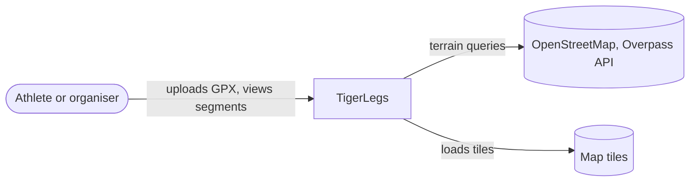
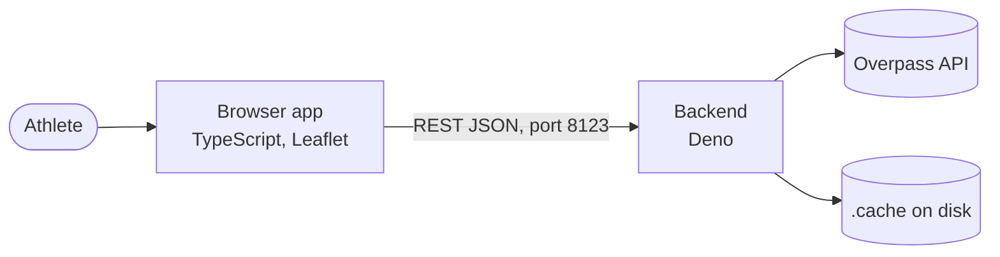
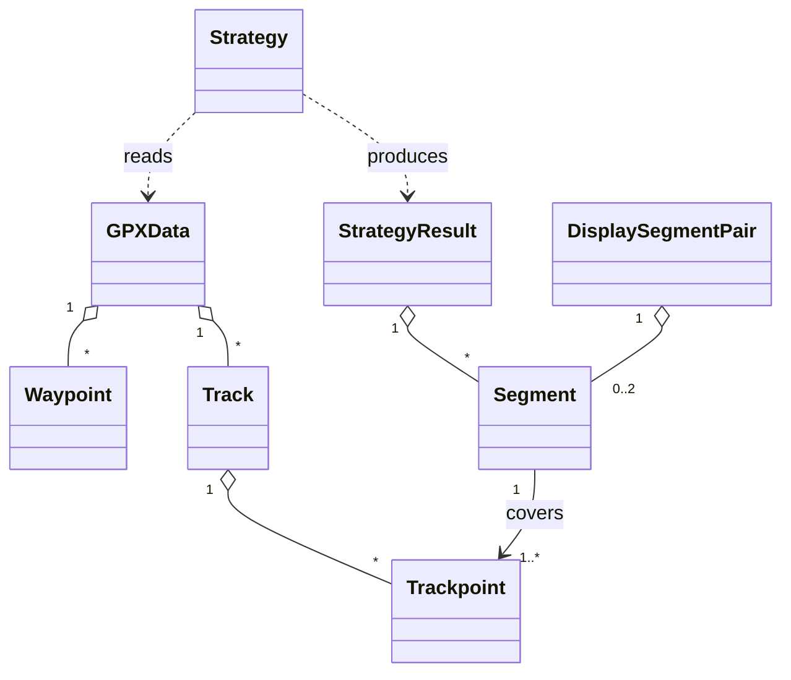

# Software guidebook: TigerLegs

TigerLegs splits a swimrun course, given as a GPX file, into swim and run legs (segments).
TIGERLegs stands for *Terrain-Informed Gpx Extractor: Lets Go Swimrun*.
The tiger also refers to Team Groot Rondje Eilanden (TGRE), the team of the maintainers.

This guidebook follows the section structure of Brown's software guidebook (Brown, n.d.-a): lightweight documentation of what you cannot read from the code.
The C4 diagrams (Brown, n.d.-b) form only part of it, namely chapter 6.

## Reading guide

Chapter 1 explains who uses the system and which external systems it relies on; read it first.
Chapter 2 lists what the system does, as user stories, use cases and an example course; read it before you change a feature.
Chapters 3 to 5 describe the quality attributes, constraints and principles that limit your design choices; read them before you make an architecture decision.
Chapter 6 shows the structure of the system, from containers down to the domain model; read it before you add a component.
Chapters 7 to 12 cover code, data, infrastructure, deployment, operation and the development environment; use them as reference.
Chapter 13 links to the architecture decision records (ADRs).
Appendix A defines the domain terms; look there when a term in this guidebook is new to you.
Appendix B maps the domain onto a train journey, to explain the concepts to people outside swimrun.

## 1. Context

This chapter describes why the system exists, who uses it and which external systems it depends on.

A swimrun race alternates between running and swimming.
Organisers publish a GPX file (*GPS Exchange Format*) of the course, but they do not always publish the split into swim and run segments.
Athletes need that split, with distances, to plan their race and to write the numbers on a paddle or wristband.
The system reads a GPX file, detects the segments, computes their distances and shows them on a map and in a table.

The main stakeholders are athletes, race organisers and the maintainers of this project.
Figure 1 shows the system in its environment.

*Figure 1*: System context of TigerLegs.

Figure 1 shows that the system has one kind of user and two external data sources.
The athlete never talks to OpenStreetMap directly: the backend queries it and caches the answers.
Live tracking and race results are out of scope.

## 2. Functional overview

This chapter describes what the system does for its users.
The Kiro specs in `.kiro/specs/gpx-swimrun-analyzer/` hold the detailed requirements; this chapter gives the overview.
Section 2.1 maps the user stories to use cases, and section 2.2 shows a real course that the system analyses.
The roadmap is in the README.

An athlete interacts with the system in four ways.
Each way below is a user story with one acceptance criterion in Given/When/Then form.

1. **Upload a GPX file.** As an athlete, I upload a GPX file so that I see the swim and run segments on a map.
   - Given I opened the page, when I choose a GPX file, then the map shows the track with swim and run segments in different colours.
2. **See distances.** As an athlete, I see the distance per segment and the totals so that I can prepare my race.
   - Given a GPX file with two swims and two runs, when the analysis finishes, then the table shows four distances and a swim and run total.
3. **Link map and table.** As an athlete, I hover a table row or a map line so that I see the matching segment highlighted.
   - Given a segment is shown on the map and in the table, when I hover its table row, then its map line is highlighted.
4. **Read a compact table.** As an athlete, I see one row per run and swim pair so that I can write the numbers on a paddle (planned, [ADR-0007](./adr/0007-compact-segment-table-format.md)).
   - Given a course that starts with a run, when the table is shown run-first, then each row shows a run distance and the swim that follows it.

Behind these stories, the system detects segments with three strategies, which Table 1 lists.

*Table 1*: Strategies for detecting swim and run segments.

| Strategy | Evidence | Needs |
| --- | --- | --- |
| Waypoint | `<sym>` codes or names on waypoints | Waypoints in the GPX file |
| Speed | Speed drops when swimming | Timestamps on trackpoints |
| Landscape | Water or land at sampled coordinates | The terrain API |

The waypoint strategy is the most precise when the organiser marked the swim starts and ends.
The speed strategy works for any recorded activity, but speed is only indirect evidence.
The landscape strategy needs no extra data in the file, but it depends on OpenStreetMap and on how dense the trackpoints are.
The strategy combiner keeps, per trackpoint, the result with the highest confidence.

The system also shows aid stations, handles files with several tracks and filters GPS noise during swims; the Kiro specs describe these features.

### 2.1 Use cases

The user stories above describe what an athlete wants; the use cases below describe the features the system offers for it.
Table 2 lists the six use cases, who uses them and which user story and Kiro requirement each one implements.

*Table 2*: Use cases and the stories and requirements behind them.

| Use case | Actors | User story | Requirement |
| --- | --- | --- | --- |
| UC-1: Upload a GPX file | Athlete, organiser | US-1 | Req 1 |
| UC-2: View segment distances | Athlete, organiser | US-3, US-5 | Req 3, 5 |
| UC-3: View the course map | Athlete | US-4 | Req 4 |
| UC-4: Highlight a segment | Athlete | US-6 | Req 6 |
| UC-5: View aid stations | Athlete | US-8 | Req 8 |
| UC-6: Select a track | Athlete | US-9 | Req 9 |

Use cases UC-2 and UC-3 include UC-1, because both need an uploaded file.
UC-4, UC-5 and UC-6 extend the use case they build on: highlighting and aid stations extend the map, and track selection extends the upload.
The Kiro specs number these stories and requirements.
Two further stories, US-2 (waypoint classification) and US-7 (GPX round-trip integrity), are internal processing steps that no user starts, so they are not use cases.
Accessibility (Req 10) and performance (Req 11) are quality attributes and apply to all use cases; chapter 3 covers them.

### 2.2 Example course: Vertical SwimRunMan Laffrey 2026

The Vertical SwimRunMan Laffrey 2026 is the main test course.
It starts with a swim, which is unusual: most swimruns start with a run.
Table 3 gives the segment distances as the organisers published them.

*Table 3*: Published segment distances of the Vertical SwimRunMan Laffrey 2026.

| # | Run (km) | Swim (m) | Cumulative (km) |
| --- | --- | --- | --- |
| 1 | | 400 | 0.4 |
| 2 | 5.2 | 400 | 5.6 |
| 3 | 0.3 | 2200 | 6.3 |
| 4 | 1.4 | 400 | 9.9 |
| 5 | 0.2 | 600 | 10.5 |
| 6 | 6.7 | 1000 | 17.8 |
| 7 | 4.9 | 1100 | 23.7 |
| 8 | 6.1 | | 29.1 |
| **Total** | 24.8 | 6100 | 30.9 |

The test file is `test-data/vertical_swimrunman_2026-22910326-1781510068-71.gpx`.
On a comparable Laffrey file the system measured 24.7 km of running and 6250 m of swimming, so its swim total is 150 m longer than the published one.
The cause is not yet known.

Athletes write the numbers on a paddle or wristband, so a table with one row per swim and run pair is easier to copy ([ADR-0007](./adr/0007-compact-segment-table-format.md)).
Table 4 shows the same course in that form, with the swim first.

*Table 4*: The same course as swim and run pairs, swim first.

| # | Swim (m) | Run (km) |
| --- | --- | --- |
| 1 | 400 | 5.2 |
| 2 | 400 | 0.3 |
| 3 | 2200 | 1.4 |
| 4 | 400 | 0.2 |
| 5 | 600 | 6.7 |
| 6 | 1000 | 4.9 |
| 7 | 1100 | 6.1 |
| **Total** | 6100 | 24.8 |

A course that starts with a run would show the run first by default, and a toggle would swap the order.
Figure 2 shows the paddles that the organisers published for this course.

*Figure 2*: Swimrun paddles with the segment distances of the Laffrey course.

## 3. Quality attributes

This chapter lists the qualities that matter most, so that you can judge a design choice against them.

The system prioritises the following qualities:

- **Privacy.** The browser analyses the GPX file and does not upload it, because location data is personal data ([ADR-0004](./adr/0004-host-deno-backend-on-eu-vps.md)).
- **Responsiveness.** A typical file should be analysed in under five seconds ([ADR-0003](./adr/0003-gpx-analysis-execution-location.md)).
- **Accuracy.** Segment distances should match the published distances.
- **Accessibility.** Requirement 10 in the Kiro specs sets the accessibility requirements.
- **Testability.** Property-based tests cover the analysis and the API validation.

Accuracy deserves a note: on the Vertical SwimRunMan test file the system finds 14 segments, 24.7 km of running and 6250 m of swimming, against 24.8 km and 6100 m published.
The swims come out 50 to 150 m longer than published.
The cause is not yet known; waypoint placement is a hypothesis.

### 3.1 Sampling gap on sparse tracks

The landscape strategy asks the terrain API about a sample of the trackpoints.
`sampleCoordinates` picks existing trackpoints and does not interpolate.
The *gap* between two consecutive samples is therefore at most the sampling interval plus the largest step between two trackpoints.

A *sparse track* has trackpoints that lie far apart, so its gap is large and a short swim can fall between two samples.
The property test "Property 17.3" in `test/client/landscape-client.test.ts` checks this bound.
It first asserted a maximum of twice the interval, which was wrong for sparse tracks, and now asserts the interval plus the largest step.
Interpolating between trackpoints would give a guaranteed maximum gap; the team has not decided on that yet.

The problem resembles the Nyquist–Shannon sampling idea: you can only detect a feature if you sample more densely than the feature is long.
This guidebook gives no exact factor, because it has no verified source for one.

## 4. Constraints

This chapter lists the choices that the team did not make freely.

The following constraints apply:

- The system runs on Deno and TypeScript ([ADR-0002](./adr/0002-use-deno-with-typescript.md)), so browser and server share code.
- The system uses an open-source GIS stack: OpenStreetMap, Leaflet and custom Haversine code ([ADR-0006](./adr/0006-open-source-gis-stack.md)).
- The backend runs on a VPS in the EU, because location data is personal data under GDPR ([ADR-0004](./adr/0004-host-deno-backend-on-eu-vps.md)).
- GPX files can be up to 10 MB with up to 50,000 trackpoints ([ADR-0003](./adr/0003-gpx-analysis-execution-location.md)).
- A planned Garmin Connect IQ data field shapes the data the web app must export. The watch app would be written in Monkey C with the Connect IQ SDK, and during a race it would show the remaining and total distance of the current segment, the segment number out of the total (for example 3/15) and whether it is a swim or a run. The web app must therefore export segments in a format the watch can import, such as a FIT course or a JSON file loaded through Garmin Connect.

## 5. Principles

This chapter lists the rules that guide design choices when no constraint decides.

- **Analyse on the client.** The server proxies terrain data and nothing more.
- **One source of truth for configuration.** Ports and origins live in `src/server/config.ts`, so changing a port touches one line.
- **Use the domain language.** Names in code follow the glossary in Appendix A.
- **Document decisions.** Significant choices get an ADR, and the team writes documentation in English.

### 5.1 Documentation approach

This project writes its documentation next to the code and keeps it current as part of the work.
Preston-Werner (2010) advises: "Write your Readme first."
That part is done here: the README describes the tool, so what remains is keeping it true.
We call the practice of maintaining the documents together with the code *continuous documentation*; this is our own term and has no external source.
Documentation is part of the definition of done: a change is finished when the README, guidebook or ADR that it affects is up to date.

Table 5 lists the documents and the question each one answers.

*Table 5*: Documents and the questions they answer.

| Document | Where | What it shows |
| --- | --- | --- |
| README | [README.md](../README.md) | What the tool is and how to run it |
| Software guidebook | this file | Context, structure, domain model and glossary |
| Architecture decision records | [docs/adr/](./adr/) | Why we chose a design, and what we rejected |
| Specifications | [.kiro/specs/](../.kiro/specs/) | Requirements, design and tasks per feature |
| Source code and tests | [src/](../src/), [test/](../test/) | What the system does, in executable form |

The first four documents explain what, how and why, while the code and tests are the only part that is guaranteed to be current.

The source code also explains itself, in the spirit of literate programming.
Knuth (1984) wanted programs written as essays, with prose and code woven into one source.
We keep prose and code in separate files and use names, types and tests to make the code readable, which is closer to self-documenting code than to Knuth's method.

## 6. Software architecture

This chapter shows the structure of the system in three levels: containers (6.1), components (6.2) and the domain model (6.3).

### 6.1 Containers

Figure 3 shows the two containers and how they communicate.

*Figure 3*: C4 container diagram.

The browser app does the analysis and draws the map.
The backend serves the static files and answers terrain requests.
It checks the `Origin` header on every API route except the health check, and it caches terrain answers on disk.
The frontend and the backend currently share port 8123, which `src/server/config.ts` defines.

### 6.2 Components

Table 6 lists the components of the browser app and the file that holds each one.

*Table 6*: Components of the browser app.

| Component | File | Responsibility |
| --- | --- | --- |
| GPX parser | `src/client/gpx-parser.ts` | Turns GPX text into `GPXData` |
| Waypoint strategy | `src/client/waypoint-classifier.ts` | Finds segments from `<sym>` codes or names |
| Speed strategy | `src/client/speed-analyzer.ts` | Finds segments from speed changes |
| Landscape strategy | `src/client/landscape-client.ts` | Finds segments from terrain at sampled points |
| Strategy combiner | `src/client/strategy-combiner.ts` | Picks the best strategy per trackpoint |
| Analysis | `src/client/analyze.ts` | Runs the pipeline and adds distances |
| Segment builder | `src/client/segment-builder.ts` | Totals, rounding and paired table rows |
| UI | `src/client/app.ts` | Upload, map, table and highlighting |

The analysis component is the entry point for the UI: it runs the strategies that apply, combines them and computes each segment's distance.
The current page skips the landscape strategy, because it needs the backend.
The combiner leaves `distanceKm` at 0; the analysis component fills it in.

### 6.3 Domain model

Figure 4 shows the main domain types, which `src/shared/types.ts` defines.

*Figure 4*: Domain model.

A GPX file holds tracks and waypoints, and a track holds trackpoints.
A strategy reads the file and produces segments, each covering consecutive trackpoints and labelled swim, run or unclassified.
A `DisplaySegmentPair` groups a run and a swim for the compact table.
Appendix A defines each term.

## 7. Code

This chapter explains how the source code is organised.

The source lives in three folders: `src/client` for the browser, `src/server` for the backend and `src/shared` for types and distance calculation.
Tests sit next to the code (`*.test.ts`) or in `test/`.
Most tests are property-based: they state a rule that must hold for generated inputs, such as the maximum gap between samples.
`deno task build` bundles the browser code into `public/app.js` with `deno bundle`, which is an experimental Deno command.

## 8. Data

This chapter describes where the system keeps data.

The system has no database.
The browser keeps the GPX file in memory only.
The backend caches terrain answers on disk in `.cache/`, which Git ignores.

### 8.1 GPX input conventions

The GPX format (GPS Exchange Format) is an open XML schema for exchanging GPS data between applications and devices.
TopoGrafix created it in 2002, and file-extensions.com (n.d.) calls it "the de facto standard for interchange of GPS data".

Each waypoint (`<wpt>`) can contain a `<sym>` element with a symbol name.
The GPX 1.1 specification defines `<sym>` as free-form text, so there is no standard list of values (TopoGrafix, 2004).
Route planners therefore use their own conventions.
Table 7 lists the numeric `<sym>` values in the test files, which come from the route planner Openrunner.

*Table 7*: Waypoint `<sym>` values in Openrunner files.

| `<sym>` value | Meaning |
| --- | --- |
| `200` | Start of a swim section |
| `201` | End of a swim section |
| `3` | Aid station (ravitaillement) |
| `206` | Start of a vertical kilometre |
| `49` | Hot food aid station |

These numeric codes are not part of the GPX standard, and other applications such as Garmin, Komoot or Strava may use other schemes.
The system detects swims in two ways: it first matches `<sym>` 200 and 201, and falls back to waypoint names that start with "Début SWIM" or "Fin SWIM".
Support for other conventions, such as the files from racedaymap.com that ÖTILLÖ uses, needs a look at their waypoints first.

## 9. Infrastructure architecture

This chapter describes where the system runs.

[ADR-0004](./adr/0004-host-deno-backend-on-eu-vps.md) chooses a Deno process on an EU VPS.
A reverse proxy such as Caddy or nginx would add HTTPS in front of it; the team has not chosen one.
Local development needs no proxy.

## 10. Deployment

This chapter describes how the system reaches production.

Deployment is not yet automated, and no production environment exists.
The `README.md` in the repository root holds the "how to run" steps; chapter 12 covers the local setup.

## 11. Operation and support

This chapter describes how to monitor the system.

Only a health endpoint exists: `GET /api/v1/health`.
It needs no `Origin` header, so a monitor can call it.

## 12. Development environment

This chapter lists what you need to work on the code.

You need Deno.
`deno task dev` builds the bundle and starts the server on the port in `src/server/config.ts`; open that address in a browser to try the upload page.
`deno test -A` runs all tests.

## 13. Decision log

This chapter lists the ADRs, which hold the reasoning behind the architecture.

Table 8 lists the ADRs and what each decides.

*Table 8*: Architecture decision records.

| ADR | Decision |
| --- | --- |
| [0001](./adr/0001-record-architecture-decisions.md) | Record architecture decisions |
| [0002](./adr/0002-use-deno-with-typescript.md) | Use Deno with TypeScript |
| [0003](./adr/0003-gpx-analysis-execution-location.md) | Choose where the GPX analysis runs (status: proposed) |
| [0004](./adr/0004-host-deno-backend-on-eu-vps.md) | Host the backend on an EU VPS |
| [0005](./adr/0005-rest-json-api-for-multi-client-support.md) | Offer a REST/JSON API |
| [0006](./adr/0006-open-source-gis-stack.md) | Use an open-source GIS stack |
| [0007](./adr/0007-compact-segment-table-format.md) | Show a compact paired segment table |

ADR-0003 still has the status *proposed*, while this guidebook and the code already analyse on the client.
The team should either accept the ADR or revisit the choice.

## References

Brown, S. (n.d.-a). *The software guidebook*. Leanpub. https://leanpub.com/documenting-software-architecture

Brown, S. (n.d.-b). *The C4 model for visualising software architecture*. https://c4model.com/

Gruber, T. (2008). Ontology. In L. Liu & M. T. Özsu (Eds.), *Encyclopedia of Database Systems*. Springer. https://tomgruber.org/writing/definition-of-ontology

file-extensions.com. (n.d.). *GPX file format*. Retrieved June 15, 2026, from https://file-extensions.com/docs/gpx

Knuth, D. E. (1984). Literate programming. *The Computer Journal, 27*(2), 97–111. https://doi.org/10.1093/comjnl/27.2.97

Preston-Werner, T. (2010, August 23). *Readme Driven Development*. https://tom.preston-werner.com/2010/08/23/readme-driven-development.html

TopoGrafix. (2004). *GPX 1.1 schema documentation*. https://www.topografix.com/GPX/1/1/

## Appendices

### Appendix A: Glossary

This appendix defines the domain terms, so that you can look up a term when you meet it.

Table 9 lists the terms in the order in which you meet them when you follow a GPX file through the system.

*Table 9*: Domain glossary.

| Term | Meaning | Example |
| --- | --- | --- |
| Track | Ordered recording of positions of the whole course | The Vertical SwimRunMan GPX holds one track |
| Trackpoint | One position in a track, with latitude, longitude and optional elevation and time | `lat="54.4" lon="13.4"` |
| Waypoint | A named point of interest, separate from the track | "Début SWIM" |
| `<sym>` | Symbol code on a waypoint; 200 marks a swim start and 201 a swim end | A waypoint with `<sym>200</sym>` starts a swim |
| Segment | Consecutive trackpoints that are all swim or all run, with a distance | Swim of 400 m |
| Swim, run, unclassified | The three labels a segment can have | Run of 2.1 km |
| Transition | The point where one segment ends and the next begins | The beach exit after a swim |
| Distance to next transition | Distance along the track from a position to the next transition | "Next transition in 1.2 km" |
| Strategy | A method to detect segments: waypoint, speed or landscape | Waypoint strategy |
| Confidence | How sure a strategy is about a trackpoint; the combiner keeps the highest | 0.9 from waypoints beats 0.4 from speed |
| Terrain | Land or water at a coordinate, from OpenStreetMap | A lake point returns water |
| Sampling interval | Wanted distance between sampled trackpoints for terrain queries | 50 m |
| Gap | Distance between two consecutive samples | With a 50 m interval and 200 m steps, the gap can exceed 50 m |
| Sparse track | Track whose trackpoints lie far apart | A watch that records every 200 m |
| Paired segment table | Table with one row per run and swim pair ([ADR-0007](./adr/0007-compact-segment-table-format.md)) | Row: run 2.1 km, swim 400 m |
| Run-first, swim-first | Which segment type opens a paired row; run-first is the default | A toggle above the table |
| Aid station | Food and drink point, usually on land | A waypoint on a run |

The terms form a chain: a track has trackpoints, a strategy turns them into segments, segments of different terrain meet at transitions, and paired rows group segments for display.
The Kiro specs contain a longer glossary with the formal definitions.
Two terms are easy to confuse: a waypoint is a named point outside the track, while a trackpoint is part of the recorded line.

### Appendix B: Ontology mapping to a train journey

This appendix maps the domain concepts onto a train journey, so that readers who do not know swimrun can recognise the structure.

Gruber (2008) defines an ontology as follows: "an ontology defines a set of representational primitives with which to model a domain of knowledge or discourse" and "the representational primitives are typically classes (or sets), attributes (or properties), and relationships (or relations among class members)."
The glossary in Appendix A is such a small ontology.
Its classes are Track, Trackpoint, Segment, Terrain and Transition.
Its attributes include segment distance, trackpoint coordinate and confidence.
Its relations include *a track has trackpoints*, *a segment covers trackpoints* and *a segment precedes a segment*.

An ontology mapping relates the concepts of one domain to equivalent concepts in another.
A train journey fits, because it has the same structure: a route that someone records as positions, stretches with different surfaces (open track, bridge, tunnel) and a "next ... in x km" display.
The analogy is my own choice, not a published ontology.
Table 10 shows the mapping and names where it breaks down.

*Table 10*: Mapping of swimrun concepts to a train journey.

| SwimRun concept | Train journey equivalent | Where the analogy breaks |
| --- | --- | --- |
| Track | The recorded journey from A to B | A race course is fixed; a journey is one run of a timetable |
| Trackpoint | One position fix of the train | None |
| Waypoint | A station or signal on the line | Stations come from the timetable, not from the recording |
| `<sym>` 200 and 201 | Marker for tunnel entrance and exit | Symbol codes are specific to Garmin |
| Segment | A stretch of line with one surface, such as a tunnel | Swim and run alternate by design; tunnels are exceptions |
| Swim and run | Tunnel and open track | Both domains have two main classes |
| Transition | A tunnel portal | Athletes change gear at a transition; trains do not |
| Distance to next transition | "Next station in 3.2 km" | A train display counts stations, not surface changes |
| Waypoint strategy | Read the timetable and the signal list | Needs that data to exist |
| Speed strategy | Notice that the train slows down in a tunnel | Speed is weak evidence in both domains |
| Landscape strategy | Look up the line on a map to find the tunnel | Needs an external map |
| Sampling interval and gap | Check the map every 500 m and miss a 200 m tunnel | None |
| Sparse track | A recording with one ping per minute | None |

The mapping shows the core concept: a classified stretch of a route, with a boundary where the class changes.
The landscape strategy performs the mapping from the track domain to the terrain domain: it maps a trackpoint coordinate to a terrain class through OpenStreetMap.
The mapping also exposes a gap in the train analogy: a train has no equivalent of the paired segment table, because that table only serves athletes who write numbers on a paddle.

The "next transition in x km" on a sports watch is generic.
It applies to any track whose points are classified as water or land, not to one course:

> distance to next transition(p) = length of the track from p to the first trackpoint after p whose terrain differs from the terrain at p.

Only the instance changes per race.

#### Worked instance: SwimRun Rhederlaag

To do: add the Rhederlaag GPX under `test-data/`, run it through the analysis and list the real transitions here, with the distance to the next transition at a few positions.
The instance will use the same classes as above: a course as the track, ordered segments, transitions and distance-to-next values.
