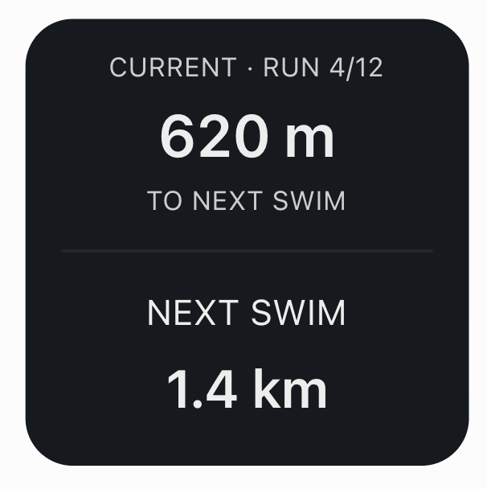

# Feature Specification: Garmin Connect IQ swimrun data field

**Feature Branch**: `001-garmin-datafield`
**Created**: 2026-11-01
**Status**: Draft
**Input**: Roadmap milestone M4 in [docs/ROADMAP.md](../../docs/ROADMAP.md); feasibility
study in [ADR-0005](../../docs/adr/0005-rest-json-api-for-multi-client-support.md);
UI mock-up in [img/garmin-datafield-mock.png](../../img/garmin-datafield-mock.png).
Related research import: [research-chatgpt-hilly-pacer.md](./research-chatgpt-hilly-pacer.md)
(a grade-adjusted pacing idea — candidate M4+ extension, not part of this spec).

## User Scenarios & Testing *(mandatory)*

### Primary User Story

As a swimrun athlete racing a course I analysed with TigerLegs, I want my
Garmin watch to show which leg I am on, how far the current leg still is,
and what comes next, so that I can pace each leg and prepare transitions
(pull buoy, paddles, goggles) without memorising the course.

### Acceptance Scenarios

1. **Given** a TigerLegs course with 12 legs is loaded on the watch and an
   activity is running on leg 4 (a run), **When** the athlete views the
   data field, **Then** it shows the leg type and position (`RUN 4/12`),
   the remaining distance of the current leg (e.g. `620 m TO NEXT SWIM`)
   and the length of the next leg (e.g. `NEXT SWIM 1.4 km`).

2. **Given** the athlete is on leg 4 approaching the planned transition,
   **When** the athlete passes within the transition radius of the next
   planned transition point, **Then** the data field advances to leg 5
   within one GPS fix and the remaining distance restarts from leg 5's
   length.

3. **Given** the athlete is on the final leg, **When** the data field
   renders, **Then** it shows `FINISH` as the next target instead of a
   next leg, with the remaining distance of the current leg.

4. **Given** GPS accuracy degrades during a swim, **When** position
   jumps place the athlete briefly outside the course corridor, **Then**
   the data field keeps the current leg (no flapping back and forth
   between legs).

5. **Given** no TigerLegs course is loaded, **When** the data field is
   added to an activity screen, **Then** it shows a clear "no course"
   message instead of failing or showing stale data.

6. **Given** the athlete passes a transition earlier or later than
   planned (observed vs planned location differ), **When** the leg
   advances, **Then** remaining distance is measured along the planned
   route from the nearest route point, not straight-line to the
   transition.

7. **Given** a course with energy stations (waypoints of the idealized
   course, spec [004](../004-course-playback-and-admin/spec.md)), **When**
   the athlete is on a run and an energy station lies ahead before the
   next transition, **Then** the data field shows the distance to the next
   energy station next to the distance to the next transition to swim or
   run; energy stations are not shown during a swim.

### Edge Cases

- Watch loses GPS entirely mid-leg: keep the last known leg, mark the
  distance as stale. [NEEDS CLARIFICATION: visual treatment]
- Athlete goes off-course (missed a transition): does the field re-sync
  to the nearest leg or stay sequential? [NEEDS CLARIFICATION: re-sync
  policy — sequential-only is simpler and matches race rules]
- Course with consecutive same-type legs (run–run after a cancelled
  swim): display still shows the planned types.
- Units: metres for swims, kilometres for runs, matching the web app's
  compact table convention (ADR-0007).

## Requirements *(mandatory)*

### Functional Requirements

- **FR-001**: The data field MUST display the current leg type (swim or
  run), the current leg number and the total leg count.
- **FR-002**: The data field MUST display the remaining distance of the
  current leg, measured along the planned route, updating with each GPS
  fix.
- **FR-003**: The data field MUST display the type and length of the next
  leg, or `FINISH` on the final leg.
- **FR-004**: The data field MUST advance to the next leg when the
  athlete passes within the transition radius (default 25 m) of the next
  planned transition, with hysteresis so GPS noise cannot advance or
  regress a leg more than once.
- **FR-005**: The watch MUST obtain the course from the TigerLegs
  versioned course export (roadmap M3). The course format MUST fit the
  Connect IQ data-field memory budget on supported devices.
  [NEEDS CLARIFICATION: transfer mechanism — Garmin Express file sync,
  makeWebRequest download via phone proxy, or FIT course; decide in plan]
- **FR-006**: The data field MUST function fully offline during the
  activity; no network access is required after the course is loaded.
- **FR-007**: The data field MUST render legibly on round and
  rectangular Connect IQ displays, following the mock-up's layout
  (current leg block above a divider, next leg block below).
- **FR-008**: Swim distances MUST be shown in metres and run distances
  in kilometres (one decimal), consistent with the web app.
- **FR-009**: The data field MUST show a "no course loaded" state and
  never crash the host activity when the course is absent or invalid.
- **FR-010**: Any network use (course download) MUST go over HTTPS via
  `Communications.makeWebRequest`, per ADR-0005.

### Non-Functional Requirements

- **NFR-001**: Written in Monkey C against the Connect IQ SDK, as a
  **data field** (not a watch app), so athletes keep their native
  activity profiles and recording.
- **NFR-002**: Target devices: modern Garmin multisport watches
  (Fenix 7/8, Forerunner 955/965, Enduro 3); older devices via phone
  proxy are best-effort (ADR-0005).
- **NFR-003**: Leg state updates complete within one `compute()` cycle
  (1 Hz) without exceeding the data-field memory limit.

### Key Entities

- **Course**: versioned, ordered list of legs exported by TigerLegs;
  carries a schema version and total distance.
- **Leg**: type (swim | run), length along route, ordered route points,
  planned start/end transitions.
- **Transition**: planned coordinate where the leg type changes; at
  runtime gains an observed coordinate and passage time.
- **LegProgress**: runtime state — current leg index, distance covered
  along the leg, remaining distance, stale/off-course flags.

## Review & Acceptance Checklist

- [ ] No implementation details beyond the platform constraints that
      motivated the feature (Monkey C / data field are requirements here,
      fixed by ADR-0005 and the product decision)
- [ ] Requirements are testable and unambiguous except where marked
- [x] All mandatory sections completed
- [ ] [NEEDS CLARIFICATION] markers resolved (2 open: GPS-loss visual
      treatment, course transfer mechanism; re-sync policy leaning
      sequential-only)

## Execution Status

- [x] User scenarios defined (BDD Given/When/Then per project convention)
- [x] Requirements generated (FR-001…FR-010, NFR-001…NFR-003)
- [x] Entities identified
- [ ] Clarifications resolved
- [ ] Plan (`plan.md`) and tasks (`tasks.md`) not yet generated
